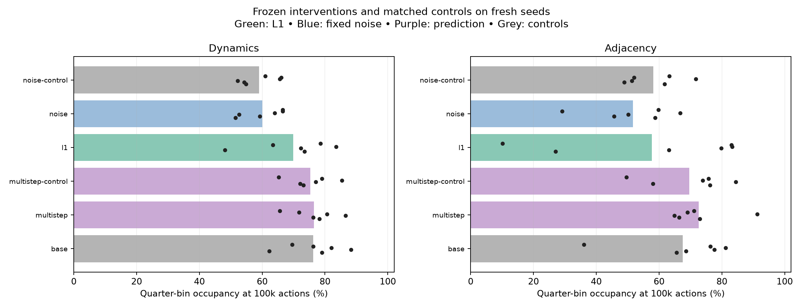
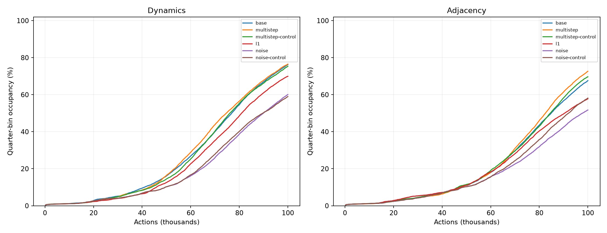
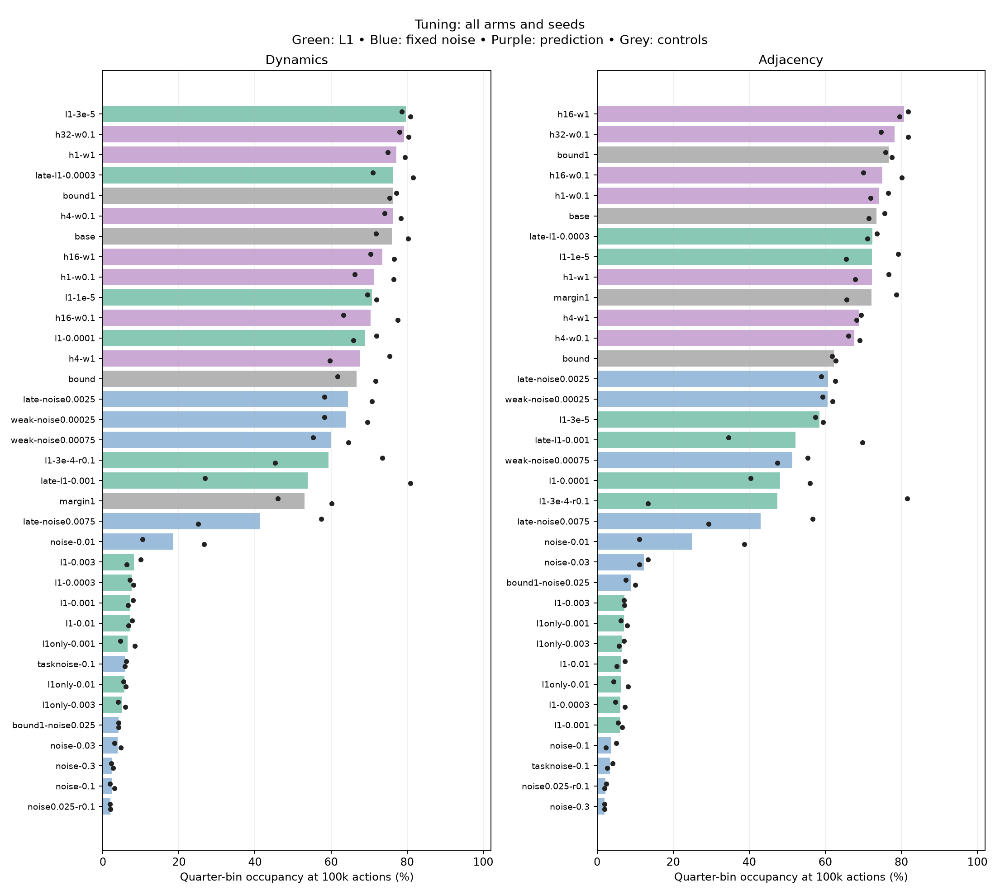
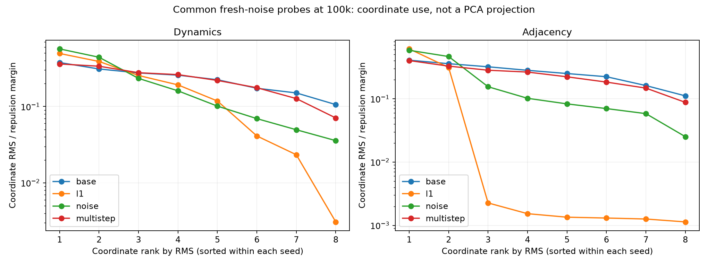
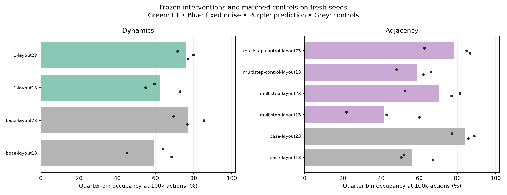
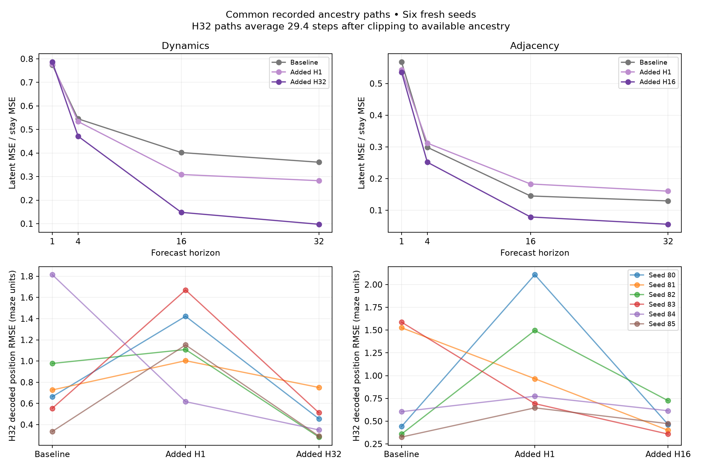
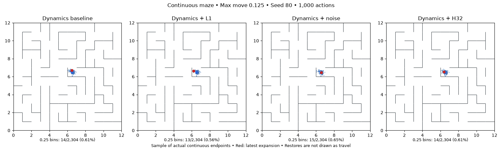
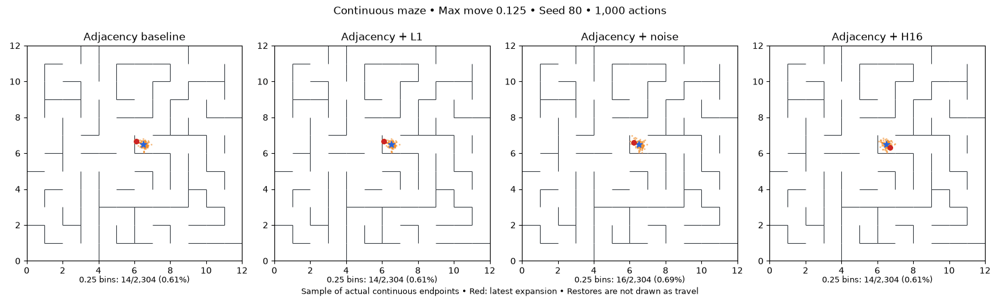

# L1, finite-noise channels and ancestry prediction

Completed November 11, 2026: **242 runs / 24.2M environment actions**. This includes 140 tuning runs, 72 fresh-seed confirmation runs and 30 additional-layout runs. Each run gets 100k actions in the harder .125-max-step noisy continuous maze. No candidate establishes a reliable improvement in exploration over the tuned original objectives.

The useful findings are more specific:

- **L1 produces coordinate sparsity, but does not selectively remove nuisance sensitivity.** The selected adjacency L1 setting effectively reduces two fresh-seed maps to one dominant dimension; those runs stall at 27.1% and 10.1% coverage.
- **The bounded noisy channel does not improve exploration.** Its noiseless bound already underperforms the original encoder. Adding the selected delayed noise is neutral within uncertainty for dynamics and hurts adjacency in all six paired seeds.
- **Longer-horizon prediction improves forecasting, without reliably improving exploration.** Adjacency H16 improves forecasts on two new layouts while reducing exploration in all six runs there. Prediction quality and a useful distance-based queue geometry are different targets.
- **The key/inventory concern remains open.** This study has no inventory. Training on parent-pointer paths cannot teach a key's consequence if exploration never collects it.

Mean quarter-bin occupancy at 100k actions on six fresh seeds, layout 7:

| Setting | Dynamics | Adjacency |
|---|---:|---:|
| Original tuned baseline | **76.22%** | **67.58%** |
| Selected L1 | 69.91% | 57.74% |
| Bounded encoder, no channel noise | 58.99% | 58.15% |
| Bounded encoder + selected delayed noise | 60.08% | 51.71% |
| Added H1 predictive control | 75.31% | 69.65% |
| Added longer predictive loss | 76.50% (H32) | 72.62% (H16) |

The small positive long-horizon means are not consistent paired gains: dynamics beats its original baseline in 1/6 seeds, adjacency in 3/6. Against matched H1 controls the wins are 4/6 and 3/6. All four exploratory paired-bootstrap intervals include zero. Noise versus its bounded/noiseless control is +1.09 percentage points for dynamics (4/6 wins, interval −1.42 to +3.74) and −6.45 for adjacency (0/6 wins, interval −13.22 to −2.45). Intervals are conditional on the layout, unadjusted for multiple comparisons; they are not definitive significance claims.





[All seed tables, including failed tuning settings](compression-study-tables.md) · [Paired effects](assets/compression-effects.json) · [Frozen selection](../configs/compression-selected-20261111/selection.json).

## What changes, and what stays fixed

The primary task is the noisy continuous maze with maximum movement .125. Inputs are normalized xy plus eight independent Gaussian nuisance coordinates. The persistent frontier prioritizes distance to the nearest expanded latent; it retains all raw observations, uses exact simulator restores, and has no physical deduplication. Search is deterministic conditional on observations/model and queue tie-breaking. Evaluation bins never enter the policy or loss.

Every full run collects 100k actions and uses 4,112 optimizer updates with 1.05M one-step transition presentations per ensemble member. Training happens every 500 actions, using causal portions of one replay epoch per 5,000 actions. The network remains an 8D encoder and three residual dynamics heads, with three width-256 hidden layers. Base margin m=.25, repulsion R=.03, latent L2=.03; pure adjacency A=.3, pure dynamics D=1. Old m=1 controls are also retained in tuning.

The base encoder objective is either coordinate/head-mean transition MSE, or A times adjacent squared Euclidean distance. Both include `R E[max(m²-||z_u-z_v||²,0)] + L2 E||z||²`. Both observed endpoint encoders receive gradients. Pure adjacency's one-step dynamics is fitted with detached inputs and targets for diagnostics.

## Interventions

**L1.** Add `lambda E sum_j |z_j|` to the existing L2, or replace L2. This is per-observation amplitude sparsity, not a direct count of globally used coordinates. We sweep weak through collapse-inducing values, stronger repulsion, and delayed L1: zero until 50k actions, linear ramp for 10k, then full coefficient. Near a collapsed representation, L1 scales linearly with latent amplitude while the original loss terms change quadratically; early trapping is a plausible failure mode.

**Fixed-noise channel.** Use a coordinatewise bounded encoder `z=B*tanh(raw)` and source channel `z+epsilon`, with independent Gaussian noise of fixed scheduled standard deviation. Targets remain clean joint encodings. Dynamics learns after the noisy channel. The repulsion hinge usually uses independent noisy versions of both random latent samples; L1 and L2 act on clean encodings. The queue always uses deterministic encodings. A bounded/noiseless control isolates the effect of changing the encoder activation/scale. A task-only-noise control leaves the hinge clean. We test bounds .25 and 1, several noise levels and delayed noise after 50k with a 10k ramp.

For adjacency alone, `E||z+epsilon-z'||² = ||z-z'||² + d*sigma²`. Thus the expected squared-adjacency gradient is unchanged by fixed source noise. Its population objective changes through the nonlinear noisy hinge; task-only noise injects gradient variance. This is distinct from a learned dynamics decoder operating after a finite-noise channel. Bounds prevent unlimited rescaling of the channel, but deterministic queue latents can still retain very fine distinctions. Do not claim an enforced finite-bit state code.

**Ancestry prediction.** Sample up to 32 anchors from the current minibatch and follow occurrence-level parent IDs to recover genuine action sequences. Choose lag uniformly from 1 to `min(H, depth)`, for H=1/4/16/32. Each head rolls its own predictions forward from the encoded ancestor, without encoding intermediate observations or averaging heads during rollout. The endpoint loss is mean squared error to the descendant encoding; both source and target encoder and every dynamics head differentiate. Weights .1/1 are tested (H32 uses .1). This adds predictive training to the adjacency baseline, rather than pretending a distant descendant is a one-step neighbor. H1 controls isolate the addition of predictive supervision. Longer rollouts use additional model computation; endpoint/path and edge presentations are logged explicitly.

Parent-child observations and action indices are checked against replay. Chronological neighboring rows, siblings and simulator restores are never treated as transitions. No shortest-path distance targets or state-equivalence labels enter training.

## Selection and validation

Tuning uses seeds 70/71. Candidate choice is mean final quarter-bin occupancy, with occupancy AUC as tie-breaker. Select the best actual intervention separately for each base objective and family, even if it fails to beat the baseline. Include matched controls: bounded/noiseless for noise, H1 at the selected coefficient for long prediction, and matching R/L2 without L1 if those coefficients changed. Freeze before opening fresh-seed outcomes. Additional-layout candidates are chosen from tuning only.

Evaluation includes all seeds and failures, fine-bin occupancy, common physical/noise probes, coordinate sparsity and PCA participation, and forecasts along identical recorded ancestry paths. Forecast physical error uses an evaluation-only ridge decoder fitted on separate common physical probes, with target-decoding error and decoded-start baselines also reported. Different models have different online replay, so these probes are not a shared-training-data causal isolation.

The first implementation passes exact zero-intervention equivalence to both existing trainers, exact checkpoint continuation including independent channel/path RNGs, branching-path tests and the adjacency antithetic-noise gradient identity. Delayed interventions are checked for exact 50k prefixes against their corresponding controls. Physics, complete occupancy, matched initialization/control/noise streams and budgets are audited independently.

### Frozen candidates

The complete screen contains 70 settings × two tuning seeds. Follow-ups test weaker L1, stronger repulsion, delayed penalties, a larger bound and weaker noise. The [protocol](compression-study-protocol.md) records each decision before launch. No fresh-seed outcomes were opened until all six family/objective candidates were frozen. Each candidate is tested on six fresh seeds (80–85), with its relevant controls.

| Family | Dynamics | Adjacency | Matched control |
|---|---|---|---|
| L1 | lambda=3e-5, from the start | lambda=.0003, starts at 50k, ramps to full at 60k | Original tuned objective; L2=.03 retained |
| Bounded noise | B=.25, sigma=.0025, starts at 50k, ramps to full at 60k | Same | B=.25 with no channel noise |
| Ancestry prediction | H32, weight .1 | H16, weight 1 | Added H1 prediction at the same weight |

Additional-layout tests use layouts 13 and 23, seeds 86–88. The candidates chosen for these tests were dynamics L1 and adjacency H16, selected from tuning performance only. Baselines and adjacency H1 are included. These are not six independent maze layouts: three model seeds are repeated on two layouts.

### Tuning findings



The frozen selection must not be mistaken for evidence of improvement. We selected the best nonzero member of each family even when every member lost to its baseline. All failures are retained in [the tuning results](assets/compression-tuning-results.json).

Immediate L1 at .0003 and above usually destroys useful exploration, even when L2 is removed. A much weaker coefficient or introducing L1 after learning a map avoids many of these failures. Delaying .001 still produces major seed-dependent failures. Larger repulsion does not consistently rescue the stronger penalty. This is compatible with collapse being locally attractive: under a small scaling z→alpha*z, L1 changes at order alpha while the squared-distance/repulsion terms change at order alpha². It is not proof that every failure has that cause; delaying also changes the available training data.

Fixed noise from the start is similarly fragile, including with a larger bound, stronger repulsion and the task-only-noise control. Delaying a weak channel is less destructive. At the largest noise level, independent noise itself supplies substantial separation to the repulsion hinge; this is an additional reason not to equate a low noisy repulsion loss with a useful map. The weak-noise and clean-hinge controls show that noisy repulsion alone is not a complete explanation.

All 16 delayed tuning runs reproduce their appropriate control's first 50,000 replay transitions and encoder/dynamics checkpoint exactly. Divergence starts only after the scheduled intervention. [Prefix audit](assets/compression-delayed-prefixes.json).

## Compression changes coordinates more than nuisance invariance

Common fresh-noise probes are evaluated at 25k and 100k, with the same physical locations/noise samples for all models. No probe labels or repeated-noise supervision enter training. The following means use the six fresh seeds at 100k:

| Method | Coordinate participation | PCA participation | Noise / open-transition RMS | Latent/xy distance Spearman |
|---|---:|---:|---:|---:|
| Dynamics baseline | 5.54 | 1.94 | .826 | .957 |
| Dynamics L1 | **3.16** | 1.90 | .820 | .928 |
| Adjacency baseline | 5.50 | 1.81 | .685 | .941 |
| Adjacency L1 | **1.64** | 1.56 | .694 | .852 |
| Adjacency H16 | 5.16 | 1.92 | .623 | .978 |

Participation is `(sum variance)^2 / sum(variance²)`, using coordinate variances or covariance eigenvalues respectively. It describes variance allocation, not bits or exact intrinsic dimension. L1 aligns the representation with fewer coordinate axes; it does not clearly improve nuisance invariance. For adjacency L1, four seeds have two substantial coordinates and two seeds have one. The latter have PCA participation approximately 1 and low exploration; their overall latent norms remain nonzero. This is loss of useful spatial dimensions, not constant collapse. A coordinate is called small here only for reporting when its RMS is below .01 times the margin (.0025); that threshold never enters search.



The bounded/noisy settings appear to have better noise/transition ratios than the original encoder, but their **bounded/noiseless controls already have the same effect**: dynamics .675→.677 with noise; adjacency .546→.555. There is no evidence here that the added channel selectively eliminated more observation noise. These models also have different collected replay, so probe differences cannot be attributed solely to an isolated loss change.

Global nuisance variance is small in every surviving model: for the original dynamics/adjacency encoders it is about .045%/.017% of total probe variance. It can nevertheless be large relative to one small movement. The noise/transition RMS denominator includes observation noise at both endpoints, so it is a sensitivity diagnostic, not a clean signal-to-noise ratio. Neither a low global nuisance fraction nor lower average sensitivity establishes good extreme queue priorities.

[All 144 fresh-seed checkpoint probes](assets/compression-confirmation-probes.json), [coordinate summaries](assets/compression-coordinates.json).

## Generalization to two additional layouts

Three paired seeds per layout, selected interventions fixed before these outcomes were opened:

| Objective / intervention | Layout 13 | Layout 23 |
|---|---:|---:|
| Dynamics baseline | 59.13% | 77.14% |
| Dynamics L1 | 62.37% | 76.20% |
| Adjacency baseline | **56.51%** | **83.90%** |
| Adjacency + H1 | 58.77% | 78.08% |
| Adjacency + H16 | 41.65% | 70.17% |

L1's dynamics effects are mixed (+3.24/−.94 points by layout). Adjacency H16 loses to both the original adjacency encoder and H1 in **all six runs**. Its primary-layout tuning gain is not a robust exploration improvement.

After seeing this failure, a read-only follow-up applied the same common-ancestry forecast audit to these layouts; no training or selection changed. H16 still improves H32 scale-normalized latent forecast error in all six seeds versus both controls, and decoded physical error in all six versus H1 (5/6 versus the original baseline). Mean physical errors, baseline→H16: 1.442→.831 on layout 13 and .779→.438 on layout 23. Thus degraded exploration cannot simply be explained by worse forecast accuracy on this audit. The novelty queue does not directly use dynamics predictions; better forecasting need not improve its ordering.

Spatial geometry is also layout-sensitive: mean latent/xy distance correlation changes .917→.880 on layout 13 and .985→.970 on layout 23, despite improving .941→.978 on the primary fresh-seed layout. This supports checking geometry beyond one maze; it does not establish the cause of each queue failure. These correlations measure Euclidean xy structure, not shortest-path distance or key-dependent reachability.



[Layout forecasts](assets/compression-layout-rollouts.json), [layout probes](assets/compression-layout-probes.json).

## What longer prediction actually learns

Forecast audit: 256 common recorded ancestry paths per fresh seed, drawn from the adjacency baseline's replay, with maximum lags 1/4/16/32. The same paths are used for every model of that seed. Each ensemble member rolls independently; final predictions are averaged for evaluation. At H32, the actual mean lag is 29.4 because shorter ancestry is clipped. Different online training replays mean these are mixed seen/unseen comparisons, not an identical-training-data isolation.

| Encoder objective | Added forecast training | H32 latent MSE / latent stay MSE | H32 decoded xy RMSE | Target-decoding RMSE |
|---|---|---:|---:|---:|
| Dynamics | None | .361 | .845 | .150 |
| Dynamics | H1, weight .1 | .283 | 1.162 | .194 |
| Dynamics | H32, weight .1 | **.097** | **.441** | .136 |
| Adjacency | None; detached one-step diagnostic head | .130 | .807 | .149 |
| Adjacency | H1, weight 1 | .160 | 1.114 | .194 |
| Adjacency | H16, weight 1 | **.056** | **.506** | .141 |

Physical errors are in maze units; a room is one unit wide. Physical stay-put RMSE is 1.173 on these paths; decoded-start baselines range 1.179–1.206. The linear xy decoder uses separate privileged position probes for evaluation only. Its target error exposes the limits of reading physical positions from the representation; it is not a mathematically guaranteed lower bound on predicted errors.

Compared with the added-H1 control, long-horizon training improves both reported prediction metrics in **6/6 seeds for each objective**. Compared with the original baseline, decoded physical error improves in 5/6 dynamics seeds but only 2/6 adjacency seeds: two large adjacency baseline failures drive its mean physical improvement. The scale-normalized latent error improves in 5/6 dynamics and 6/6 adjacency seeds. This is evidence of better compositional forecasting relative to H1, with a less uniform benefit relative to the original adjacency model.



The upper panels divide by stay-put error at each horizon; their downward slope does not mean absolute error falls as forecasts get longer. Individual physical errors in the lower panels make the variability visible.

Every predictive arm adds 131,584 endpoint/path presentations per head. The fresh H32 dynamics runs average 1,870,817 valid rollout-edge presentations per head; H16 adjacency averages 1,084,437, versus 131,584 for H1. These are **in addition** to 1,050,000 original one-step presentations. Padded computations can exceed valid-edge counts. Environment interactions and optimizer-update counts match; model computation does not. The long-horizon benefit has not been isolated from spending more computation on repeated replay edges.

## Key-dependent exploration

This maze does not contain a key or inventory state. Multi-step training can make a distinction useful when its downstream consequence is represented in replay. It cannot guarantee the agent discovers that consequence if its initial representation gives key/no-key paths the same novelty priority. An observation-only encoder also cannot recover inventory that is absent from its current input. Results here neither establish nor refute the value of memory and long-horizon prediction for Montezuma's Revenge.

## Animations

Seed 80 was chosen before confirmation outcomes were opened. Both animations show actual continuous endpoints through **100,000 actions**, sampled for display only; the tally uses every endpoint. Simulator restores are not drawn as travel. Noise arms use a different bounded encoder from the original baseline; their proper bounded/noiseless controls are included in the tables above. A single animation is not a multi-seed conclusion.





## Validation, accounting and reproduction

All 242 full jobs exited successfully. Total: 24,200,000 collection actions, 995,104 optimizer updates, 254,100,000 original one-step presentations per head, 8,421,376 added path endpoints per head and 46,754,120 valid rollout-edge presentations per head. The separate 5k-action smoke run adds 20 updates, 5,000 one-step presentations, 640 paths and 4,766 valid edges; it is not counted as a study replicate. Synthetic evaluation probes never enter replay.

Independent audits pass for sampled transition physics, complete endpoint-occupancy recounts, initialization/control/successor-noise pairing, budgets and parent-child observations/depth. Bound changes alter encoder functions despite identical parameter initialization, which is why bounded/noiseless controls are necessary. **110 tests pass**, including exact old-trainer equivalence at zero intervention, exact checkpoint/RNG continuation, branching ancestry and delayed-penalty equivalence. All 16 delayed tuning pairs match their controls exactly through 50k. Both GIFs have 100 frames and were checked at the beginning, middle and end. [Accounting and per-run budgets](assets/compression-accounting.json).

The implementation is opt-in through `--experiment-spec`; original defaults are unchanged. All run directories retain source snapshots, replay, checkpoints, raw ancestry, training metrics and completion status. No existing experiments were overwritten and no commit was made.

Run from the repository root to reproduce all 72 fresh-seed jobs in a new directory:

```sh
.venv/bin/python scripts/run_continuous_study.py \
  --arms configs/compression-reproduction-20261111/confirmation-arms.json \
  --out runs/compression-reproduce-fresh --seeds 80 81 82 83 84 85 --workers 6
```

The corresponding `layouts-arms.json` uses seeds 86–88. The five tuning manifests are in `configs/compression-20261111`: `regularizers-arms.json`, `multistep-arms.json`, `followup-arms.json`, `delayed-noise-arms.json` and `weak-noise-arms.json`, with seeds 70/71. The full candidate selection and matched controls are in `configs/compression-selected-20261111`; the earlier multi-step-only freeze is preserved separately.

Analysis entry points: `analyze_compression_study.py`, `audit_compression_study.py`, `diagnose_compression.py`, `audit_compression_rollouts.py` and `compression_effects.py`. Machine-readable final results: [fresh seeds](assets/compression-confirmation-results.json), [additional layouts](assets/compression-layout-results.json), [tuning](assets/compression-tuning-results.json). [Protocol and all adaptive decisions](compression-study-protocol.md).

The current evidence supports keeping both original tuned objectives as working baselines. The ancestry-prediction implementation is useful for future experiments requiring imagined rollouts; this study does not justify enabling it as an exploration improvement. No hard quantization, inventory task, pixel observation task, unreliable reset, or equal-model-compute comparison was tested.
