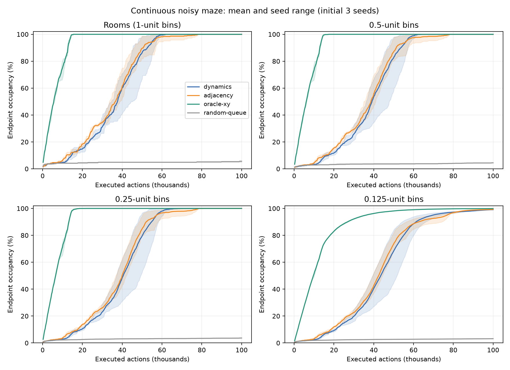
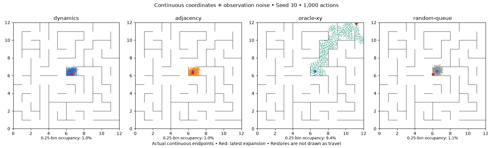
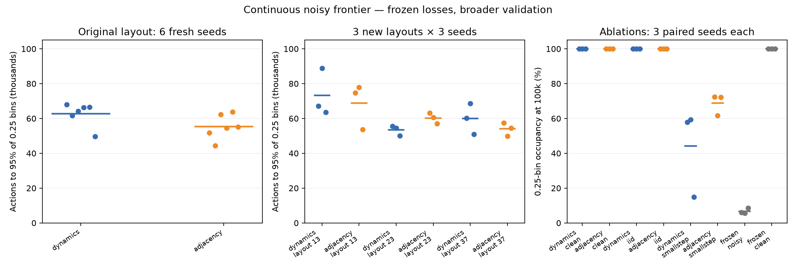
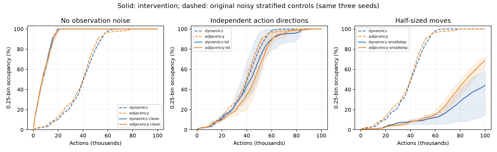
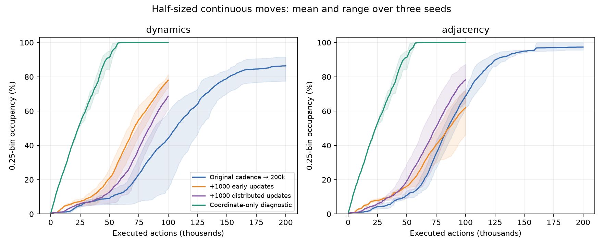

# Continuous-coordinate maze exploration

**Completed November 11, 2026. The existing dynamics-trained encoder supports continuous-coordinate exploration with observation noise. Adjacency also works, and becomes substantially more reliable in the smaller-movement stress test.** These results retain exact simulator resets and coordinate inputs.

## What changed

The physics already accepted bounded 2D controls, but the previous five fixed actions kept positions on a quarter-cell lattice. The new experiment samples real-valued controls and supplies the **actual control vector** to each dynamics head. Position is not snapped or rounded. This adds action diversity without hidden motor noise: given a position and a control, the physical transition remains deterministic.

At each expansion, four perpendicular directions have a fresh random rotation, and their lengths are independently uniform from .5 to 1 in control units. With step_size=.25, nonblocked moves span .125–.25 maze units. A fifth action stays still. Every child comes from an actual simulator step. The existing swept wall-intersection check rejects blocked moves completely, including diagonal paths; it does not slide along walls or teleport through them.

We retain the 12×12 maze, eight independent Gaussian observation-noise coordinates, exact simulator restores, persistent raw-observation frontier and visited archive, and nearest-expanded-latent queue priority. Queued states retain their original noisy observation; all archived/queued observations are reencoded after training. There is **no state deduplication, distance threshold, quantization, or coverage signal in the agent**. Both learned methods still use deterministic 8D encoders. Adjacency's auxiliary dynamics are detached and diagnostic only.

## Coverage means finite spatial resolution

There are infinitely many mathematical positions, so unique-coordinate count is not a completion metric. We record occupancy of spatial bins of width 1, .5, .25, .125; the main sample-efficiency target is 95% occupancy of .25-wide bins. The maze has 144 unit rooms, 2,304 quarter-width bins, and 9,216 eighth-width bins. Walls have zero thickness and every room is connected by construction.

A bin counts when an actual observed endpoint lies inside it; we do not credit the full path segment, latent predictions, or simulator resets. Bins are used only by evaluation, never by the learner/queue. As an additional measure, fixed probes in each room are tested for proximity to an observed endpoint in the **same room**, avoiding spurious coverage through walls. This is conservative at open room boundaries and is not a geodesic metric.

## Initial three-seed comparison

Both dynamics and adjacency reach every room and all quarter-width bins at 100k. Fine-bin occupancy is 98.8–99.5%. Coordinate-only distance is a privileged diagnostic which discards known nuisance input dimensions. Random queue selection uses the same physical proposals and simulator-reset protocol.

|Method|Actions to 95% quarter-bin occupancy, seeds 30/31/32|Final quarter-bin occupancy|
|---|---|---|
|Dynamics|51,847 / 60,542 / 49,529|100% each|
|Adjacency|50,136 / 54,277 / 72,537|100% each|
|Coordinate-only diagnostic|13,867 / 14,204 / 13,767|100% each|
|Random queue|Not reached|3.4% / 4.0% / 3.6%|



First prespecified seed 30; the animation displays a deterministic subsample of cumulative **actual continuous endpoints**, not an evaluation lattice. Red marks the latest expansion, not a physically traversed line between simulator restores. Numerical occupancy uses every endpoint, regardless of display subsampling.



## Validation and ablations

Loss coefficients were frozen before validation. Both methods reach all 144 rooms and the 95% quarter-bin target in **all 15 validation runs per method** (six new seeds on the original layout, nine runs across three new layouts). At 100k, all but one run per method reach every quarter-width bin; those two runs each miss just one of 2,304 bins.

| Method | Mean actions to 95%, original layout / 6 fresh seeds | Three new layouts / 3 seeds each |
|---|---:|---:|
| Dynamics | 62,715 | 62,149 |
| Adjacency | 55,320 | 60,977 |

Adjacency wins 5/6 paired seeds on the original layout, about 11.8% fewer actions in the mean. An exploratory paired-bootstrap interval for adjacency minus dynamics is approximately [−13,708, −718] actions. This is six seeds on one layout, not six environments.

On new layouts its mean advantage falls to 1.9%, with only 4/9 paired wins. Dynamics wins every seed on layout 23. Fine-bin occupancy at 100k ranges from 97.8–99.6% for dynamics and 96.7–99.7% for adjacency across these layouts. Thus adjacency is useful but not a consistently superior replacement. The default remains dynamics.



## What the controls say

Removing observation noise makes both learned methods fast: mean actions to 95% coverage are **17,455 for dynamics and 17,717 for adjacency**. Even a frozen random encoder succeeds on clean coordinates in 17,947 / 22,301 / 17,923 actions. With eight nuisance dimensions, frozen encoders cover only 6.0% / 5.6% / 8.5% of quarter-width bins after 100k.

This supports a useful distinction in this particular coordinate-input task: continuous coordinates alone do not require a sophisticated learned representation. Suppressing nuisance variation enough for nearest-neighbor priorities is an important contribution of training. This does not establish that random encoders suffice for image observations.

Independent action directions also work: both losses reach the 95% target in all three seeds, with mean times 64,903 (dynamics) and 66,218 (adjacency). Thus success does not require exactly one proposal in each of four directions. The independent-direction intervention changes the collected trajectories, as intended.



## Smaller movements expose a harder regime

Halving maximum displacement from .25 to .125 gives the following quarter-bin occupancy at 100k, on the same three seeds. All rows except the coordinate diagnostic fall short of the 95% target.

| Training | Dynamics, seeds 30 / 31 / 32 | Adjacency, seeds 30 / 31 / 32 |
|---|---|---|
| Original cadence | 57.9% / 59.4% / 15.0% | 72.5% / 61.6% / 72.3% |
| 1,000 extra updates early | 78.9% / 81.3% / 73.5% | 71.9% / 67.7% / 46.4% |
| Same 1,000 updates distributed | 66.3% / 79.0% / 60.8% | 87.2% / 82.4% / 64.9% |

The two extra-training placements have identical total updates and sample exposure. Early means all 1,000 updates after the first 5,000 actions; distributed means 50 extra updates after each 5,000-action block. This increases total updates from 4,112 to 5,112. Only existing noisy replay is used. Early fitting helps dynamics in every seed, but does not consistently help adjacency; extra optimization is not a universal repair.

Crucially, the coordinate-only half-step diagnostic also slows down: 95% coverage takes 54,782 / 49,062 / 51,093 actions, versus about 14k at the original step size. Approximately fourfold scaling is consistent with needing a denser set of expansion points in two dimensions as the move radius shrinks. That is an interpretation, not a fitted law or a proof. We cannot attribute the learned methods' slowdown solely to observation noise or a failed representation.

The original-cadence **200k extensions separate the two objectives**:

| Method | Final quarter-bin occupancy, seeds 30 / 31 / 32 | Runs reaching 95% |
|---|---|---:|
| Dynamics | 90.02% / 91.58% / 77.52% | 0/3 |
| Adjacency | 99.96% / 95.62% / 96.40% | 3/3 |

Adjacency reaches 95% at 136,368 / 168,712 / 148,637 actions. It enters all 144 rooms in two seeds, and 141 in the third. Meeting the 95% evaluation target is **not complete coverage**. This is nevertheless a useful case where the simpler distance loss is a better fallback than the current dynamics loss, without retuning either objective.

All six extensions reproduce their corresponding first 100k replay observations, controls, positions, and encoder/dynamics weights **exactly**. They are not additional independent seeds. The original cadence gives 16,036 updates and 4,100,000 presentations per head at 200k, versus 4,112 and 1,050,000 at 100k; additional data and optimization are not separated.



[Half-step animation through 200k, prespecified seed 30](assets/continuous-smallstep-example.gif). [Exact-prefix audit](assets/continuous-smallstep-example-prefix-audit.json).

## Representation probes

A fixed set of uniformly sampled positions, fresh observation noise and real-valued controls provides a held-out diagnostic. It is not exact replay memorization or a nearest-class accuracy score.

At 100k in the original step-size setting, the RMS distance between two noisy observations of the same point, divided by RMS distance across an unblocked transition, is .46–.49 for dynamics and .32–.34 for adjacency. With half-sized moves it rises to .67–.80 and .51–.60 respectively. Some nuisance sensitivity remains relative to the smaller navigational signal. These models collected different replay, so this comparison does not isolate the loss's causal effect on a fixed dataset.

Neither low prediction MSE nor a smooth noise-averaged map proves useful queue ordering. The poorest small-step dynamics seed has only 15% coverage at 100k and greater nuisance sensitivity; the better-looking models can still explore slowly. Source probes and per-checkpoint measurements are preserved in the [representation audit](assets/continuous-representation-audit.json).

## Accounting and checks

Completed **87 experiment jobs**: 81 runs to 100k plus six exact-prefix extensions rerun to 200k. These contain 9.3 million executed collection actions, including the six repeated 100k prefixes; they are not 87 independent replications. Of the jobs, 72 train representations and 15 are untrained controls. Total: 379,608 updates and 96,972,000 transition presentations per head. Separate smoke checks add 15,000 actions, 70 updates and 17,560 presentations per head. Synthetic diagnostic probes are evaluation-only and do not feed replay.

All experiment processes exited successfully. Initial parameter hashes, action-vector bounds, training budgets, physical transition samples, observation/position agreement and independently recounted coverage are audited. Within each seed/proposal, action streams are shared across arms. The six long-run prefixes match exactly. **99 tests pass**, including discrete-action compatibility, continuous collision checks, vector replay/checkpoint roundtrips and detached auxiliary gradients. Figures and animation frames were inspected.

Preexisting work and completed run data were preserved. No commits were made by this experiment agent; external commits during the study were retained. Default discrete settings were not changed. [Full results](assets/continuous-results.json), [accounting](assets/continuous-validation-accounting.json), [protocol and staged decisions](continuous-study-protocol.md).

## Implementation and reproducibility

Dynamics: coordinate encoder 10→256→256→256→8 with SiLU, and three residual dynamics heads with 2D continuous controls. Joint transition MSE + .03 random-pair hinge repulsion + .03 latent squared norm. The dynamics MSE is averaged over latent dimensions and heads. Both endpoint encodings retain gradients.

Adjacency replaces encoder dynamics gradients with `.3 E||f(o)-f(o')||²`, keeping the same repulsion/L2. Squared adjacency distance sums over dimensions. Both encoder endpoints train; auxiliary dynamics receive detached embeddings. No posterior distributions or sampling during encoding.

Every 100 expansions/500 actions, training receives a causal slice of one full replay epoch per 5,000 actions. Thus each 100k learned run has 4,112 updates and 1,050,000 transition presentations per head. This is **not** a full epoch every 500 actions. All newly collected transitions are trained; old experience stays in replay. Controls without learning have zero updates and are interaction-matched, not compute-matched.

```
.venv/bin/python scripts/continuous_frontier.py \
  --objective dynamics --seed 100 --blocks 20 \
  --out runs/new-continuous-dynamics

.venv/bin/python scripts/continuous_frontier.py \
  --objective adjacency --seed 100 --blocks 20 \
  --out runs/new-continuous-adjacency
```

Use `--proposal iid`, `--nuisance-dims 0`, `--step-size .125`, or `--layout 13` for the corresponding interventions. `--objective oracle_xy|random_queue|frozen` selects diagnostic controls. `configs/continuous_frontier.json` is separate; existing discrete-action defaults and checkpoints remain supported.

The experiment retains coordinate observations and exact resets. It does not establish exploration with pixels, unreliable restores, a continuous-action learned actor, or imagined latent rollouts. Continuous simulation uses floating-point coordinates, not an imposed lattice; stays and blocked actions still revisit exact positions.

[Protocol and staged decisions](continuous-study-protocol.md). Initial machine-readable results: [screen](assets/continuous-screen-results.json). Checkpoint representation probes: [audit](assets/continuous-representation-audit.json). Run roots and frozen arm manifests are recorded in the protocol; each run retains source snapshots, replay, checkpoints, metrics and visualization frames.
