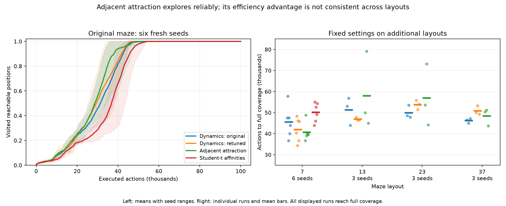
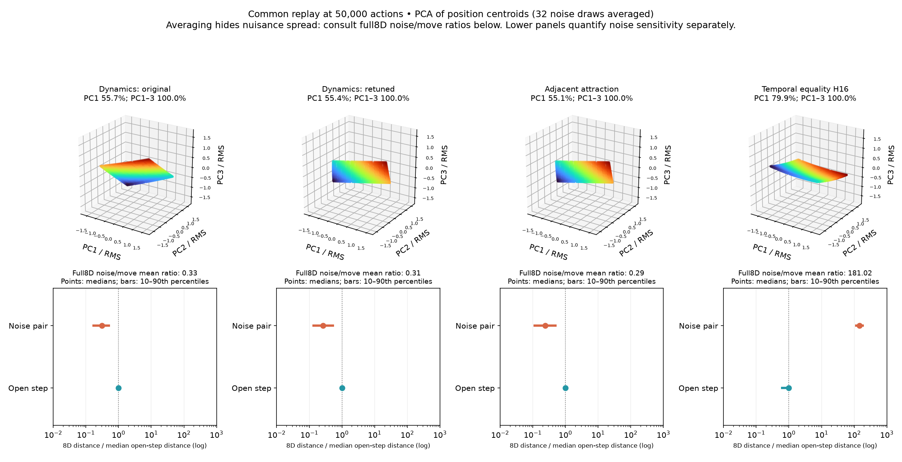
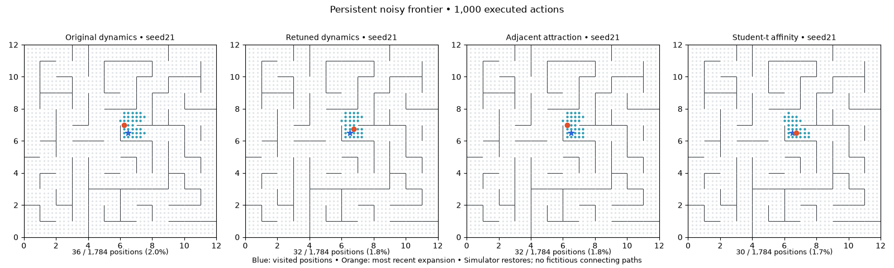

# Distance losses for noisy-maze exploration

Completed overnight November 10–11, 2026. **Adjacent attraction is a viable replacement for the encoder's dynamics loss, but we did not find a consistent sample-efficiency improvement across mazes.** Student-t neighbor affinities also work. Direct regression to observed path lengths performs poorly; treating those lengths as upper bounds helps at a long horizon. None of these results establishes a shortest-path geometry.

## Validation, after tuning was frozen

Every entry below reaches 100% coverage. Values are mean executed actions to first full coverage; lower is better. All runs continue to 100k for matched final diagnostics.

| Encoder objective | Original maze, 6 fresh seeds | Three new layouts, 3 seeds each |
|---|---:|---:|
| Original joint dynamics + repulsion + L2 |45,573 |49,157 |
| Retuned joint dynamics (both regularizers halved) |41,938 |50,511 |
| **Adjacent attraction + repulsion + L2** |**40,665** |54,476 |
| Student-t neighbor affinities + L2 |50,193 |Not tested |

On the original maze, adjacency is 10.8% faster than the original baseline in the mean and wins 5/6 paired seeds. Its 3.0% mean advantage over retuned dynamics splits 3/6 versus 3/6. An exploratory paired-bootstrap interval for that difference spans about 4.5k fewer to 2.0k more actions; this does not establish superiority or statistical equivalence.

The extra layouts change the conclusion about speed: adjacency is slower than the original baseline on 6/9 runs, with two slow runs at 79k and 73k. It still completes **all 15 validation runs** across the original maze and three new layouts. These are three new layouts, not nine independent environments. No settings were changed after seeing these results. The baseline default remains unchanged.



Full per-run results, exact completion times and manifests: [consolidated results](assets/distance-study-results.json). [Paired confirmation differences](assets/distance-paired-confirmation.json).

## The useful simple loss

For deterministic `z=f(o)`, adjacent transition `(o,o')`, and independently sampled replay observations `(u,v)`, the selected adjacency arm uses

```
L = 0.3 E ||f(o)-f(o')||²
  + 0.03 E max(1-||f(u)-f(v)||², 0)
  + 0.03 E ||f(u)||².
```

Both encoder endpoints receive gradients. Squared distances sum over 8 coordinates; the original dynamics MSE averages over coordinates and ensemble heads, so the raw coefficients have different units. There is no decoder, action-conditioned encoder loss, learned distance head, posterior sampling, codebook, state merging, or privileged noise label. Dynamics heads remain fitted on **detached** encodings for diagnostics; they cannot shape the encoder and the queue never calls them. Tests explicitly verify this separation.

This is temporal smoothness plus anti-collapse and norm regularization. Its conceptual relative is [Slow Feature Analysis](https://www.ini.rub.de/PEOPLE/wiskott/Abstracts/WisSej2002.html), which also seeks slowly varying features. Our repulsion/L2 formulation differs from its original algorithm.

There is a useful local explanation for why the attraction coefficient matters. Suppose a small centered nuisance component has variance `V`, independent across transition endpoints, equally distributed in all samplers, and all repulsion hinges are active. Its expected contribution is

```
Delta L = (2*w - 2*alpha + lambda) * V.
```

With alpha=lambda=.03, attraction w=.01 gives coefficient −.01: small independent noise actually lowers this approximate objective. At w=.1 or .3 the coefficient is positive, penalizing that nuisance. A slowly changing spatial component pays much less adjacency cost. This calculation agrees with the weak-attraction arm's failure (about 6% coverage after 100k), but is a local explanation, not a theorem about our adaptive replay distribution or the full nonlinear training process. [Synthetic numerical check](assets/distance-nuisance-toy.json).

## What else was tried

All screening/tuning used seeds 18–20. Fresh confirmation used 21–26. Additional layouts 13/23/37 used model/environment seeds 27–29. Selection decisions and formulas were recorded before their corresponding runs in [the protocol](distance-objectives.md).

| Family | Main observation |
|---|---|
| Adjacent attraction |Works without dynamics gradients. Sweep attraction .01/.03/.1/.3/1 and L2 .003/.01/.03. Weak attraction fails; stronger settings trade noise suppression against learning speed. |
| Student-t neighbor affinities |A t-SNE-inspired KL(P‖Q), with observed neighbors supplying P and Student-t latent affinities supplying Q, completes all initial and fresh seeds. Slower than the selected adjacency arm. |
| QRL-inspired expansion |Euclidean metric, random-pair expansion, and a dual upper-bound constraint on adjacent distances. Swept edge cost, dual rate, and removal of L2. Viable settings complete, but substantially later than the controls. |
| Temporal equality |Regress bounded Euclidean distance to clipped actual ancestry lag. H4/H16/H64 complete 0/3 each; mean final coverage 6.6%/10.1%/48.6%. |
| Temporal upper bounds |Penalize distances only when they exceed the observed-lag target. H64 improves to 3/3 completion at 76.4–86.9k actions. H4/H16 still fail; upper bounds alone are not sufficient across settings. |

The QRL and temporal versions deliberately use the queue's Euclidean distance instead of the papers' learned distance heads. They are **not reproductions of complete QRL or Time-Myopic Go-Explore**. The Student-t experiment also changes t-SNE's input affinities to transition adjacency. Sources and exact differences: [QRL](https://arxiv.org/abs/2304.01203), [Time-Myopic Go-Explore](https://arxiv.org/abs/2301.05635), [t-SNE](https://jmlr.org/papers/volume9/vandermaaten08a/vandermaaten08a.pdf); implementation details in [the protocol](distance-objectives.md).

### Why observed temporal distance is problematic here

The queue resets the simulator, so consecutive pops are not consecutive motion. The implementation preserves explicit parent/child occurrence IDs and samples genuine ancestry paths. It never joins unrelated queue pops into fictitious trajectories.

Even correct ancestry contains stays, wall collisions and loops. For H16, sampled mean path lengths across three runs are 11.7/8.2/11.7 actions, versus actual shortest distances 2.9/2.0/2.3. About 10–12% of positive-lag pairs end at exactly the same physical position with different noise. A zero-self-distance Euclidean metric cannot faithfully treat these positive path lengths as equalities while also becoming noise invariant. This motivates the upper-bound intervention; its partial success supports that distinction, without isolating every cause of the original failure. [Target audit](assets/distance-temporal-targets.json).

### QRL constraint optimization was measurable, not assumed solved

At edge cost .05 with L2 .03, the default dual rate gives final full-replay average squared violations 6.9–8.3 times the allowed budget. Raising the dual rate to 10 brings those ratios to .74–1.13. Nevertheless, mean completion gets later (76.7k to 86.9k). Removing L2 does not rescue exploration speed in the tested settings. Better satisfaction of the local constraint is not sufficient for better online exploration. These finite-budget results do not establish that QRL is intrinsically hard to optimize or incapable of useful geometry. [Full-replay constraint audit](assets/distance-constraint-results.json).

## What geometry did we learn?

We fit all initial families, plus the selected tuned methods, on identical recorded baseline streams: 24 fixed-data fits. For a given seed they receive identical observations, update cadence, transition indices, repulsion draws and initialization. Native control fits reproduce the source run's encoder **and** dynamics weights exactly at 100k. This distinguishes representation differences from changes in collected experience.

At 50k, dynamics, adjacency and affinity encoders mostly recover two-dimensional spatial geometry. Their full 8D centroid distances correlate about .99 with physical straight-line separation. Crucially, equally separated points across walls are assigned almost the same latent distance as points connected by an open passage. In the same probe groups, actual shortest-path distances differ by median factors 8 and 11 in the two coordinate directions. This is useful position geometry for novelty ordering, not a demonstrated shortest-path map. [Wall-detour audit](assets/distance-barrier-results.json).



The figure uses the first matched source/model seed, 18. PCA is fitted separately for each encoder, so display rotations carry no meaning. The upper row averages 32 independent noise draws per physical position; the lower row measures full 8D distances before that averaging.

Temporal H16 can produce a superficially reasonable **noise-averaged** surface while individual observations remain dominated by nuisance: common-data noise/movement ratios are enormous. QRL can have a smaller average noise/movement ratio while retaining a very narrow spatial direction and exploring slowly. Neither a smooth centroid plot nor a single average noise metric establishes a useful queue geometry.

The paired 25k frontier continuations also show why one checkpoint's ranking is insufficient to predict a whole online run. On identical source queues, tuned adjacency and tuned dynamics discover averages 6.1 and 7.8 new positions over 640 actions; the original baseline discovers 1.8. Initial QRL discovers 15.2 there despite slower complete online exploration. Each number averages three model/source seeds, with three noise replicates nested inside each seed. Those replicates are not additional independent training runs.

Prediction probes are separate from exploration and from exact replay memorization. At 50k, fresh-noise probes on balanced seen physical edges give roughly 79% nearest-centroid accuracy for original dynamics and 76% for initial adjacency's detached auxiliary dynamics. That result depends on both encoder noise sensitivity and dynamics, and does not reproduce the earlier noiseless 98–99% memorization experiment. [Prediction audit](assets/distance-prediction-results.json).

## Exploration animations

First fresh seed 21, fixed before inspecting its outcome. All panels show 100k actions, a visited-position tally, and simulator restores without drawing fictitious connecting paths.



[Seed 23 comparison](assets/distance-exploration-seed23.gif) includes a case where retuned dynamics finishes before adjacency. All six fresh seeds are included in the numerical analysis regardless of which animations are displayed.

## Controls, limits and accounting

The original maze has 144 cells and 1784 reachable quarter-cell positions. Inputs are normalized xy plus 8 independent Gaussian nuisance coordinates. Exact simulator restores, persistent frontier/visited observations, all 5 actions per expansion, and Euclidean nearest-visited priorities remain fixed. No ground-truth positions, shortest distances, resampled-noise equivalences or physical identities enter training/search. Physical labels and synthetic noise probes are evaluation only.

Every 100 expansions (500 actions), training receives a causal slice of one replay epoch per 5000-action block. It is **not** a complete epoch every 500 actions. Each 100k run has 4112 updates and 1,050,000 transition presentations/anchors per head. Temporal objectives sample an ancestor per anchor, so this does not imply every edge appears as a one-step temporal target. No learned actor or goal-conditioned policy is trained. Auxiliary dynamics keep model/optimizer capacity comparable but make this a matched-interaction/update comparison, not a matched-FLOP benchmark.

Completed: **141 online runs + 24 fixed-data fits = 165 full fits**; 14.1 million main training interactions; 678,480 gradient updates; 173.25 million presentations per head. Frozen diagnostic continuations add 46,080 actions. Separate smoke work adds 2500 training actions, 1920 diagnostic continuation actions and 30 updates. All main run processes exit successfully; budgets and initialization hashes are audited. **93 tests pass.** Preexisting work was preserved; no commits or baseline-default changes were made.

This evidence is specific to coordinate inputs with nuisance noise, discrete small-step controls and free exact restores. It does not establish performance for pixel observations, continuous action/position spaces, unreliable resets or imagination-based planning. The strongest outcome is a simpler encoder objective that reliably supports this exploration procedure, together with clear evidence about which distance targets and interpretations fail.

## Reproduction and artifacts

```
.venv/bin/python scripts/persistent_frontier.py \
  --config configs/deterministic_frontier.json --arm interleaved100 \
  --distance-spec configs/distance_adjacency.json --seed 100 \
  --out runs/new-adjacency-frontier
```

[Exact loss protocol and staged decisions](distance-objectives.md). Study roots are `runs/distance-{screen,followup,dynamics-controls,qrl-unregularized,confirm,layout13,layout23,layout37}-20261110`. Each contains immutable manifests, configs, source snapshots, logs, checkpoints, raw replay and visualization frames. Shared-data fits are `runs/distance-fixed-20261110` and `runs/distance-tuned-fixed-20261110`; their metadata identifies the source replay.

[Initial screen](assets/distance-screen.png), [adaptive sweep](assets/distance-followup.png), [native-weight controls](assets/distance-dynamics-controls.png), [QRL norm controls](assets/distance-qrl-unregularized.png), [all machine-readable results](assets/distance-study-results.json). Core implementation: `src/map_learning/distance_learning.py`; experiment/audit/render commands are in `scripts/*distance*.py`. The training log entry is in [training_runs.md](../training_runs.md).
