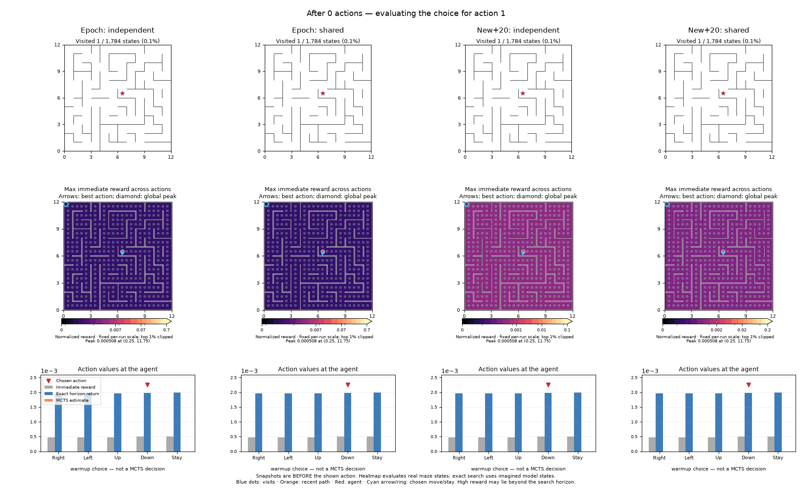
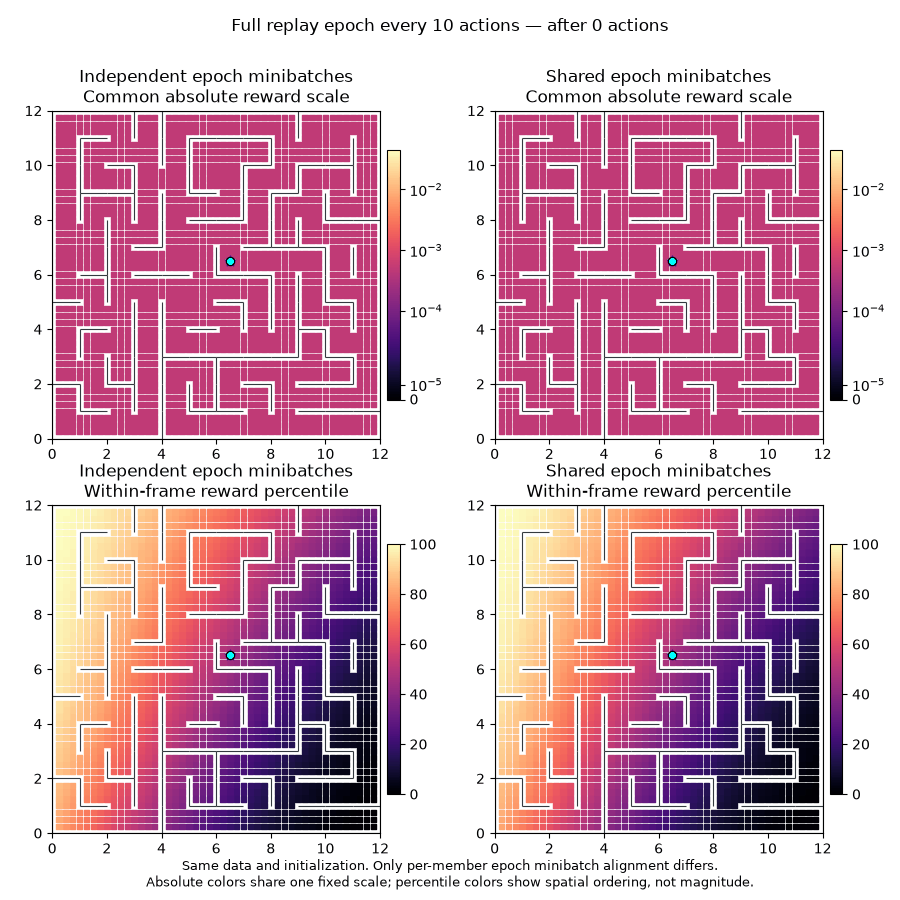

# Shared versus independent ensemble minibatches

The matched-data experiment supports the proposed stability mechanism: **shared minibatches reduce spatial reward-map volatility in all six seed/cadence pairs.** They do not improve next-state prediction accuracy in this experiment.

Twelve runs: three seeds × full replay epoch or new-once-plus-20 updates × shared or independent batches. For each seed, all four conditions received exactly the same 10,000 observations, actions and successor observations from persistent-random exploration. Replay equality was checked, rather than inferred from using the same seed. Every model uses the same architecture, joint MSE/repulsion objective, learning rates and initialization seed.

| Training cadence | Batch mode | Map shape L1 change ↓ | Adjacent-map rank correlation ↑ | Seen-edge accuracy |
|---|---|---:|---:|---:|
| Full epoch | Independent | 0.447 | 0.758 | 90.7% |
| Full epoch | Shared | 0.374 | 0.835 | 89.7% |
| New once + 20 | Independent | 0.583 | 0.582 | 76.7% |
| New once + 20 | Shared | 0.460 | 0.748 | 75.8% |

Shape change falls **16% with full epochs and 21% with new+20**. Each reward map is divided by its own mean before computing L1 change, so this reduction is not merely a smaller overall reward scale. Rank correlation independently confirms greater stability. Measurements compare snapshots 200 actions apart during actions 5,000–9,800; they cover all reachable state-action pairs, not just visited ones.

Within full epochs, every member sees every replay transition exactly once per epoch in both conditions. Independent batches use separate shuffles; shared batches synchronize transition indices. Under new+20, the explicit new-transition pass and the subsequent replay batches are shared or independent accordingly. Members retain independent initial weights. The code consumes the same number of sampling draws in both modes, preserving the repulsion sampler's random stream.

There is a coupled-encoder caveat: with independent member batches, the shared encoder receives gradients from more distinct examples per update. Synchronizing batches changes that gradient diversity as well as ensemble exposure. This experiment tests the proposed practical training change; it does not isolate head-only optimization noise from encoder optimization.

Full epochs remain substantially more accurate than new+20, but shared batches do not improve accuracy (the mean decreases by about one percentage point). Agreement and stability are therefore not sufficient evidence of correctness. Whether the more stable reward improves active exploration is evaluated separately in the horizon factorial, where trajectories can diverge.

## Matched seed-0 animation

The visitation paths are identical by design. The reward maps differ because training differs. Color scales are fixed within each panel but differ between panels; use the labels and normalized-shape statistics rather than treating color intensity as a common uncertainty unit.

## Reproduction

Use `configs/ensemble_matched.json` with `scripts/run_probabilistic_sweep.py`. Raw runs are in `runs/ensemble-matched-20261109`; per-run `overnight-audit.json` files contain stability and physical next-state retrieval metrics. `scripts/report_horizon.py` aggregates these and verifies identical replay arrays. The linked animation is generated with `scripts/animate_rewards.py`.

## Full-epoch heatmaps with matched color scales

Seed0 from the existing matched-data full-epoch experiments; no retraining. Left: independently shuffled member minibatches. Right: aligned member minibatches. Both train every recorded transition once per member per epoch, every ten actions. Top row uses one fixed numerical color scale pooled across both runs after2k actions; bottom row shows within-frame percentiles of maximum action reward. The common scale does not remove dependence on learned latent geometry. Identical replay arrays were reverified across all three seed pairs.

Regenerate with `.venv/bin/python scripts/compare_replay_sharing.py --mode epoch`. Static example: `assets/epoch-sharing.png`.
