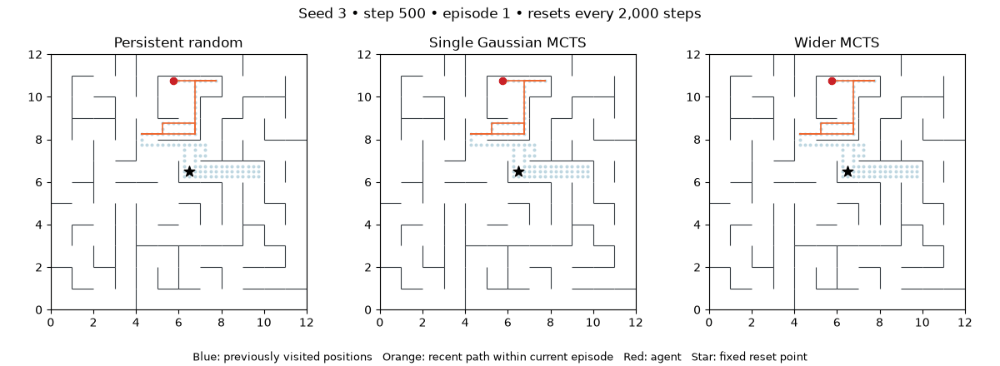
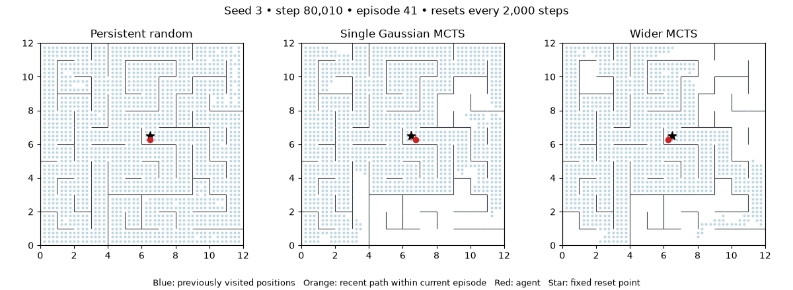

# Exploration animations

These saved animations compare seed 3: persistent random, a three-member ensemble with one Gaussian/member and width 64, and a three-member ensemble with three Gaussians/member and width 128. Both learned agents use the same horizon-4, 24-simulation MCTS. The 12×12 maze resets to its center every 2,000 steps; model weights and replay persist.

Blue marks accumulated visited positions, orange shows up to 200 recent transitions within the current episode, red marks the agent, and the star marks the starting point. Reset jumps are never drawn as paths. The full-run view advances 500 transitions/frame and therefore summarizes rather than shows every action. The late-episode view advances 10 transitions/frame.





## Regenerate or compare other runs

Install the project dependencies, then run from the repository root:

```bash
.venv/bin/python scripts/animate_exploration.py \
  runs/probabilistic-long-random-20261104/random-seed3 \
  runs/probabilistic-long-gaussian-20261104/single_gaussian-seed3 \
  runs/probabilistic-long-wide-20261104/wide128-seed3 \
  --labels 'Persistent random' 'Single Gaussian MCTS' 'Wider MCTS' \
  --end 100000 --stride 500 --out runs/exploration-full.gif
```

For the late episode, use `--start 80000 --end 82000 --stride 10 --out runs/exploration-late.gif`. `--trail` controls recent path length and `--fps` controls playback speed. The default end is the shortest supplied replay. One run or multiple runs are supported; episode boundaries and starting positions come from the actual replay. Outputs refuse overwriting existing files.

Each input folder needs `config.json` and `replay.npz`. Raw runs are gitignored and must be available locally to regenerate; the two GIFs above are included in the repository so they can be viewed without training artifacts. Rendering uses Matplotlib and Pillow, with no FFmpeg dependency. GIF generation retains frames in memory, so increase the stride for very long runs.

The animation generator now includes visited-state counts. See [reward diagnostics](reward-visualization.md) for the joint-MSE runs with contemporaneous reward heatmaps and exhaustive-search comparisons.
