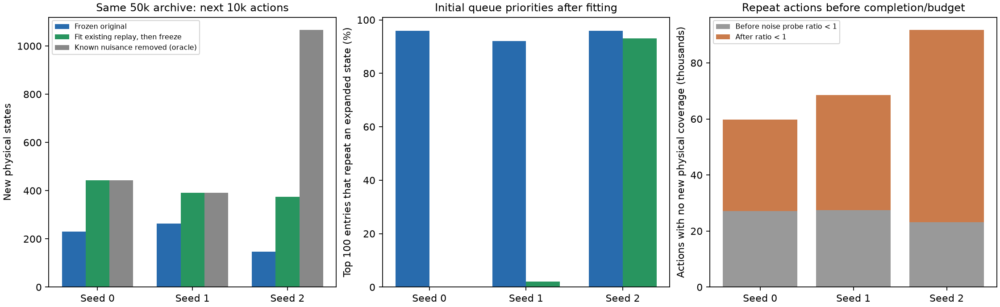
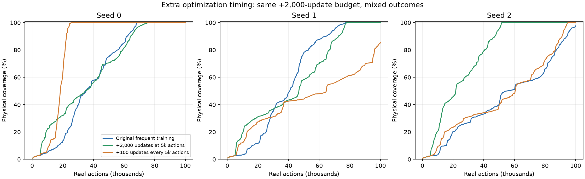
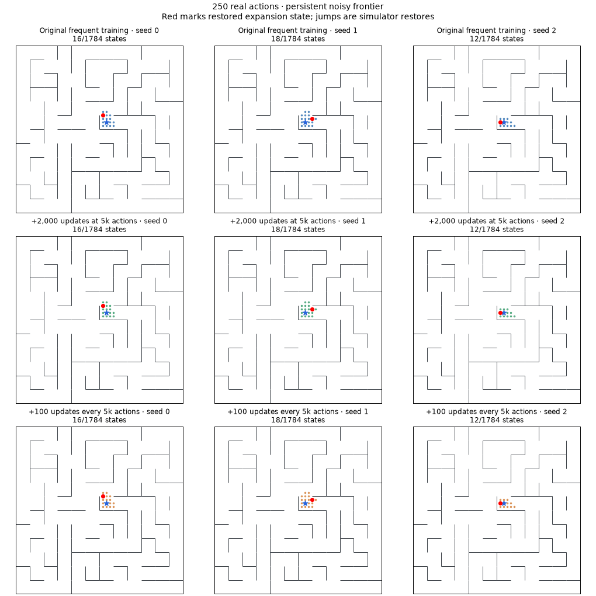

# Where noisy-frontier exploration spends its actions

Completed November 10, 2026. Saved-run audits plus 18 new diagnostic/online runs; 720,000 additional real actions and 44,672 new gradient updates. Existing runs preserved. No loss changes, merging thresholds, or disagreement policy.

## Findings

**Repeated physical expansions dominate even before completion.** In the original frequent-training seeds, 87.1%, 88.6%, and 91.7% of expansions before full coverage or the 100k limit revisit previously expanded positions. Because every expansion executes all five deterministic actions, those repeats cannot expose new physical states. They can still provide useful noisy observations and gradient-training data: “no new coverage” does not mean no learning value. Accounting excludes gratuitous actions after full coverage, and uses the whole expansion containing first completion.

Representation acquisition explains only part of this. A descriptive, isolated whole-maze probe first reports same-position noise distance smaller than neighboring-position distance around the checkpoints below. Much of the repeated interaction happens **after** that crossing. This is not a control threshold or a causal definition of sufficient training; diagnostics are sampled every 5k actions, and represent post-training weights.

seed 0: first probe ratio <1 at 30,000 actions; 27,170 repeat actions before, 32,575 after; seed 1: first probe ratio <1 at 30,000 actions; 27,455 repeat actions before, 41,010 after; seed 2: first probe ratio <1 at 25,000 actions; 23,135 repeat actions before, 68,570 after.

**Seed 2 was not trapped behind an inaccessible frontier.** At 100k actions, 43 states were unobserved, but 34 queued physical positions could immediately discover a new neighbor. The best such entry ranked 7th. Nevertheless, 88 of the top 100 queue entries repeated an expanded position. This is a snapshot ranking, not a promise that the seventh pop must be productive: every pop updates distances and generates more entries.

The same final archive and frozen model finish in **3,846 additional actions** under a fresh paired noise stream. Fitting its existing replay for 2,000 updates first reduces that to **489 actions**. No newly collected data is used for training in either branch. Removing known nuisance dimensions only for encoding finishes in 584 actions; that is a privileged diagnostic, not an admissible learned solution.

**Small average noise sensitivity is insufficient for a maximum-priority queue.** The queue selects extreme scores from tens of thousands of noisy entries. Residual within-state variation can outrank physically different candidates even when the average noise/movement ratio is about 0.1. At 50k, 96%, 92%, and 96% of the top 100 entries repeat previously expanded positions. After fixed-data fitting, these fractions become 0%, 2%, and 93%. Global probe ratios and average prediction MSE do not reliably reflect that improvement: seed 0's normalized replay MSE slightly increases while its queue ranking dramatically improves. Local ranking matters more directly than aggregate fitting metrics.

## Controlled fixed-archive fitting

Take the original frequent-training checkpoints at 50k actions. Reconstruct their exact active frontier and visited archive from raw observation entry identity; validate reconstruction against all final saved archives. Compare unchanged weights versus 2,000 replay updates using **only that existing dataset**, then freeze both while expanding for 10k more actions. The model, queue archive, and successor-noise stream are paired. No encoder is supplied with future data.

| Seed | Initially observed | New states: frozen original | New states: extra fitting | New states: known noise removed |
|---|---:|---:|---:|---:|
| 0 | 1340 | 231 | 444 | 444 |
| 1 | 1393 | 264 | 391 | 391 |
| 2 | 718 | 147 | 374 | 1066 |

Extra fitting helps all three seeds in this matched intervention, but seed 2 still does not finish. Seeds 0/1 finish in 2,958/2,987 additional actions after fitting; neither unchanged model finishes within 10k. Frozen-original branches intentionally stop online learning, so they are not direct continuations of the baseline online algorithm. Additional fitting can change all aspects of geometry; these experiments do not attribute improvement exclusively to noise suppression.

The zero-noise control sets the eight **known nuisance input coordinates** to zero for ranking, leaving observed transitions and simulator physics untouched and models frozen. It supplies exact observation invariance, so repeated physical states encode identically. Its strong results diagnose remaining sensitivity but do not demonstrate that the agent learned equivalent invariance. All three 50k archives finish with this oracle intervention in 3,016 / 2,917 / 5,772 extra actions.



## Online optimization timing

Two adaptive follow-ups were chosen after the repeat/queue audit. Both retain persistent search, frequent interleaved epochs, and unchanged losses. **Early:** add 2,000 replay updates immediately after 5k actions. **Distributed:** add 100 updates after each 5k actions, totaling the same 2,000. All six new runs use three paired seeds, 100k actions, 6,112 updates, and 1,562,000 transition presentations per head. Base epochs still train every accumulated transition exactly once per block; extra updates sample replay with replacement. Shared batches across heads. Every new run's initial weights, first 5k experience, and complete successor-noise stream were checked against the original baseline. Extra optimization does not consume environment observations.

| Schedule | Actions to full coverage, seeds 0 / 1 / 2 | Final observed states, seeds 0 / 1 / 2 |
|---|---|---|
| Original frequent training | 68,628 / 77,266 / >100,000 (not reached) | 1784 / 1784 / 1741 |
| +2,000 updates at 5k actions | 75,613 / 77,931 / 51,844 | 1784 / 1784 / 1784 |
| +100 updates every 5k actions | 25,438 / >100,000 (not reached) / 95,213 | 1784 / 1521 / 1784 |

**Early extra training achieves full coverage in all three tested seeds**, but is slightly slower than baseline in seeds 0/1. Its benefit is concentrated in seed 2. **Distributed extra training is highly variable:** seed 0 finishes at 25,438 actions, seed 1 reaches only 1,521 states at the limit, seed 2 finishes at 95,213. More optimization changes representation and therefore subsequent collected data; it is not monotonically helpful. Do not select the 25k seed as evidence of a robust schedule, or average censored completion times as if they were observed. Three seeds and one layout do not establish broad reliability.





## Implications and remaining questions

The existing joint loss is capable of supporting complete noisy-maze exploration in all three early-extra seeds, without state merging. But the original “solved” claim omitted sample cost and seed variation. The action budget remains far above an exact-state graph explorer's upper bound of 1,784 × 5 = 8,920 actions to expand every state once. That bound supplies identity and restoration; it is a reference, not a fair learned-agent baseline or a lower bound on any exploration task.

Both inadequate optimization on a given archive and residual noise-sensitive priority ordering are real contributors. The fixed-archive intervention establishes that better search can come from more training without new data. The zero-noise control establishes that perfect nuisance invariance removes duplicate novelty in this discrete setting. Neither tells us a universally good training stopping rule. Aggregate MSE and average noise ratio alone look insufficient for that rule. A next training/prioritization change should be evaluated on queue-relevant local/tail behavior as well as coverage, with multiple seeds; no new loss is implemented here.

## Validation, artifacts, reproduction

The six original persistent runs were audited at 5k/25k/50k/100k checkpoints. Repeat discovery was checked directly: no repeated physical expansion produced a new position. Exact frontier reconstruction matches saved final observations and archive ordering. Training-prefix and successor-noise controls passed for every new online run and all paired fixed-archive branches. Reports preserve unsuccessful runs as well as successes. All 64 repository tests pass.

```sh
.venv/bin/python scripts/audit_frontier_efficiency.py --out runs/frontier-efficiency-audit-NEW
.venv/bin/python scripts/run_frontier_optimization.py --out runs/frontier-optimization-NEW
.venv/bin/python scripts/branch_frontier_fitting.py --out runs/frontier-fitting-branches-NEW
.venv/bin/python scripts/branch_frontier_fitting.py --zero-only --out runs/frontier-zero-noise-oracle-NEW
.venv/bin/python scripts/report_frontier_efficiency.py
```

Reporting currently names the recorded 20261110 run roots at the top of the script; change those constants when reporting new roots. Launchers refuse existing output directories. Raw data: `runs/frontier-efficiency-audit-20261110`, `runs/frontier-optimization-20261110`, `runs/frontier-fitting-branches-20261110`, `runs/frontier-zero-noise-oracle-20261110`. Branch scripts preserve actual noisy replay even for privileged encoding. Portable combined [results](assets/frontier-efficiency-results.json); code/source snapshots and checkpoints retained. No background work remains.
