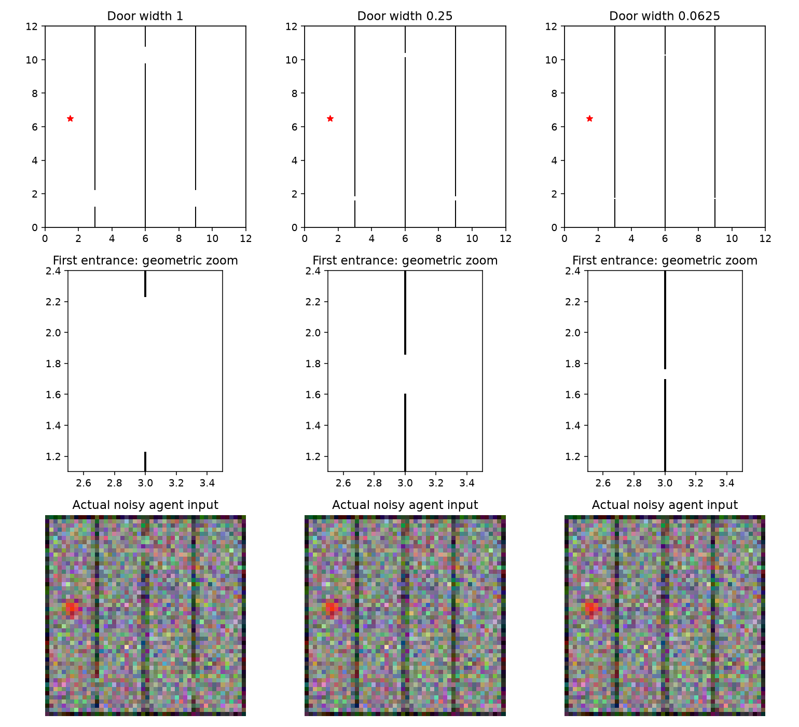
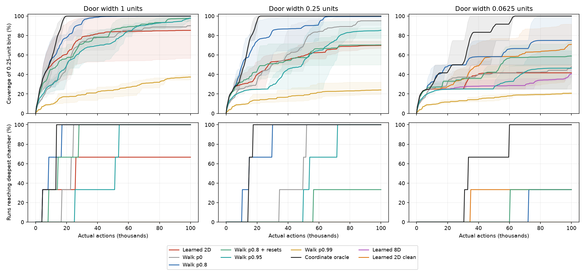
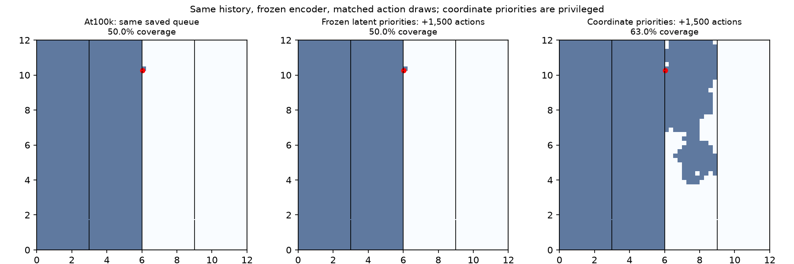
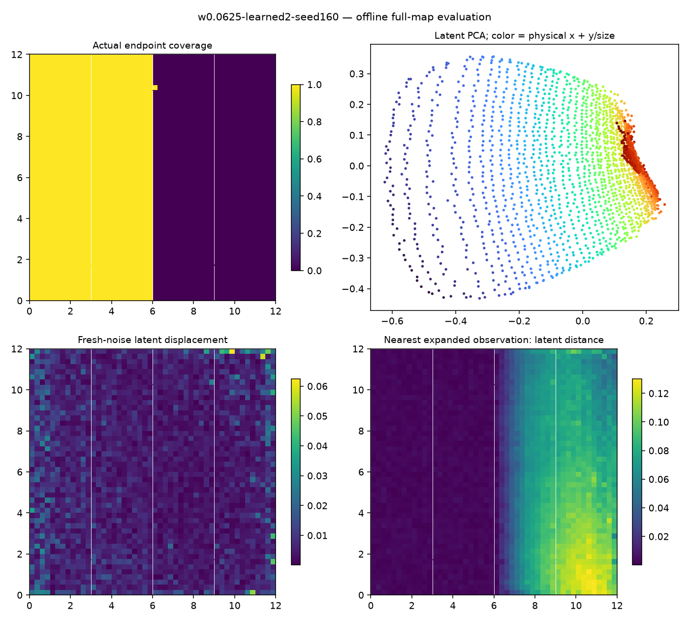
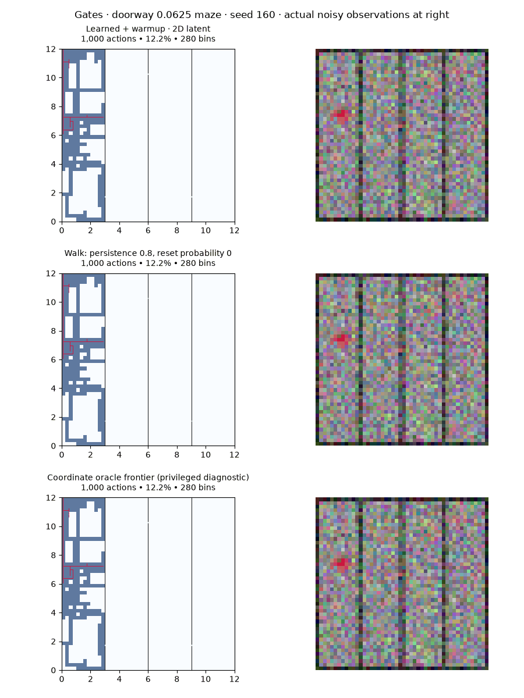

# Narrow entrances under noisy pixels

Completed November 11, 2026. **Small entrances hurt persistent random walking, but our learned pixel frontier currently fares worse. The same frontier with coordinate distances solves all three widths.** This creates a useful benchmark for improving representation and queue priorities.

The most concrete failure is not always finding the doorway: two narrow-maze runs crossed into a new chamber, saved the observation, and never expanded from it. A matched continuation from one failed queue gained **zero new coverage bins with latent priorities versus 298 with coordinate priorities** in 1,500 additional actions. Coordinates are privileged in this diagnostic; this is not a learned-agent success.

## Environment and comparison

Four 3×12 chambers are separated by walls at x=3,6,9. Openings alternate between y=1.73,10.27,1.73, requiring travel across each chamber. Start: (1.5,6.5). Door widths are 1, 0.25 and 0.0625 world units. The smallest is four times narrower than the maximum movement of 0.25; positions are continuous. The agent is a point for collision physics; its displayed sprite has no collision radius.



The agent still receives only noisy 48×48 RGB images. For this maze family, walls use pixel-area rendering so a subpixel opening affects intensity continuously rather than rounding shut or being widened. At the narrowest width the door is only about a quarter pixel high, so perception under noise is difficult. The coordinate control separates that difficulty from what the frontier procedure can accomplish with accurate positions. Tests verify crossing inside each opening, blocking outside it, and a complete route through all three doors using legal cardinal movements without resets.

Seeds 160–162 each run for 100,000 actual actions. The previous selected model and five nonreactive walking controls were fixed before these results. No hyperparameter was selected on this benchmark. Main outcomes are doorway/deepest-chamber entry and time to entry; coverage is the fraction of 2,304 quarter-unit bins visited by actual endpoints. Unreached chambers remain failures censored at 100k, rather than being excluded from timing summaries. AUC is average coverage over the action budget.

## Results

Mean coverage at 100k; parentheses give the number of seeds reaching the fourth chamber.

| Door width | Learned 2D | Persistent walk, p=.8 | Same frontier with coordinate distances |
|---|---:|---:|---:|
| 1 | 85.3% (2/3) | 100.0% (3/3) | 100.0% (3/3) |
| 0.25 | 69.8% (0/3) | 99.6% (3/3) | 100.0% (3/3) |
| 0.0625 | 41.7% (0/3) | 75.0% (1/3) | 100.0% (3/3) |

The proposed bottleneck does impair the strong walk baseline. Accurate-distance frontier search retains its advantage here, while the learned representation does not deliver it. Even the wide-opening learned control fails in one seed; tiny doors are not the only weakness. One wide-opening seed reaches the fourth chamber during the common 5k walk warmup, so its success is not attributable to the learned frontier discovering that chamber.

All narrow-opening controls:

| Method | Final coverage | Coverage AUC | Fourth chamber reached |
|---|---:|---:|---:|
| Learned 2D, noisy pixels | 41.7% | 35.6% | 0/3 |
| Learned 8D, noisy pixels | 40.6% | 28.8% | 0/3 |
| Learned 2D, clean pixels — diagnostic | 70.9% | 48.9% | 1/3 |
| Independent random walk | 47.9% | 37.2% | 0/3 |
| Persistent walk, p=.8 | 75.0% | 57.6% | 1/3 |
| Persistent walk, p=.8, random resets | 59.0% | 44.2% | 1/3 |
| Persistent walk, p=.95 | 46.5% | 32.1% | 0/3 |
| Persistent walk, p=.99 | 20.7% | 15.4% | 0/3 |
| Coordinate-distance frontier — privileged | 100.0% | 75.7% | 3/3 |

The coordinate frontier first reaches the fourth chamber at 33,436 / 59,671 / 30,826 actions. The p=.8 walk does so only in seed 161, at 72,296 actions. Its reset counterpart also succeeds only in seed 161, at 60,139. More directional persistence is not automatically better: p=.99 reaches no first doorway at the narrowest setting.



[Every condition and doorway timing](assets/gates-results.md), [individual runs and prefix checks](assets/gates-results.json).

## A rare discovery left unexpanded

Narrow noisy 2D seed 160 crosses the first wall at action 28,096. At action **88,471**, it crosses the second wall to (6.03297,10.25462), entering the third chamber. That single observation is never selected as an expansion source in the remaining 11,529 actions.

At the final checkpoint, among 81,000 queued occurrences, this observation ranks **9,614th by latent distance versus 16th by coordinate distance** from the expanded archive. Its nearest latent archive match is its actual parent, at (5.87734,10.25462), only 0.15563 units away. This is not a remote-location alias: the new observation is insufficiently novel under the learned distance compared with other pending observations. The ranks are final-model snapshots, not reconstructed historical priorities.

Seed 161 similarly crosses the first wall at action 76,951 and eventually has two observations on the other side, but never expands from either. The best final latent rank there is 15,110, versus 155 with coordinates. This gives two examples of failing to exploit a valid discovery; it does not establish the same cause for every failed run.

To test the priority explanation directly, start both continuations from seed 160's exact final replay, pending queue and expanded archive. Freeze the encoder, perform no further training, and use identical future controls and a matched fresh image-noise stream. Change only the representation used for nearest-archive queue scores.

| Priority representation | Additional actions | New bins | Final coverage | First expansion of the rare state |
|---|---:|---:|---:|---:|
| Frozen learned latent | 1,500 | 0 | 50.04% | Never |
| Coordinates, privileged | 1,500 | 298 | 62.98% | Additional action 61 |



This isolates a consequential priority failure in one selected failed case. It does not show that coordinates are an optimal policy, or that a pixel-only fix will reproduce the gain. It does suggest that improving how discoveries compete against already familiar observations could be more valuable than merely increasing the action budget.

[Queue audits](assets/gates-frontier.json), [rare-state details](assets/gates-rare-state.json), [paired continuation](assets/gates-queue-counterfactual.json).

## Resolution, noise and latent dimension

An offline probe encodes 256 common uniformly distributed physical positions with 16 fresh noisy images each, and compares them with positions displaced vertically by one narrow-door width. For the three noisy 2D models, average pairwise noise RMS is **2.13× / 2.64× / 2.31×** the distance between estimated centroid encodings of the displaced positions. Noise exceeds that displacement measure at 92–98% of probe positions. The older half-unit localization diagnostic was too coarse to characterize this scale.

These are approximate local-resolution measurements, not exact Jacobians or a causal explanation by themselves. For seed 160, noise RMS is .00674 and centroid displacement .00316; the finite-16-view centroid difference has an estimated noise floor of about .00168. Thus the movement estimate itself contains sampling error. [Probe data](assets/gates-precision.json).



After the first noisy run stalled, three otherwise matched **clean-image diagnostic runs** were added. Their individual final coverages are 47.3%, 91.7%, 73.7%. Clean input improves two of three outcomes, but still reaches the fourth chamber only once. Removing observation noise alone does not reliably solve the task. This intervention also changes training and subsequent experience, so it is not a fixed-replay isolation of test-time noise.

An **8D latent** gives 40.6% mean coverage and no fourth-chamber entries. This is an untuned dimensionality ablation, not evidence that 2D is necessary. The dynamics MSE averages over dimensions while repulsion and L2 use summed squared distances/norms, so identical coefficients do not preserve all relative pressures across dimensions. The 2D main arm remains a favorable geometry-informed bottleneck inherited from the previous study.

## Animation

Seed 160, smallest opening, through all 100k actions. Rows: learned 2D, p=.8 nonreactive walk, coordinate frontier. Right panels show actual noisy observations. Traces show real transitions and break at simulator restores; shaded coverage counts visited endpoints. The oracle row uses privileged coordinates for priorities.



## Training and controls

The [previous pixel architecture and losses](pixel-study.md) are unchanged: eight learned spatial-attention maps, a width-128 MLP, and three residual dynamics heads, jointly trained with dynamics MSE + .3 hinge repulsion with margin .25 + .03 latent squared norm. Inputs have independent Gaussian pixel/channel noise σ=.12 plus brightness noise σ=.036. No coordinates, masks, clean targets, decoder or pretraining enter the learned model.

Each frontier starts with a 5k nonreactive walk at persistence .8, retaining every observation. It then repeatedly expands the queued observation farthest from the expanded archive under the current representation. Each expansion restores the simulator and tries the four cardinal directions with independent lengths in [.125,.25], plus stay. It trains one full replay epoch plus 100 extra size-128 batches every 5k actions, then refreshes stored encodings and priorities. Each trained 100k run makes 10,214 updates and 1,306,000 presentations per ensemble head. Search uses deterministic encoder outputs; dynamics shapes the encoder but is not used for imagined planning here.

Walking controls choose directions independently of pixels, collisions and rewards. With probability p they retain the previous heading; otherwise they draw a cardinal direction uniformly. Reset controls restore a uniformly sampled previously encountered occurrence with probability .001 each action. There are no collision-triggered turns. All methods use the same physical movement range. The coordinate frontier uses the same warmup/expansion procedure and receives positions for priorities, but no wall map, path planner or doorway labels. Restore operations themselves are free; action budgets do not equalize reset counts or compute. Image noise is fresh after restoration.

There are three stochastic seeds on one fixed four-chamber layout, not three independent layouts. These results establish a reproducible weakness and diagnostic opportunity, not a population-level performance guarantee or a tuned optimal random baseline.

## Accounting, checks and reproduction

**69 completed full runs, 6.9M actual actions:** 12 noisy trained runs, 3 adaptive clean diagnostics, 45 walks and 9 coordinate controls. Training totals: 153,210 updates and 19,590,000 presentations per head. The paired queue continuation adds 3,000 actions; two separate smoke/regression runs add 2,000. The first continuation attempt failed on an allocation slice before taking any actions; its empty output directory is retained and the successful retry uses a new directory.

All full jobs exited zero. All 69 pass trajectory, ancestry, coverage and applicable control/image audits. Thirty matched warmup pairs have identical actions, parents and positions; 24 same-noise pairs also have identical images. Six clean/noisy pairs intentionally differ in images. The full suite passed 131 tests, followed by five passing focused tests after strengthening the legal-action route test. A legacy 1k pixel run reproduces its trajectory, noisy images and encoder weights exactly; existing maze rendering and starts are unchanged. No workers remain. Prior work is preserved.

[Accounting](assets/gates-accounting.json), [54 control audits](assets/gates-controls-audit.json), [15 trained-run audits](assets/gates-learned-audit.json), [initial protocol](../configs/gates-study-20261111/protocol.json). Files named `gates-interim`, `gates-controls`, and `*-first` are retained intermediate analyses; `gates-results` and this report supersede them.

From the repository root, use a **new output directory** for each invocation:

```sh
.venv/bin/python scripts/run_pixel_study.py \
  --arms configs/gates-study-20261111/learned.json \
  --out runs/gates-learned-new --seeds 160 161 162 --workers 1
```

Repeat with `walk.json`, `oracle.json`, and `clean-diagnostic.json` and separate output roots. The immutable completed roots are `runs/gates-{learned,walk,oracle,clean}-20261111`. Learned manifests use MPS; changing to CPU can change adaptive trajectories. Individual CLI options include `--family gates --gate-width .0625`, `--dim 8`, and the explicitly privileged `--policy coordinate_oracle --dim 2`.

```sh
.venv/bin/python scripts/analyze_gates.py \
  runs/gates-learned-20261111 runs/gates-clean-20261111 \
  runs/gates-walk-20261111 runs/gates-oracle-20261111 \
  --prefix docs/assets/gates-results
.venv/bin/python scripts/animate_pixel_study.py \
  runs/gates-learned-20261111/w0.0625-learned2-seed160 \
  runs/gates-walk-20261111/w0.0625-walk-p0.8-r0.0-seed160 \
  runs/gates-oracle-20261111/w0.0625-oracle-seed160 \
  --out docs/assets/gates-narrow-seed160.gif
.venv/bin/python scripts/continue_gates_queue.py \
  runs/gates-learned-20261111/w0.0625-learned2-seed160 \
  --out runs/gates-queue-continuation-new --steps 1500
```

`probe_gates_precision.py` and `probe_gates_frontier.py` accept completed run directories followed by `--out <json>`. The completed helper `finish_gates_study.py` records the audit and aggregation workflow. Full raw replay, images, checkpoints, run specs and source snapshots remain in the run directories.
