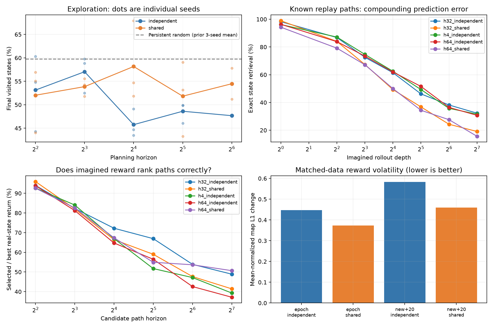
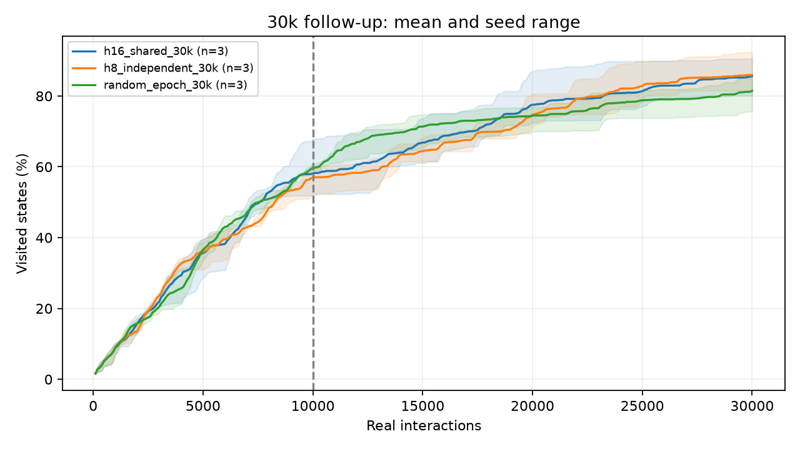

# Horizon and ensemble-data experiments

55 completed, audited runs. All use the same maze layout, 10,000 real interactions and center resets every 2,000 actions unless noted. Three initialization/action seeds are used for the main factorial.

Joint MSE dynamics + 0.01 repulsion, width 256 × three layers, eight unbounded latents, three independently initialized heads. Full replay epoch every ten actions for horizon experiments. Shared batches synchronize transition indices across heads; independent batches permute each epoch separately. Both see every replay transition once per epoch. Random-control streams isolate sampling from agent-induced changes in data.

Main horizon sweep: discount 0.99, 24 MCTS simulations per action, 10% persistent-random epsilon. Horizon changes hold simulation count fixed, not total model evaluations or wall time. The prior horizon-4 baseline used discount 0.9, so compare horizons within this sweep.

## Exploration and fitting

| Condition | Seeds | Coverage mean (range) | Coverage AUC | Seen next-state accuracy | Seen disagreement | Collection minutes |
|---|---:|---:|---:|---:|---:|---:|
| epoch_independent | 3 | 59.8% (58.3%–60.7%) | 33.4% | 90.7% | 1.95e-05 | 5.4 |
| epoch_shared | 3 | 59.8% (58.3%–60.7%) | 33.4% | 89.7% | 1.54e-05 | 8.1 |
| h16_independent | 3 | 45.8% (43.5%–49.1%) | 30.0% | 95.2% | 2.51e-05 | 20.3 |
| h16_independent_s96 | 3 | 46.6% (43.9%–48.0%) | 27.5% | 94.8% | 2.99e-05 | 45.7 |
| h16_shared | 3 | 58.2% (51.8%–67.9%) | 33.6% | 94.8% | 1.31e-05 | 19.9 |
| h16_shared_30k | 3 | 85.6% (80.1%–90.9%) | 60.6% | 99.6% | 1.35e-06 | 65.6 |
| h32_independent | 3 | 48.6% (46.1%–49.9%) | 29.8% | 95.1% | 2.47e-05 | 33.8 |
| h32_independent_shoot256 | 3 | 42.8% (33.4%–51.1%) | 27.8% | 95.0% | 2.06e-05 | 15.0 |
| h32_shared | 3 | 51.8% (43.3%–59.1%) | 33.1% | 96.2% | 1.38e-05 | 32.7 |
| h4_independent | 3 | 53.1% (44.3%–60.3%) | 31.6% | 94.7% | 2.08e-05 | 8.7 |
| h4_shared | 3 | 52.0% (44.1%–57.0%) | 30.0% | 93.4% | 1.6e-05 | 8.7 |
| h64_independent | 2 | 47.7% (47.5%–47.8%) | 28.9% | 94.8% | 1.68e-05 | 63.4 |
| h64_shared | 2 | 54.5% (51.2%–57.8%) | 33.7% | 95.6% | 1.25e-05 | 63.8 |
| h8_independent | 3 | 57.0% (52.5%–59.8%) | 32.8% | 93.9% | 2.06e-05 | 13.0 |
| h8_independent_30k | 3 | 85.9% (81.6%–92.3%) | 59.7% | 98.9% | 2.16e-06 | 50.3 |
| h8_shared | 3 | 53.9% (51.8%–55.5%) | 32.9% | 92.8% | 1.3e-05 | 13.4 |
| new_then_replay_independent | 3 | 59.8% (58.3%–60.7%) | 33.4% | 76.7% | 2.16e-05 | 3.7 |
| new_then_replay_shared | 3 | 59.8% (58.3%–60.7%) | 33.4% | 75.8% | 1.59e-05 | 3.4 |
| random_epoch_30k | 3 | 81.4% (75.6%–85.8%) | 60.5% | 99.3% | 2e-06 | 34.4 |

## Rollout faithfulness

Final frozen models, 96 sampled reset-free replay trajectories per run. Every edge on these paths has been observed. Open-loop mean predictions are decoded by nearest latent among all 1,784 reachable states; the oracle catalogue is evaluation-only. Accuracy is exact coordinate retrieval, not latent-distance thresholding. Position error is Euclidean distance in units of one 0.25-unit action and ignores walls.

| Condition | Exact @4 | @16 | @32 | @64 | @128 | Mean position error @32 | @128 |
|---|---:|---:|---:|---:|---:|---:|---:|
| epoch_independent | 84.0% | 63.9% | 37.2% | 30.2% | 22.6% | 1.65 | 4.79 |
| epoch_shared | 80.6% | 52.1% | 31.9% | 25.0% | 15.6% | 1.86 | 6.06 |
| h16_independent | 91.3% | 73.6% | 57.3% | 46.9% | 35.1% | 0.96 | 3.12 |
| h16_independent_s96 | 93.1% | 66.0% | 53.5% | 45.1% | 40.6% | 1.26 | 3.82 |
| h16_shared | 84.7% | 58.3% | 41.0% | 27.1% | 21.9% | 1.42 | 4.84 |
| h16_shared_30k | 99.3% | 96.5% | 88.5% | 76.7% | 55.2% | 0.44 | 2.60 |
| h32_independent | 86.8% | 61.5% | 46.2% | 38.2% | 32.3% | 1.30 | 3.88 |
| h32_independent_shoot256 | 89.2% | 66.3% | 49.0% | 41.0% | 28.8% | 1.10 | 3.98 |
| h32_shared | 84.0% | 49.3% | 36.8% | 24.3% | 19.1% | 1.61 | 5.55 |
| h4_independent | 87.2% | 62.5% | 49.3% | 35.8% | 31.6% | 1.40 | 4.54 |
| h4_shared | 87.2% | 60.1% | 44.4% | 37.8% | 27.8% | 1.45 | 4.86 |
| h64_independent | 83.9% | 62.0% | 51.6% | 36.5% | 30.7% | 1.39 | 4.10 |
| h64_shared | 79.2% | 50.0% | 34.4% | 27.6% | 15.6% | 1.48 | 4.66 |
| h8_independent | 85.8% | 60.8% | 44.1% | 33.7% | 23.6% | 1.40 | 4.59 |
| h8_independent_30k | 99.0% | 89.2% | 78.8% | 66.7% | 47.9% | 0.95 | 3.38 |
| h8_shared | 86.5% | 52.1% | 32.3% | 20.1% | 10.1% | 1.86 | 5.89 |
| new_then_replay_independent | 54.2% | 17.7% | 6.6% | 4.5% | 2.1% | 3.75 | 7.97 |
| new_then_replay_shared | 52.8% | 16.0% | 6.9% | 2.1% | 3.1% | 3.82 | 8.48 |
| random_epoch_30k | 99.0% | 97.9% | 93.1% | 86.1% | 76.0% | 0.16 | 1.65 |

## Does imagined reward select useful candidate paths?

16 visited starts × 64 persistent-random candidate sequences. Each sequence is scored with the same frozen ensemble twice: once along imagined mean latents and once along encoded true maze states reached by its actions. No true transitions enter planning. “Real-state return” here means model disagreement evaluated at true states, not environmental novelty or exploration gain. Selected/best measures the true-state return of the imagined-best candidate divided by the best candidate in that same bank.

| Condition | Selected/best @4 | @16 | @32 | @64 | @128 | Random/best @32 | Optimism @32 |
|---|---:|---:|---:|---:|---:|---:|---:|
| epoch_independent | 96.4% | 64.2% | 58.0% | 48.3% | 49.1% | 29.0% | 3.38× |
| epoch_shared | 93.2% | 66.7% | 62.1% | 51.5% | 45.8% | 27.8% | 2.12× |
| h16_independent | 93.6% | 73.3% | 52.5% | 47.2% | 45.3% | 28.9% | 4.47× |
| h16_independent_s96 | 94.1% | 76.5% | 64.1% | 55.3% | 48.4% | 34.3% | 3.42× |
| h16_shared | 93.6% | 66.4% | 59.7% | 50.7% | 52.5% | 34.1% | 3.08× |
| h16_shared_30k | 92.3% | 73.3% | 60.4% | 53.4% | 43.3% | 22.5% | 8.25× |
| h32_independent | 94.0% | 72.2% | 66.9% | 53.9% | 48.9% | 34.7% | 3.11× |
| h32_independent_shoot256 | 96.2% | 72.1% | 51.5% | 42.7% | 35.1% | 33.2% | 6.28× |
| h32_shared | 95.9% | 66.4% | 59.0% | 47.7% | 41.4% | 36.3% | 4.91× |
| h4_independent | 92.7% | 67.0% | 51.7% | 47.2% | 39.3% | 27.6% | 3.84× |
| h4_shared | 94.4% | 71.1% | 62.1% | 47.5% | 42.4% | 29.0% | 3.44× |
| h64_independent | 93.9% | 64.7% | 56.5% | 42.6% | 37.2% | 30.3% | 5.96× |
| h64_shared | 92.6% | 67.4% | 54.9% | 53.7% | 50.7% | 33.5% | 4.13× |
| h8_independent | 94.0% | 68.4% | 53.1% | 40.8% | 32.5% | 29.5% | 3.97× |
| h8_independent_30k | 96.1% | 70.4% | 53.6% | 40.7% | 37.9% | 26.0% | 8.76× |
| h8_shared | 91.5% | 66.3% | 50.6% | 48.6% | 44.5% | 31.6% | 5.02× |
| new_then_replay_independent | 96.1% | 81.3% | 70.7% | 67.2% | 60.0% | 38.6% | 1.63× |
| new_then_replay_shared | 93.5% | 75.0% | 63.5% | 53.3% | 47.9% | 39.0% | 2.90× |
| random_epoch_30k | 96.5% | 78.3% | 62.1% | 48.6% | 47.4% | 15.4% | 4.46× |

## Reward-map stability on identical random trajectories

Adjacent snapshots every 200 actions in the second half of training. Spatial L1 compares maps divided by their own mean (lower is more stable); rank correlation and top-decile Jaccard ignore overall reward scale (higher is more stable). This separates shape changes from latent/replay-normalization scale changes. Maps include all state-action pairs.

| Condition | Spatial L1 change | Rank correlation | Top-decile overlap | Raw scale log-change |
|---|---:|---:|---:|---:|
| epoch_independent | 0.447 | 0.758 | 0.605 | 0.086 |
| epoch_shared | 0.374 | 0.835 | 0.687 | 0.098 |
| new_then_replay_independent | 0.583 | 0.582 | 0.454 | 0.155 |
| new_then_replay_shared | 0.460 | 0.748 | 0.596 | 0.157 |

Verified identical replay arrays across all available random-control conditions for each seed (12 runs).

## Duration follow-up

The strongest 10k learned conditions (H8 independent, H16 shared) were selected for a 30k-action follow-up against persistent random, three seeds each. This adaptive selection is exploratory. Every completed 30k run is checked against its original 10k replay prefix. Reward snapshots are 600 rather than 200 actions apart, so duration-run stability statistics are excluded from the matched-data stability comparison above.

## Limitations and reproduction

Three seeds on one maze are exploratory evidence, not a broad benchmark. Final-checkpoint audits describe the final model; intermediate checkpoint audits are separate artifacts. Full replay training still weights repeated transitions by visit frequency. Shared data do not make the heads a calibrated posterior. Long-horizon random candidate banks diagnose model ranking, not exact MCTS optimality. Nearest-latent decoding can conceal or exaggerate model error; raw latent MSE, teacher-forced error, off-manifold distance and known-prefix fractions are retained in JSON.

Raw runs include configurations, source hashes/snapshots, checkpoints every 2,000 actions, replay, and reward snapshots. Each `overnight-audit.json` contains fitting, rollout, candidate-ranking and temporal-stability measurements. Run manifests in `configs/horizon_*.json` and `configs/ensemble_matched.json` with `scripts/run_probabilistic_sweep.py`; audit with `scripts/postprocess_horizon.py`; regenerate this report with `scripts/report_horizon.py`.
