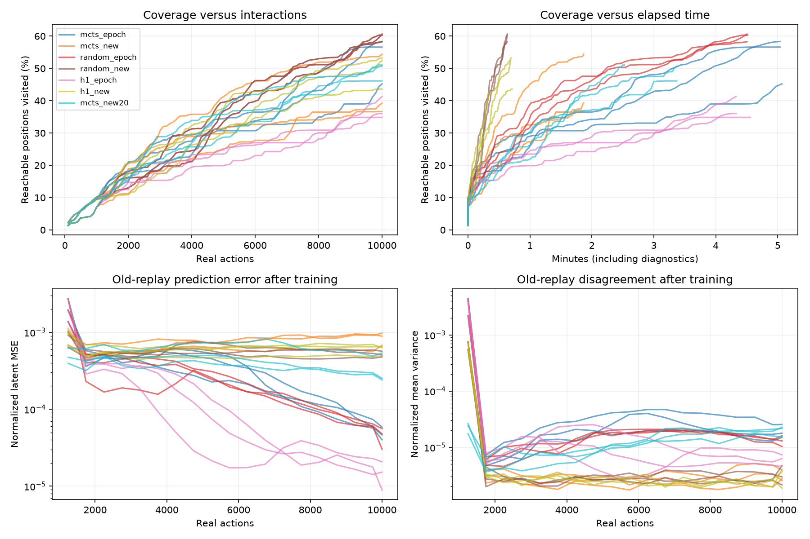
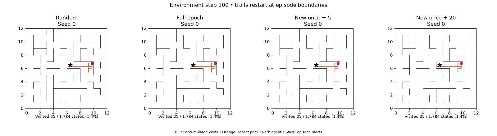

# Online exploration with the joint MSE model — 2026-11-09

Fresh three-layer width-256 encoder and three dynamics members, eight unbounded latents. Joint mean MSE + 0.01 hinge repulsion. Constant dynamics LR 3e-4 and encoder LR 9e-5. No actor, frozen representation, coordinate target, reconstruction, state codebook, or oracle guidance.

Three seeds per condition, 10k real actions each, the same 12×12 maze, center resets every 2,000 actions, and 1,000 persistent-random warmup actions. Full epochs replace the original replay updates. New-once explicitly trains all new transitions, then takes five random replay updates. All raw transitions remain in replay; repeated visits retain their weighting. This differs from unique-edge sampling and cosine decay in the fixed-dataset memorization tests.

MCTS replans after every real action. Reward is ensemble variance of predicted means normalized by replay latent variance. Rollouts follow the deterministic ensemble mean. Horizon 4, 24 simulations, discount 0.9, epsilon 0.1 unless noted in a variant. UCT bonus is scaled to root maximum reward times the discounted horizon sum to remain commensurate with small MSE rewards. Gaussian variance outputs do not enter reward or rollouts.

**Finding:** replay cadence strongly changes retained prediction accuracy, but improved fitting does not yet beat persistent-random exploration. On identical random-control trajectories, full epochs achieve 90.7% seen-edge accuracy versus 56.4% for new-once + 5. The worse-fitting ensemble has about 4.2× less disagreement, showing that agreement alone is not a reliable fitting/convergence criterion.

The four-step MCTS full-epoch runs have local untried-action AUROC 0.46–0.52 at the final checkpoint. This is evidence that the current reward does not reliably distinguish untried actions at visited states; it is not proof that all untried actions should be uncertain, nor a causal explanation of every online action.



## Results

Means across seeds. Coverage is exact reachable-position coverage (1,784 positions); AUC is mean coverage across the action budget. Accuracy is evaluation-only nearest-latent next-position retrieval. Seen accuracy weights observed state-actions uniformly, not by visit count.

| Condition | Final coverage (range) | Coverage AUC | Updates | Elapsed min | Seen accuracy | Unseen accuracy | Seen disagreement | Unseen disagreement |
|---|---:|---:|---:|---:|---:|---:|---:|---:|
| mcts_epoch | 53.4% (45.2–58.4) | 29.9% | 39,158 | 5.05 | 92.8% | 70.5% | 2.03e-05 | 0.000244 |
| mcts_new | 43.5% (36.7–54.4) | 28.9% | 5,413 | 1.87 | 58.1% | 62.6% | 3.1e-06 | 8.6e-06 |
| random_epoch | 59.8% (58.3–60.7) | 33.4% | 39,158 | 4.51 | 90.7% | 73.1% | 1.95e-05 | 8.79e-05 |
| random_new | 59.8% (58.3–60.7) | 33.4% | 5,413 | 0.63 | 56.4% | 63.1% | 3.8e-06 | 4.56e-06 |
| h1_epoch | 37.4% (34.9–41.3) | 22.0% | 39,158 | 4.40 | 94.5% | 56.0% | 9.15e-06 | 0.000299 |
| h1_new | 49.8% (43.6–53.3) | 30.8% | 5,413 | 0.70 | 55.1% | 63.1% | 3.46e-06 | 4.99e-06 |
| mcts_new20 | 49.3% (46.1–51.1) | 30.8% | 18,928 | 3.09 | 80.8% | 65.3% | 2.17e-05 | 4.87e-05 |

## Immediate effect of training

Pre → post means over the last 100 training events per run; identical diagnostic samples before and after each event. Disagreement is normalized mean variance, not JS divergence.

| Condition | New-transition MSE | Old-replay MSE | New-transition disagreement | Old-replay disagreement |
|---|---:|---:|---:|---:|
| mcts_epoch | 0.000271 → 0.000194 | 7.02e-05 → 6.98e-05 | 5.31e-05 → 3.07e-05 | 1.99e-05 → 2e-05 |
| mcts_new | 0.00068 → 0.000446 | 0.000812 → 0.000812 | 3.94e-06 → 3.18e-06 | 3.49e-06 → 3.5e-06 |
| random_epoch | 0.000229 → 0.00018 | 6.47e-05 → 6.44e-05 | 2.16e-05 → 2.17e-05 | 1.4e-05 → 1.39e-05 |
| random_new | 0.000339 → 0.000201 | 0.00053 → 0.00053 | 2.65e-06 → 2.61e-06 | 2.83e-06 → 2.84e-06 |
| h1_epoch | 0.000264 → 0.00016 | 1.95e-05 → 1.93e-05 | 3.37e-05 → 1.7e-05 | 6.6e-06 → 6.44e-06 |
| h1_new | 0.000536 → 0.00032 | 0.000606 → 0.000607 | 2.84e-06 → 2.36e-06 | 2.33e-06 → 2.33e-06 |
| mcts_new20 | 0.00047 → 0.00027 | 0.000369 → 0.000369 | 3.31e-05 → 2e-05 | 1.89e-05 → 1.88e-05 |

## Does disagreement rank untried actions highly?

AUROC ranks untried actions against tried actions; 0.5 is chance, 1 is perfect ranking. The local score restricts both groups to physically visited states, avoiding an easy separation of faraway unseen states. These are final-checkpoint diagnostics, not a causal explanation of every online decision. A well-generalized action need not be uncertain merely because it was untried.

| Condition | Unseen-edge AUROC | Local untried-action AUROC | Stationary real steps | Action switches |
|---|---:|---:|---:|---:|
| mcts_epoch | 0.611 | 0.486 | 0.467 | 0.372 |
| mcts_new | 0.682 | 0.503 | 0.510 | 0.264 |
| random_epoch | 0.593 | 0.499 | 0.592 | 0.161 |
| random_new | 0.536 | 0.458 | 0.592 | 0.161 |
| h1_epoch | 0.801 | 0.587 | 0.516 | 0.330 |
| h1_new | 0.584 | 0.472 | 0.552 | 0.179 |
| mcts_new20 | 0.616 | 0.453 | 0.462 | 0.321 |

## Matched-data control and interpretation

The paired random-epoch and random-new runs were verified to have identical actions, observations and positions for each seed. With the data stream held fixed, their final replay normalized MSE is 5.87e-5 versus 5.30e-4, while disagreement is 1.35e-5 versus 3.23e-6. Physical seen-edge accuracy is 90.7% versus 56.4%. Restricting the retrieval catalogue to visited states changes these accuracies only to 90.8% and 56.5%, so unvisited catalogue points do not explain the fitting gap.

These online fits do not retain the ≥98% memorization level demonstrated on a fixed dataset. Raw replay frequency weighting, continual target drift and constant learning rates differ from that offline setup. We have not isolated which change is responsible. Full epochs improve fitting substantially; they do not establish that fitting is solved.

## Exploration replay

Seed 0 at matched interaction counts. This single-seed animation illustrates behavior; aggregate conclusions use all three seeds.



## Limits / artifacts

This is one deterministic coordinate-observation maze. Online trajectories differ between policies, so end-of-run fitting is not a fixed-data comparison. Final seen/unseen sets differ by trajectory. Latent MSE changes units with the encoder; physical retrieval is a common readout, not an optimal decoder. Runs use three concurrent workers, so wall times are observed costs rather than isolated throughput benchmarks.

The horizon-1 and new-once + 20 comparisons were chosen adaptively after inspecting initial results. They share seeds and layout; they are diagnostic follow-ups, not untouched validation. Several concurrent workers share the machine, including overlapping adaptive runs, which further limits throughput comparisons.

[Portable numeric results](assets/joint-exploration-results.json) include per-run metrics and per-member accuracies. Raw configurations, source snapshots, weights, replay and diagnostics are under the run directories. The primary manifest is `configs/joint_exploration_cadence.json`; the base model/planner configuration is `configs/joint_exploration_base.json`.


## Reproduction

```bash
MPLCONFIGDIR=/tmp/map-live-mpl .venv/bin/python scripts/run_probabilistic_sweep.py --manifest configs/joint_exploration_cadence.json --out runs/joint-exploration-cadence-20261109 --jobs 3
MPLCONFIGDIR=/tmp/map-live-mpl .venv/bin/python scripts/run_probabilistic_sweep.py --manifest configs/joint_exploration_horizon1.json --out runs/joint-exploration-horizon1-20261109 --jobs 2
MPLCONFIGDIR=/tmp/map-live-mpl .venv/bin/python scripts/run_probabilistic_sweep.py --manifest configs/joint_exploration_new20.json --out runs/joint-exploration-new20-20261109 --jobs 2
.venv/bin/python scripts/evaluate_next_state_retrieval.py --summaries runs/joint-exploration-cadence-20261109/summary.json runs/joint-exploration-horizon1-20261109/summary.json runs/joint-exploration-new20-20261109/summary.json --out runs/joint-exploration-cadence-20261109/retrieval.json
.venv/bin/python scripts/analyze_exploration_uncertainty.py --summaries runs/joint-exploration-cadence-20261109/summary.json runs/joint-exploration-horizon1-20261109/summary.json runs/joint-exploration-new20-20261109/summary.json --out runs/joint-exploration-cadence-20261109/calibration.json
MPLCONFIGDIR=/tmp/map-live-mpl .venv/bin/python scripts/report_joint_exploration.py --runs runs/joint-exploration-cadence-20261109 runs/joint-exploration-horizon1-20261109 runs/joint-exploration-new20-20261109 --retrieval runs/joint-exploration-cadence-20261109/retrieval.json --calibration runs/joint-exploration-cadence-20261109/calibration.json --out docs/joint-exploration.md
MPLCONFIGDIR=/tmp/map-live-mpl .venv/bin/python scripts/animate_exploration.py runs/joint-exploration-cadence-20261109/random_epoch-seed0 runs/joint-exploration-cadence-20261109/mcts_epoch-seed0 runs/joint-exploration-cadence-20261109/mcts_new-seed0 runs/joint-exploration-new20-20261109/mcts_new20-seed0 --labels "Persistent random" "MCTS: full epoch" "MCTS: new + 5" "MCTS: new + 20" --end 10000 --stride 50 --out runs/joint-exploration.gif
```
