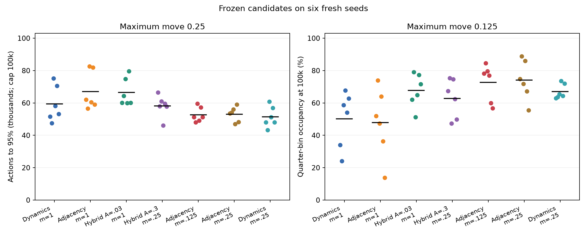
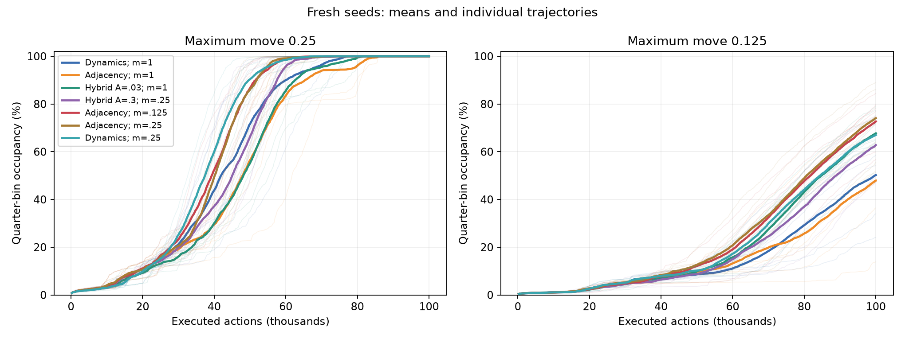
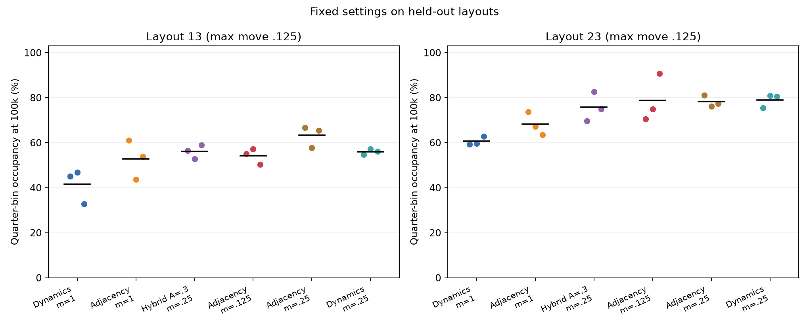
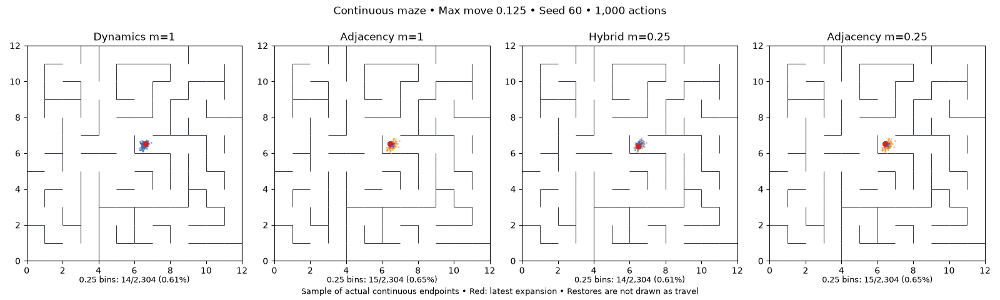
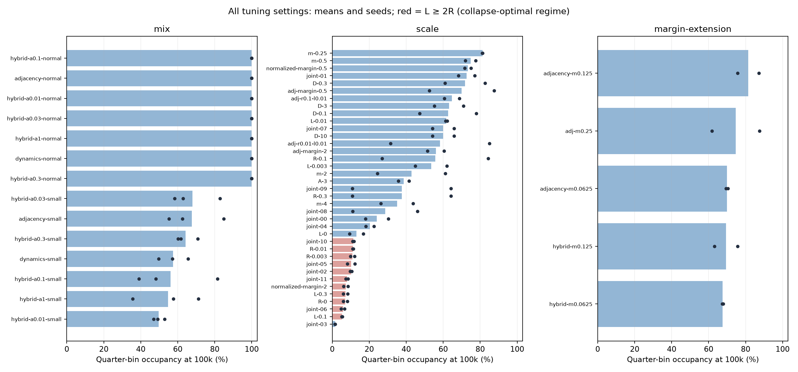
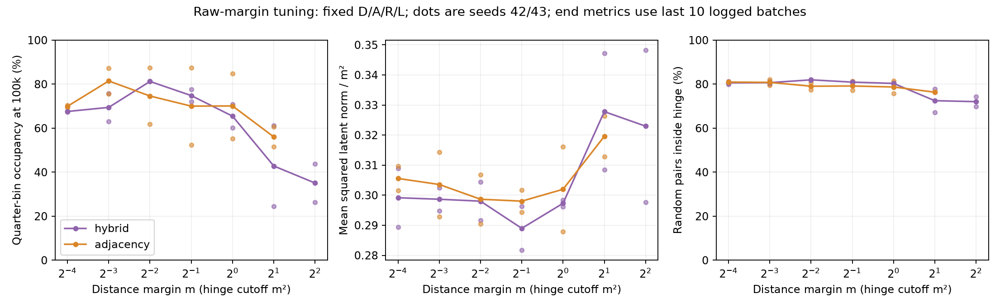

# Joint dynamics/adjacency objectives and loss-scale sweeps

Completed November 11, 2026: **246 full runs, 24.6 million executed actions**. Smaller repulsion margins give the clearest reliable gain. Combining dynamics and adjacency can help the old baseline, but the selected hybrid underperforms pure adjacency with identical regularizers on every fresh small-step seed and five of six additional-layout runs. The original defaults remain unchanged.

## Fresh-seed results

Candidates were frozen before inspecting seeds 60–65. Every entry uses the same six seeds, initial networks, proposed controls, successor-noise streams and training budget. Main coverage is occupancy of 2,304 quarter-width bins. “Small” is maximum move .125; “normal” is .25. R=L=.03 throughout this table; pure adjacency A=.3, pure dynamics D=1, hybrids D=1.

| Objective | Small-step coverage at 100k | Seed range | Normal-step actions to 95% |
|---|---:|---:|---:|
| Dynamics, m=1 | 50.2% | 24.0–67.8% | 59,354 |
| Adjacency, m=1 | 47.9% | 13.9–73.9% | 67,088 |
| Hybrid A=.03, m=1 | 67.7% | 51.3–79.0% | 66,514 |
| Hybrid A=.3, m=.25 | 62.8% | 47.3–75.3% | 58,165 |
| Adjacency, m=.125 | 72.7% | 56.8–84.5% | 52,738 |
| Adjacency, m=.25 | 74.0% | 55.5–88.9% | 52,985 |
| Dynamics, m=.25 | 67.0% | 63.0–73.7% | 51,383 |

All 42 normal-step validation runs reach 95%; none of the 42 small-step runs reaches 95% by 100k. Thus the small-step result is better coverage at a fixed budget, not completed exploration.

**Margin change within pure adjacency:** m=1→.25 raises small-step coverage 47.9→74.0%, a paired gain of 26.1 percentage points, winning 6/6. The exploratory seed-bootstrap 95% interval is +20.0 to +33.3 points. Normal-step actions to 95% fall 67,088→52,985 (21.0% fewer), winning 6/6. With pure dynamics, the same margin change raises small-step coverage 50.2→67.0% and reduces normal-step cost 59,354→51,383, also winning 6/6 in each comparison.

**Combining alone:** D=1,A=.03,m=1 raises small-step coverage to 67.7%, versus 47.9% for the original adjacency baseline and 50.2% for original dynamics. It is slower than original dynamics on normal movements. This is useful evidence that mixing can help in some regimes, not a universal advantage.

**Matched comparison:** the selected hybrid D=1,A=.3,m=.25 reaches 62.8%, versus 74.0% when the dynamics contribution to the encoder is removed while retaining A/R/L/m. Pure adjacency wins 6/6; the hybrid-minus-adjacency difference is −11.2 points, exploratory interval [−17.2,−6.7]. The hybrid is also slower on normal movements, winning only 1/6 against the matched adjacency control. Its 81.2% tuning mean did not transfer to fresh seeds. The tuned pure-adjacency margin .125 gives 72.7%, close to the .25 control; there is no evidence for a uniquely optimal exact margin.

All intervals are exploratory, conditional on one maze, and uncorrected for multiple comparisons. Candidate selection, accidental duplicate handling, and every failed setting are retained in the [protocol](joint-loss-protocol.md) and [frozen selection](../configs/joint-loss-selected-20261111/selection.json).





## Additional layouts

No retuning. Layouts 13/23, seeds 66–68, small movements; each entry is a mean over three seeds. These layouts were excluded from this study's selection, though they appeared in prior studies.

| Objective | Layout 13 | Layout 23 |
|---|---:|---:|
| Dynamics, m=1 | 41.6% | 60.6% |
| Adjacency, m=1 | 52.8% | 68.2% |
| Hybrid A=.3, m=.25 | 56.1% | 75.7% |
| Adjacency, m=.125 | 54.2% | 78.7% |
| Adjacency, m=.25 | 63.3% | 78.2% |
| Dynamics, m=.25 | 56.0% | 79.0% |

Margin 1→.25 improves each pure objective on all six matched seed-layout runs. The hybrid loses to matched pure adjacency 5/6; its average difference is −7.2 points on layout 13 and −2.5 on layout 23. Only two layouts are represented, with repeated model seeds across them. The original-margin A=.03 hybrid was not evaluated on these additional layouts.



For the next small-step frontier experiment, pure adjacency with A=.3,R=L=.03,m=.25 is a sensible working setting. Dynamics with m=.25 remains a useful comparator, especially for normal movements. This is a recommendation from the tested settings, not an exhaustive optimum.

## Animation

Seed 60 was fixed before reading confirmation outcomes. The last two panels compare the hybrid and pure adjacency at the same margin .25. All panels run through 100k actions; dots are a fixed subsample of actual continuous endpoints, counts use all endpoints, and simulator restores are not drawn as movement.



## Objective and controls

The encoder minimizes

```
D * E mean_coordinates (g_h(z,a)-z')²
+ A * E ||z-z'||²
+ R * E [m²-||zu-zv||²]+
+ L * E ||z||².
```

`z=f(o)` and `z'=f(o')` are the observed transition endpoints; `z_u,z_v` are independent replay-state samples. `[x]+` means `max(x,0)`, and `h` indexes the dynamics ensemble. Dynamics MSE is also averaged over ensemble members; adjacency and norm terms sum coordinates. Both endpoint encodings get gradients. D=1/A=0 is the historical dynamics baseline. D=0/A=.3 is the historical adjacency baseline, with detached auxiliary dynamics fitted only for diagnostics. Hybrid training differentiates both dynamics and adjacency through the encoder. No learned actor or imagined planning is added; exploration still uses real simulator restores and nearest-expanded-latent priority.

Architecture, noisy coordinate inputs, action proposals, replay cadence and budgets match the previous continuous study. Every run has 100k actions, 4,112 updates and 1,050,000 transition presentations per head. Coverage bins are evaluation only. No latent/physical merging or clean-noise training pairs are used.

## What was swept

Mixing screen: both maximum move sizes .25/.125, three tuning seeds 42–44, A=.01/.03/.1/.3/1 with D=1, plus both pure baselines. R=L=.03, m=1.

The smaller-step coefficient stage independently explores D=.1/.3/1/3/10 (and the pure-adjacency endpoint), A from .01 to 3 across both stages, R=0/.003/.01/.03/.1/.3, L=0/.003/.01/.03/.1/.3, and margins m=.0625/.125/.25/.5/1/2/4. It includes 12 balanced joint combinations and pure-adjacency controls. These are staged sweeps, not the full Cartesian product. All configurations and failed settings are retained.

Two normalized-hinge controls set R=.03/m² so the maximum repulsion contribution stays constant when m changes. This changes relative loss weighting and must be interpreted separately from varying m alone.

## Two useful analytical checks

**Collapse boundary.** For independent replay samples with latent law Z, expected pairwise squared distance is twice the trace variance. Since `[m²-d²]+ >= m²-d²`, the regularizers obey

```
R * E[m²-||Z-Z'||²]+ + L * E||Z||²
>= R*m² + (L-2R)*Var(Z) + L*||E Z||².
```

Dynamics and adjacency costs are nonnegative and can both vanish at the zero representation. Therefore **L>=2R makes collapse a global optimum**, though not necessarily unique at equality. Finite optimization need not reach that optimum. This prediction was recorded before the relevant sweep arms finished.

**Margin is also a choice of units.** For this identity-output encoder, the transformed functions `f_m=m*f` and `g_m(z,a)=m*g(z/m,a)` are realizable by rescaling a few affine layers. At margin m, all four losses become m² times their margin 1 values, and Euclidean queue order is preserved. A trained-checkpoint audit verifies this at m=.25/.5/2/4. Thus a margin improvement can reflect optimization, initialization, clipping or finite capacity/training effects; it does not establish a uniquely correct semantic neighborhood radius. Fixed-initialization Adam training is not invariant under this change of units. [Static audit](assets/joint-margin-units.json).


## What the sweep and saved models explain

The tuning stage includes 47 distinct small-step objective/coefficient settings: dynamics/adjacency endpoints, mixing strengths, all four coefficients, raw hinge margins, normalized-hinge controls, and joint combinations. It is not a full Cartesian grid. There are 126 tuning jobs: 42 mixing, 74 coefficient and 10 bounded margin-extension jobs. Two coefficient-stage arms accidentally duplicate other settings on both seeds; all four repeated runs reproduce the original replay and final weights exactly and receive no extra statistical weight.

Margins .0625/.125 were a final bounded extension after .25 was best at the original boundary. Smaller was not monotonically better. The pure-adjacency tuning winner was m=.125; the hybrid winner m=.25. Their matched pure-objective controls were specified before unblinding. The fresh results show why the tuning winner alone was insufficient.



Removing L2 performs poorly (hybrid final coverage 16.8/9.3% on tuning seeds). High L2 or insufficient repulsion produces near-zero latents and poor coverage, consistent with the collapse bound above. High repulsion is not automatically better: R=.1 gives 84.3% on one tuning seed but 27.0% on the other. A strong adjacency coefficient 3 also performs poorly. Coefficients interact; tuning a single promising seed would be misleading.



The historical 1 in repulsion is m²: m=.25 replaces it with .0625; m=.125 replaces it with .015625. Latent squared norm tracks m² closely, while roughly 80% of sampled random pairs remain inside the hinge at small margins. Repulsion is traded against adjacency/dynamics and L2; it is not expected to reach zero.

A stronger timing check is possible: **all twelve matched pure-objective margin 1/.25 pairs have bit-identical encoder and dynamics checkpoints through 25k actions.** Their real trajectories first diverge at about 27k–35.5k actions, around the first logged minibatches with pairs beyond the smaller hinge cutoff. As long as every sampled pair remains inside both hinges, changing m merely adds a constant to the loss and leaves its gradients unchanged. Thus these gains are not an initial-parameter advantage or a different exploration prefix. The cutoff changes subsequent optimization and then the collected data. Logging samples only the last batch of each training event, so it does not locate the exact first divergent gradient step. [Prefix audit](assets/joint-loss-margin-prefix.json).

Fixed physical probes at 25k/100k evaluate fresh nuisance draws without entering replay. At 100k:

| Objective | Noise / moving-transition RMS | Centroid-distance Spearman versus xy | Top-2 centroid variance |
|---|---:|---:|---:|
| Dynamics, m=1 | 0.741 | 0.750 | 88.04% |
| Adjacency, m=1 | 0.606 | 0.792 | 96.91% |
| Hybrid A=.03, m=1 | 0.707 | 0.904 | 89.91% |
| Hybrid A=.3, m=.25 | 0.673 | 0.941 | 98.03% |
| Adjacency, m=.125 | 0.774 | 0.979 | 99.99% |
| Adjacency, m=.25 | 0.705 | 0.977 | 99.99% |
| Dynamics, m=.25 | 0.825 | 0.955 | 99.73% |

Smaller margins yield centroid distances much more correlated with physical Euclidean distance, despite **worse** noise/transition ratios in both pure objectives. The ratio denominator includes fresh observation noise as well as physical movement, so it is not a pure signal-to-noise estimate. Centroids average 16 noise draws; this can hide per-observation noise. Distances and spectra use the full 8D representation. These online runs have different replay after divergence, so the probes do not isolate an objective-only causal mechanism. They support improved spatial shape, not learned geodesic distances or proof that geometry alone causes the queue gain. Pure global rescaling cannot change queue order.

## Validation and accounting

All 246 jobs exit 0. Total 1,011,552 gradient updates and 258,300,000 transition presentations per head. Every run has 100k collection actions, 4,112 updates and 1,050,000 presentations per head: one replay epoch per 5k actions, apportioned causally across training events every 500 actions. No run receives a larger optimization budget because of its loss.

Independent audits reconstruct coverage from all real endpoints, check sampled transitions against maze physics, continuous controls, observed coordinates, checkpoint initialization, matched full action/noise streams, training budgets, and exact duplicate reproducibility. **102 tests pass**; figures and initial/middle/final animation frames were inspected. Raw checkpoints and prior uncommitted work are preserved; no commit was made.

[Accounting and pairing](assets/joint-loss-accounting.json), [tuning results](assets/joint-loss-tuning-results.json), [fresh effects](assets/joint-loss-confirm-effects.json), [layout effects](assets/joint-loss-layout-effects.json), [baseline probes](assets/joint-loss-baseline-probes.json), [selected probes](assets/joint-loss-selected-probes.json). Individual stage audit files are named `docs/assets/joint-loss-<stage>-audit.json`. `report_joint_confirmation.py`, `report_joint_loss.py`, `plot_joint_margin.py` and `render_continuous_study.py` reproduce the figures.

## Individual fresh small-step seeds

| Objective | Seed 60 | 61 | 62 | 63 | 64 | 65 |
|---|---:|---:|---:|---:|---:|---:|
| Dynamics, m=1 | 34.0% | 24.0% | 58.6% | 67.8% | 54.1% | 62.7% |
| Adjacency, m=1 | 51.9% | 73.9% | 47.3% | 64.1% | 36.4% | 13.9% |
| Hybrid A=.03, m=1 | 62.1% | 79.0% | 51.3% | 64.8% | 77.4% | 71.7% |
| Hybrid A=.3, m=.25 | 67.4% | 75.3% | 47.3% | 74.7% | 62.4% | 49.8% |
| Adjacency, m=.125 | 78.2% | 84.5% | 79.7% | 77.0% | 59.9% | 56.8% |
| Adjacency, m=.25 | 74.9% | 88.9% | 71.7% | 86.0% | 67.3% | 55.5% |
| Dynamics, m=.25 | 63.0% | 63.7% | 65.4% | 73.7% | 64.4% | 72.0% |

## Reproduction and implementation

```sh
# Pure adjacency with the margin that worked well across the confirmation sets.
.venv/bin/python scripts/continuous_frontier.py --objective adjacency \
  --adjacency-weight .3 --repulsion-weight .03 --latent-l2 .03 \
  --repulsion-margin .25 --step-size .125 --seed 60 \
  --out runs/reproduce-adjacency-margin025

# Hybrid selected from tuning, small-movement case; choose a new output directory.
.venv/bin/python scripts/continuous_frontier.py --objective hybrid \
  --dynamics-weight 1 --adjacency-weight .3 --repulsion-weight .03 \
  --latent-l2 .03 --repulsion-margin .25 --step-size .125 \
  --seed 60 --out runs/reproduce-joint-hybrid

# Frozen candidate confirmation, both movement scales.
.venv/bin/python scripts/run_continuous_study.py \
  --arms configs/joint-loss-selected-20261111/confirm-arms.json \
  --seeds 60 61 62 63 64 65 --workers 4 \
  --out runs/reproduce-joint-confirm
```

All eight stage roots begin `runs/joint-loss-` and end `-20261111`: `mix`, `scale`, `margin-extension`, `confirm-controls`, `confirm-mix`, `confirm-selected`, `layout-controls`, `layout-selected`. The first five and layout controls have corresponding top-level config manifests; frozen candidate manifests live in `configs/joint-loss-selected-20261111`. Every run saves its config, source snapshot, initial/intermediate/final checkpoints, replay, frontier, progress, training diagnostics and completion status. Output directories are immutable: reruns need new names.

`TrainConfig.dynamics_weight` and `adjacency_weight` expose the combination through the existing deterministic trainer. Defaults are unchanged (1 and 0). The continuous driver additionally exposes repulsion weight, L2 and distance margin. Tests check the exact weighted arithmetic, encoder-versus-dynamics gradient effects, checkpoint continuation and squared-margin convention. A full all-coefficient Cartesian product was not attempted: the design combines one-factor sweeps, balanced joint settings, endpoints and targeted controls.

Coverage means occupancy of finite bins by real observed endpoints, not coverage of every point in a continuum. The agent never sees these bins. Inputs are coordinates plus nuisance variables, not pixels. Exact simulator restores remain privileged. The study changes representation learning, not the frontier search rule, and establishes no result for an imagined planner, unreliable resets or reset-free exploration.
