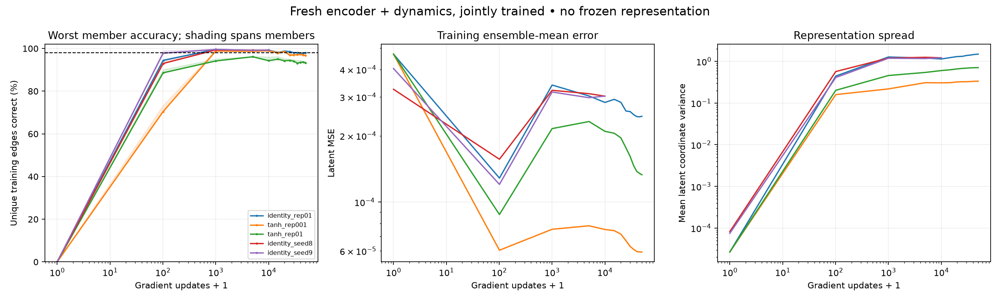

# Joint memorization above 98% — 2026-11-09

The learned joint setup exceeds the target: both fresh confirmation seeds reach above 99.2% training accuracy in **every ensemble member** after 10k updates. Saved-weight re-evaluation reproduces the scores, with no exact collisions among the 762 observed-state latents. No fixed-coordinate encoder, frozen targets, codebook or lookup-table predictor is used.



## Recipe

- Encoder: 2 inputs → three width-256 SiLU hidden layers → 8 unconstrained outputs (134,408 parameters).
- Three residual dynamics members: latent + one-hot action → three width-256 SiLU layers → Gaussian parameter outputs (139,537 parameters/member, 418,611 total). MSE trains their means; variance outputs are unused by this objective.
- Both networks are initialized fresh and jointly optimized throughout. Encoder gradients flow through both source and successor branches.
- Loss: average per-member mean-prediction MSE + **0.01 × hinge repulsion**, with margin 1. Repulsion pairs come from training endpoints; no target latent layout is specified.
- Adam: dynamics LR 3e-4, encoder LR 9e-5; both cosine-decay to 1/30 of their initial rates. Independent shuffled passes through all unique observed edges, batch 128, keeping partial batches.
- Dataset: the same 10k-transition replay as previous experiments, containing 2,606 unique training edges and 762 states. Configuration is read from the old checkpoint, but neither encoder nor dynamics weights are reused.
- Initial seed-7 screen used 50k updates. Two confirmation seeds (8, 9) used a 10k budget and correspondingly shortened cosine schedule. This is adaptive model development on one dataset, not a pre-registered evaluation.

## Verified final results

Accuracy is nearest-latent next-position retrieval against the complete evaluation-only maze catalogue. It is not zero continuous residual error. Each training edge has equal weight. Unseen accuracy uses 1,024 state-actions absent from fitting, sampled independently of training.

| Run | Updates | Member 1 | Member 2 | Member 3 | All members correct together | Unseen ensemble | Pass ≥98% each |
|---|---:|---:|---:|---:|---:|---:|---|
| identity_rep01 | 50,000 | 97.93% | 98.04% | 97.93% | 97.39% | 90.23% | no |
| tanh_rep001 | 50,000 | 96.70% | 97.35% | 97.20% | 96.28% | 85.25% | no |
| tanh_rep01 | 50,000 | 93.98% | 93.71% | 93.25% | 91.63% | 70.51% | no |
| identity_seed8 | 10,000 | 99.27% | 99.23% | 99.23% | 99.23% | 95.41% | yes |
| identity_seed9 | 10,000 | 99.31% | 99.27% | 99.27% | 99.27% | 96.29% | yes |

## Latent geometry / repulsion

Computed exactly over training-endpoint pairs using their sampling frequencies, including identical states. Distinct-state mean distance weights the 762 unique states uniformly. The identical-state floor is the unavoidable contribution from sampling the same state twice.

| Run | Latent variance | Minimum distinct-state distance | Mean distinct-state distance | Moving-edge distance | Repulsion | Identical-state floor |
|---|---:|---:|---:|---:|---:|---:|
| identity_rep01 | 1.7250 | 0.0235 | 4.6733 | 0.1981 | 0.0327 | 0.0016 |
| tanh_rep001 | 0.3651 | 0.0070 | 2.1846 | 0.0880 | 0.0928 | 0.0016 |
| tanh_rep01 | 0.7549 | 0.0034 | 3.2689 | 0.2015 | 0.0319 | 0.0016 |
| identity_seed8 | 1.3183 | 0.0429 | 4.1079 | 0.1719 | 0.0397 | 0.0016 |
| identity_seed9 | 1.3181 | 0.0480 | 4.1092 | 0.1721 | 0.0396 | 0.0016 |

## What this establishes

Longer fitting was not uniformly better: the seed-7 unbounded model finished its 50k budget at 97.93–98.04% per member, below its earlier scores. The tanh variants finished at 93.25–93.98% (repulsion 0.01) and 96.70–97.35% (repulsion 0.001). The successful final checkpoints are the two 10k confirmation runs; ongoing joint training can still degrade retrieval accuracy.

The ≥98% fixed-data joint-memorization milestone is met. The architecture remains a generalizing neural encoder and action-conditioned dynamics model, with no fixed latent coordinates. Unseen-action results are encouraging but cover one coordinate-observation maze. This does not demonstrate live exploration, stochastic uncertainty modeling, or pixel generalization.

The change bundles larger/deeper networks, fresh initialization, uniform-edge training and a slower encoder learning rate. The activation and repulsion comparisons inside the seed-7 screen are matched; comparison with earlier experiments does not isolate capacity alone. Accuracy can vary during joint fitting, as the curves show. The 10k confirmations are final checkpoints at a fixed budget, not cherry-picked intermediate checkpoints.

## Reproduction

```bash
MPLCONFIGDIR=/tmp/map-joint-mpl .venv/bin/python scripts/run_memorization.py --manifest configs/joint_memorization.json --out runs/joint-memorization-20261109 --jobs 3
MPLCONFIGDIR=/tmp/map-joint-mpl .venv/bin/python scripts/run_memorization.py --manifest configs/joint_memorization_confirm.json --out runs/joint-memorization-confirm-20261109 --jobs 2
.venv/bin/python scripts/verify_joint_memorization.py --runs runs/joint-memorization-20261109 runs/joint-memorization-confirm-20261109 --out runs/joint-memorization-20261109/verification.json
MPLCONFIGDIR=/tmp/map-joint-mpl .venv/bin/python scripts/report_joint_memorization.py --runs runs/joint-memorization-20261109 runs/joint-memorization-confirm-20261109 --verification runs/joint-memorization-20261109/verification.json --out docs/joint-memorization.md
```

Use fresh output directories when repeating training. Every run saves data hashes, source snapshots, selected training indices, full options, learning logs and `weights.pt`. Model reconstruction uses encoder/dynamics configs from `experiment.json`; these are diagnostic weight files, not the online runner checkpoint format. [Portable numeric results](assets/joint-memorization-results.json) include verification and learning curves.
