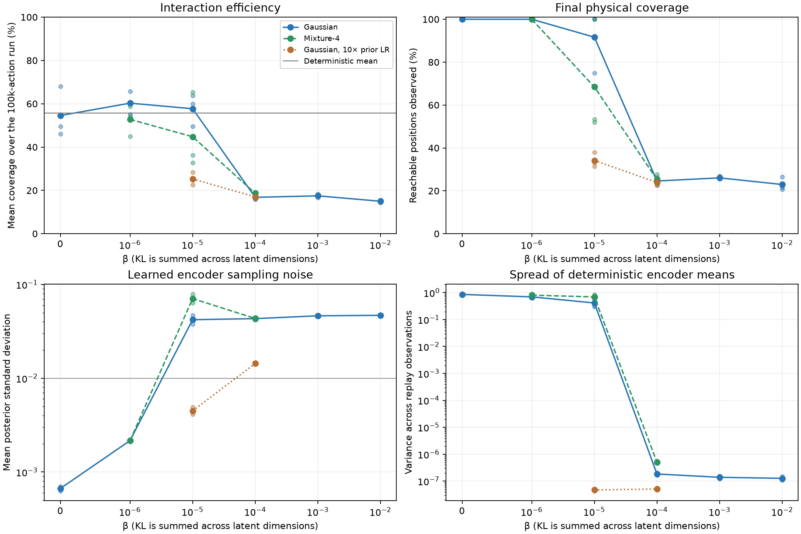
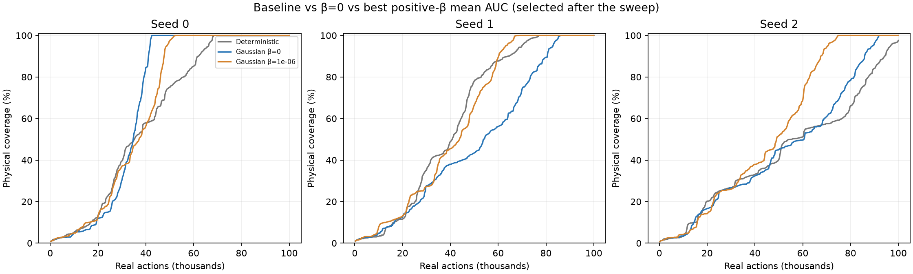
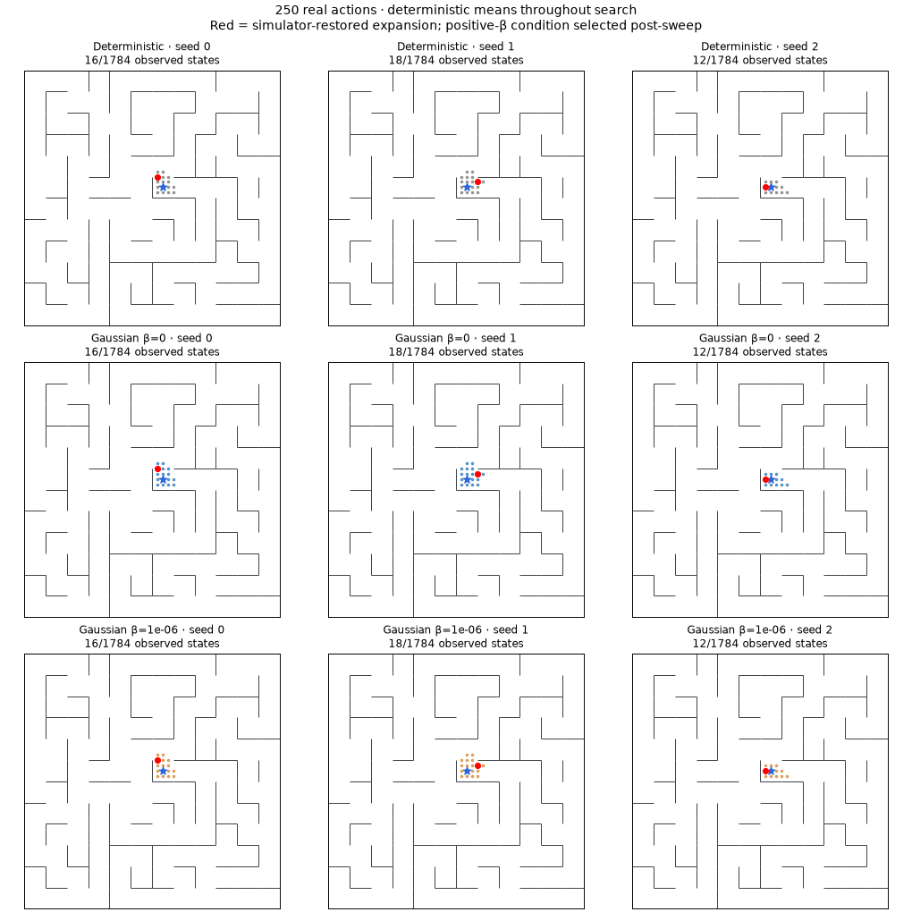

# Learned-prior KL bottleneck experiments

Completed November 10, 2026. **40 new full runs** (including one deterministic reproduction), plus two reused deterministic references: 14 conditions × three seeds. Same noisy maze, persistent nearest-visited-mean frontier, 100,000 actions and 4,112 gradient updates per run. No extra replay updates. This study adds 4,000,000 real actions and 164,480 joint updates; the separate small smoke trial is excluded.

## Findings

**A small positive coefficient helps on average, but does not eliminate nuisance sensitivity.** Gaussian β=1e-6 completes all three seeds at 52,472 / 69,202 / 74,798 actions, versus stochastic β=0 at 42,498 / 86,192 / 91,846. Mean completion cost falls from 73,512 to 65,491 actions (10.9%); two seeds improve and one slows down. Mean coverage over the 100k run improves from 54.6% to 60.3%. These three seeds are exploratory, not proof of a broadly optimal coefficient.

**Stochastic training itself matters.** β=0 completes all three seeds, but its mean coverage AUC 54.6% is slightly below the deterministic baseline 55.8%. It is not uniformly better than the old agent. Its posterior standard deviation shrinks about 15× from initialization, consistent with the prediction objective suppressing input sampling noise when there is no KL cost for doing so.

**Stronger from-scratch compression collapses useful mean variation.** At Gaussian β≥1e-4, final mean latent variance is around 1e-7, repulsion is nearly its maximum 1, posterior std remains about 0.04–0.05, and only 23–26% of the physical maze is observed on average. KL becomes nearly zero. This combination supports a collapse interpretation; shrinking scale alone would not establish collapse. β=1e-5 is intermediate: two seeds finish faster than their β=0 counterparts, but the third reaches only 1,337/1,784 positions.

**Additional prior flexibility does not win this sweep.** The four-component prior at β=1e-6 completes all seeds but is slower on average than the single Gaussian; at 1e-5 it succeeds in only one seed. Faster prior learning fails to rescue the stronger penalty and also collapses the 1e-5 runs. The early 25k warm start still prevents useful representation learning. The 35k switch preserves substantial variation but finishes only seed 0; final coverage is 1,784 / 994 / 937. These are separate failed hypotheses retained in the report, not discarded trials.

**The intended noise-removal mechanism is not established.** Final same-position-noise / neighboring-position distance ratios are 0.115 / 0.138 / 0.143 for β=0, versus 0.111 / 0.145 / 0.142 for β=1e-6. That is no consistent reduction. The best small-β arm is a promising optimization/representation change, but it has not “wiped noise from the means.” Noiseless mean search can still exploit distinctions that sampled-input dynamics cannot reliably use. Rank audits at 25k/50k/100k are included in the JSON; different online arms have different archives, so their rank fractions are not identical-data causal comparisons.

## All results

Mean coverage over the run is the area under the coverage-vs-actions curve divided by 100k, evaluated on the common 250-action logging grid. It rewards earlier exploration without pretending censored completion times are observed. Dots in the sweep figure are individual seeds; curves are three-seed means.

| Condition | Mean final coverage | Mean coverage over run | Full coverage | Actions to full coverage, seeds 0 / 1 / 2 |
|---|---:|---:|---|---|
| Deterministic | 99.2% | 55.8% | 2/3 | 68,628 / 77,266 / >100k |
| Gaussian β=0 | 100.0% | 54.6% | 3/3 | 42,498 / 86,192 / 91,846 |
| Gaussian β=1e-06 | 100.0% | 60.3% | 3/3 | 52,472 / 69,202 / 74,798 |
| Gaussian β=1e-05 | 91.6% | 57.7% | 2/3 | >100k / 55,286 / 56,314 |
| Gaussian β=0.0001 | 24.6% | 16.8% | 0/3 | >100k / >100k / >100k |
| Gaussian β=0.001 | 26.0% | 17.5% | 0/3 | >100k / >100k / >100k |
| Gaussian β=0.01 | 22.9% | 15.0% | 0/3 | >100k / >100k / >100k |
| Mixture-4 β=1e-06 | 100.0% | 52.8% | 3/3 | 85,623 / 72,702 / 93,147 |
| Mixture-4 β=1e-05 | 68.4% | 44.8% | 1/3 | 54,427 / >100k / >100k |
| Mixture-4 β=0.0001 | 25.3% | 18.6% | 0/3 | >100k / >100k / >100k |
| Gaussian (10× prior LR) β=1e-05 | 34.2% | 25.3% | 0/3 | >100k / >100k / >100k |
| Gaussian (10× prior LR) β=0.0001 | 23.9% | 17.0% | 0/3 | >100k / >100k / >100k |
| Gaussian β=1e-4, start 25k | 27.2% | 20.4% | 0/3 | >100k / >100k / >100k |
| Gaussian β=1e-4, start 35k | 69.4% | 46.8% | 1/3 | 42,504 / >100k / >100k |



The best positive-β condition by mean coverage AUC is **Gaussian β=1e-06**, selected after inspecting this sweep. That selection is exploratory, not held-out validation. The main comparison is against **Gaussian β=0**, not just against the deterministic model: stochastic training itself changes optimization. All settings and unsuccessful runs are included above.





## Exact learning setup

The existing encoder's final layer remains the deterministic mean μ(o), with width 256, three hidden layers, latent dimension eight. Add a linear head from its last hidden layer for observation-dependent log σ(o), initialized to log(0.01), weights zero; clamp log σ to [−12, 2] (minimum std about 6.1e-6). Original mean-encoder and dynamics initial weights are preserved exactly. A separate generator samples ε from a standard normal during training only; z=μ(o)+σ(o)⊙ε. The same sampled input latent is given to all three dynamics heads for each shared transition batch.

Loss:

`MSE(g_m(z_t,a_t), μ(o_next)) + 0.01 × mean max(0, 1 − ||μ(o_i)−μ(o_j)||²) + β × E_o KL(q(z|o) || p(z))`, where MSE averages squared coordinate errors over heads, batch entries, and latent dimensions.

Prediction targets and repulsion use means. Both prediction endpoints and both repulsion endpoints retain encoder gradients. KL uses a separate batch of replay observations (the same 512 observations used for repulsion) and is **summed across latent dimensions**, averaged across observations: nats per observation, not nats per dimension. Model/encoder learning rates remain 3e-4/9e-5. Adam jointly fits encoder and dynamics; an independent Adam fits prior parameters with gradients of βKL. β=0 leaves the prior inactive, so its reported KL to the initial reference is not a fitted information estimate.

Single-Gaussian prior: learned diagonal mean and standard deviation, initialized mean 0/std 0.05; analytic KL. Four-component prior: learned logits, means, diagonal scales, initial std 0.05 and small distinct random means; analytic posterior entropy plus four reparameterized samples for expected prior log density. Do not clamp Monte Carlo KL estimates to zero. Diagnostic mixture KL uses 32 isolated samples. Prior log std is clamped to [−12,2]. These are learned priors, not a requirement that the latent population stay standard normal.

**Agent/queue inference always uses μ(o).** No encoder sampling enters queue storage, nearest-neighbor indexing, priorities, or simulator interaction. Physical coordinates are only observation features, restoration payloads, and evaluation labels; no physical-ID deduplication. Observation noise and tie-breaking remain stochastic. All replay remains available; refresh every 100 expansions/500 executed actions, with one accumulated-replay epoch apportioned across every 1,000 expansions exactly as in the previous matched-budget study.

## Arms and adaptive decisions

Primary sweep: learned diagonal Gaussian with β=0,1e-6,1e-5,1e-4,1e-3,1e-2, all three seeds. Four-component mixtures test β=1e-6,1e-5,1e-4 on three seeds. No separate mixture β=0 run is needed to change the loss: an unused prior cannot affect the intended β=0 objective; the Gaussian β=0 is the stochastic baseline.

Two adaptive controls address observed failure modes:

1. **10× prior learning rate**, Gaussian β=1e-5/1e-4, three seeds: selected after early Gaussian runs showed a prior scale much smaller than latent spread. It tests prior adaptation speed, leaving the encoder/dynamics rates and update count unchanged.
2. **Delayed KL**, Gaussian β=1e-4: keep β effectively zero for 296 updates (first 25k actions), then activate it. At activation initialize the prior mean/variance from the current sampled replay aggregate: mean μ and Var(μ)+Eσ², detached. No additional environment data or gradient steps. This combines delayed compression with a causal prior initialization; it does not isolate those two changes separately. The 25k attempt revealed that β=0 had not yet learned strong invariance (probe noise/movement ratio 2.1–8.6), so a second three-seed delay to 651 updates/35k actions was added, when all three baseline ratios were 0.20–0.30. Activation first affects the next training event (25.5k/35.5k actions). The failed earlier switch is retained in the table.

## Diagnostics and limits

The β=0 posterior std shrinks from 0.01 to 0.000629–0.000703 on average across replay samples after training. This supports the expected pressure to remove unused sampling noise, but is not exact zero and does not imply the same optimization trajectory as deterministic training. Per-dimension posterior std and mean variance, prior weights/scales, sampled-input and mean-input prediction MSE, repulsion, observation-noise sensitivity, and KL are saved at every 5k actions.

Checkpoints at 25k/50k/100k are independently audited for productive-entry density, repeat-entry density, and nearest-visited distances. A productive entry is one whose real expansion would reveal an unobserved neighbor; these labels never affect training/search. Completed mazes naturally have zero productive entries, so final rank density is not compared as if all runs still had new states available. Mean-encoding scale alone does not establish collapse; inspect it together with repulsion, sampled noise/mean variance, and exploration.

Compression constrains sampled latent information, while the agent reads noiseless means. Residual distinctions can therefore remain visible to distance search even when they are inaccessible to noisy dynamics inputs. This experiment tests that mismatch empirically rather than assuming information compression guarantees exact state equivalence. Only a coordinate-plus-nuisance discrete maze with simulator restoration is tested. Three paired seeds on one layout are not broad validation; no claim of optimal β or statistical significance.

## Checks and reproduction

**70 tests pass:** analytic KL matches PyTorch distributions; mixture Monte Carlo agrees with identical-component Gaussian KL; gradients reach variance and prior parameters; initial mean/dynamics parameters match deterministic controls; mean inference consumes no sampling RNG; checkpoints reproduce the next update exactly; β=0 leaves the prior unchanged; delayed KL matches β=0 before activation. Existing tests still pass.

Independent run audits verify all initial mean/dynamics parameters, 500-action pre-training prefixes, complete successor-noise streams, action/update/exposure budgets, and every final frontier priority. Delayed runs match their β=0 data prefix through 25k/35k. The fresh deterministic seed 0 run reproduces the original replay exactly. Original deterministic seeds 1/2 are reused references. Legacy checkpoint loading remains supported; stochastic checkpoints dispatch through their saved bottleneck specification.

```sh
.venv/bin/python scripts/run_kl_bottleneck.py --out runs/kl-gaussian-NEW --deterministic-control
.venv/bin/python scripts/run_kl_bottleneck.py --out runs/kl-mixture-NEW --components 4 --betas 1e-6,1e-5,1e-4
.venv/bin/python scripts/run_kl_bottleneck.py --out runs/kl-fast-prior-NEW --prior-lr-multiplier 10 --betas 1e-5,1e-4
.venv/bin/python scripts/run_kl_bottleneck.py --out runs/kl-warm-start-NEW --betas 1e-4 --kl-warmup-updates 296
.venv/bin/python scripts/run_kl_bottleneck.py --out runs/kl-late-start-NEW --betas 1e-4 --kl-warmup-updates 651
.venv/bin/python scripts/audit_kl_bottleneck.py
.venv/bin/python scripts/report_kl_bottleneck.py
```

Audit roots are explicit constants in the audit script; change them for new roots. Every scientific run refuses an existing output directory and retains source snapshots, config/specification, replay, checkpoints, metrics, frontier, and animation data. Recorded roots end in 20261110. Portable [audit/results](assets/kl-bottleneck-audit.json) and [summary](assets/kl-bottleneck-summary.json). No background runs remain.
