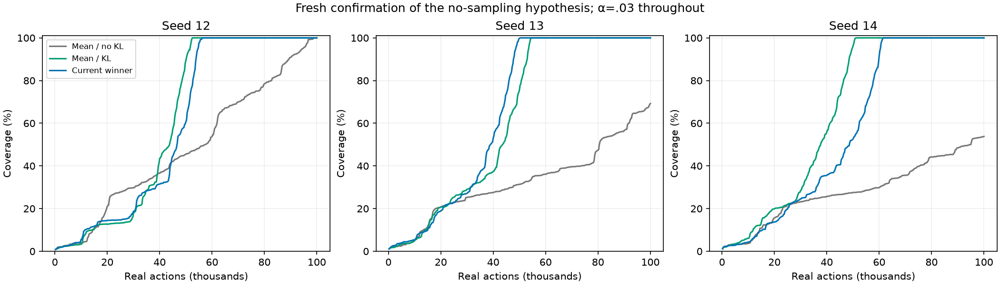
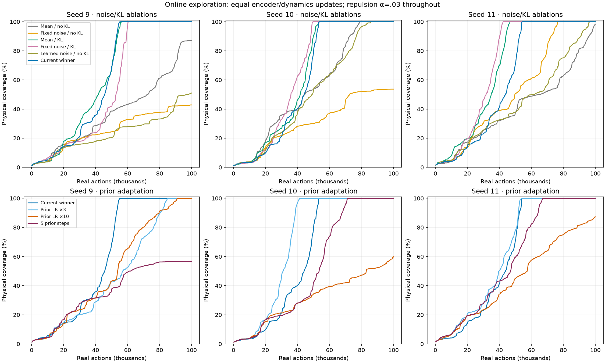
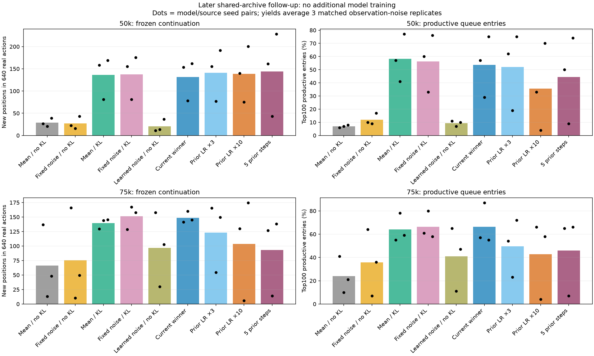
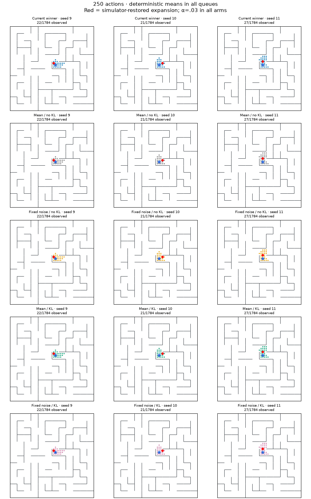

# What causes the KL exploration improvement?

Completed November 10, 2026. **Sampling during dynamics training is not necessary for the improvement in this noisy maze.** Keeping KL while feeding deterministic encoder means to the dynamics model retained the gain on six new seeds. Noise injection without KL did not reproduce it. Shared-data experiments show that KL changes queue ranking usefully even before online data feedback can amplify the difference.

Optimizing the prior faster substantially reduced mismatch, but did not consistently improve exploration at the current β. The evidence favors a useful representation-regularization effect over the explanation that posterior sampling itself is the essential ingredient. Exactly which part of the KL-induced geometry matters remains unresolved.

## The cleanest confirmation

Repulsion is **α=.03 throughout**. This comparison does not change repulsion along with KL. The first nine-arm study used seeds 9/10/11. Once its no-sampling result emerged, we fixed three confirmation arms and ran new seeds 12/13/14 without retuning coefficients.

| Dynamics training input / objective | Full-coverage actions, seeds 12 /13 /14 | Mean coverage throughout 100k |
|---|---|---:|
| Deterministic means, no KL | 98,542 / >100k / >100k | 36.3% |
| **Deterministic means, KL β=1e-5** | **52,379 /54,613 /51,002** | **63.1%** |
| Original adaptive samples, KL β=1e-5 | 56,139 /50,378 /61,592 | 60.5% |

No-sampling KL completes all six seeds 9–14; deterministic no-KL completes two. No-sampling KL is faster than deterministic no-KL in every paired seed. Against the original winner, its completion costs are comparable: four of six are faster, two slower; mean completion 52,374 versus 55,290 actions. This is descriptive evidence on one layout, not a claim of universal superiority or formal equivalence.



All agents use deterministic means in the queue. The intervention here concerns **training input**; observation noise remains present in every arm. Removing dynamics-input sampling does not remove environmental nuisance inputs.

## Separating noise and KL

The core study is a 2×2 factorial: deterministic versus prescribed noisy dynamics inputs, crossed with KL off/on. Adaptive-noise β=0 and the original winner are additional controls. The prescribed schedule is scalar RMS posterior standard deviation averaged over the **previous** winning seeds 0/1/2 and interpolated by gradient-update count. It is fixed before these new runs and cannot be learned away. It matches aggregate noise amplitude over training, not the winner's observation-dependent variances or gradients through its variance head.

| Arm | Dynamics input | KL | Completion actions, seeds 9 /10 /11 | Mean coverage throughout 100k |
|---|---|---:|---|---:|
| Mean / no KL | μ | 0 | >100k /79,067 />100k | 44.5% |
| Fixed noise / no KL | μ + s(update)ε | 0 | >100k />100k /76,516 | 36.7% |
| Mean / KL | μ | 1e-5 | 56,036 /53,514 /46,698 | 64.6% |
| Fixed noise / KL | μ + s(update)ε | 1e-5 | 60,313 /49,573 /42,403 | 63.7% |
| Learned noise / no KL | μ + σ(o)ε | 0 | >100k /86,073 /97,383 | 39.7% |
| Original winner | μ + σ(o)ε | 1e-5 | 55,671 /53,631 /54,328 | 60.7% |

The factorial supports a KL benefit with and without prescribed noise. This particular noise-only schedule is insufficient. It does not prove that every noise magnitude, covariance, or schedule would fail. There is no consistent necessity for adaptive sampling in the tested regime; modest differences between KL variants remain seed-dependent.

In the deterministic KL arm the posterior variance head and prior still train through KL, but dynamics receives μ only. This intentionally breaks the sampled bottleneck interpretation. A bound on information carried by a sample does not bound information carried by the noiseless mean.

For diagonal Gaussians, with prior mean m and variance v,

`KL(q||p) = (1/2) Σ_j [(μ_j−m_j)²/v_j + σ_j²/v_j − 1 + log(v_j) − log(σ_j²)]`.

Thus KL still directly pressures encoder means even when sampling is disabled. Gradients through the shared variance branch also remain. The experiment shows that sampling is unnecessary for the observed benefit; it does not establish that the mean-quadratic term alone explains it or that a simple fixed L2 penalty is equivalent.



## The benefit exists on identical data and queues

Online trajectories feed back into replay, so we also trained each arm from scratch on identical archived streams. Two source families were used: the previous learned-prior winner and stochastic β=0, source seeds 6/7/8. Each source seed is paired with model seed 9/10/11. All nine arms see identical chronological observation prefixes, transition minibatches, repulsion samples, and update counts within a pair. The queue and visited archive being evaluated are also identical raw observations, merely re-encoded by each model.

At each evaluation checkpoint we measure how high the queue ranks **productive entries**: observed positions whose expansion would reveal a physical position not yet observed in that archive. Physical labels are evaluation-only. At 35k, and in a later follow-up at 50k/75k on the still-incomplete β=0 archives, each frozen model gets 128 sequential expansions =640 real actions. Each comparison uses three matched fresh observation-noise RNG streams. No gradient updates or oracle priorities occur during these continuations.

The50k common-archive result is especially clear:

| Arm | New positions /640 actions, model seeds 9 /10 /11 | Mean new positions | Productive fraction of top100 queue entries |
|---|---|---:|---:|
| Mean / no KL | 26.7 /20.7 /39.0 | 28.8 | 7.0% |
| Fixed noise / no KL | 22.3 /16.0 /43.0 | 27.1 | 12.0% |
| **Mean / KL** | **158.0 /81.3 /169.0** | **136.1** | **58.3%** |
| Fixed noise / KL | 155.3 /81.3 /175.7 | 137.4 | 56.3% |
| Original winner | 153.7 /78.3 /162.0 | 131.3 | 53.7% |

Entries are already-observed states, not unseen states sitting in the queue. Their expansion exposes new neighbors. Discovery counts are distinct physical positions, not queued-entry counts.

This establishes a useful representation/ranking difference under common training data; the online gain cannot be attributed solely to receiving luckier experience. The extra new observations collected during each frozen continuation can affect later queue choices but are not used to train the model.

At 35k on the β=0 archives, mean-KL finds 98.6 new positions on average versus 57.1 without KL. On the winner's35k archives, corresponding yields are only 10.3 versus 9.1, with mixed paired effects. Source-archive difficulty and what remains undiscovered matter. At 75k on β=0 archives, mean-KL yields 139.7 versus 66.2; its advantage is large in seeds10/11, but reverses slightly in seed 9. We retain these differences rather than pooling every checkpoint as an independent replication.



[35k shared-data figures](assets/kl-mechanisms-fixed.png), [all tables](kl-mechanisms-tables.md), and [later tables](kl-mechanisms-late-tables.md) include every arm and seed. Three rollout RNG replicates are not three additional trained models. The two data families share paired initializations and are not six independent model seeds.

## Faster prior adaptation

The additional arms hold β=1e-5, α=.03 and the original sampled-input setup fixed. They change only prior LR to 3×/10×, or take five total prior optimizer steps per joint update. Extra prior steps reuse the same detached, pre-update posterior batch; no encoder/dynamics update, new replay sample, or Gaussian sampling RNG draw is added.

On the common winner data, mean final avoidable prior mismatch falls from 81.95 nats to 12.55 with 3×LR,1.39 with 10×LR, and0.08 with five steps. On the β=0 source family it falls from 79.26 to 11.27,1.52, and0.03. These are independent full-replay moment computations. Faster fitting really does fix much of the measured lag.

| Prior optimization, online seeds 9/10/11 | Completion actions | Mean coverage throughout 100k |
|---|---|---:|
| Original | 55,671 /53,631 /54,328 | 60.7% |
| LR×3 | 86,037 /41,257 /54,018 | 60.7% |
| LR×10 | 91,846 />100k />100k | 42.1% |
| Five total prior steps | >100k /71,832 /67,549 | 49.1% |

LR×3 gives a substantial win in one seed, a substantial loss in another, and almost unchanged AUC averaged over three seeds. The more aggressive variants worsen average exploration. At the later 75k common β=0 archives their frozen yields also become less reliable: original 148.8 new positions on average, LR×3=123.0, LR×10=103.4, five steps=93.0.

The online runs independently show final mean prior gaps of 82.01, 14.37, 0.95, and 0.16 nats for the original, LR×3, LR×10, and five-step variants respectively.

A statistically better-fitting prior is not automatically a better encoder regularizer. This isolates adaptation speed at the existing coefficients; it does not establish the best β after changing speed. Nor does it prove that mismatch is intrinsically desirable. Retuning could alter the result, as could a different regularizer with controlled geometric pressure.

## Noise suppression and geometry

The ranking improvement is not explained by the average nuisance metric becoming smaller. In the shared β=0-data fits at 100k, independent fixed physical probes give median noise/local-movement ratio .104 for mean/no-KL versus .124 for mean/KL;99th percentiles are .408 versus .459. The KL model nevertheless ranks productive states much better in the shared-queue tests.

Covariance participation ratio of the physical-position centroids averages 1.53 without KL and 1.94 with deterministic KL in these final shared-data models. This is a descriptive indication of different spread across directions, not an estimate of intrinsic dimension or a causal explanation. Noise/geometry probes use the same physical positions and nuisance draws across arms, while replay prediction MSE remains representation-dependent.

A uniform rescaling of every latent would multiply all queue distances by the same constant and leave priorities ordered identically. Therefore “the latents are smaller” alone cannot explain better ranking. Nonuniform geometry, local noise sensitivity, and the learning trajectory are plausible mechanisms. We have not yet separated mean-quadratic KL gradients from variance-branch gradients or identified the specific useful distortion of the map.

The practical conclusion is to retain deterministic-input KL as a strong, simpler experimental candidate alongside the original winner. The evidence no longer supports treating training-time sampling as essential to the maze improvement. No repository default was changed.

## Protocol, cost, and validation

Same fixed maze layout, 1,784 reachable positions, normalized coordinates plus eight fresh Gaussian nuisance inputs, latent dimension 8, width 256/three-hidden-layer encoder and three dynamics heads. Exact simulator restoration, five real actions per expansion, persistent nearest-visited-mean frontier. No physical-ID deduplication, distance supervision, reconstruction, trained policy, or privileged labels in optimization.

All full fits use 4,112 encoder/dynamics updates and 1,050,000 transition presentations/head. Online training occurs every 100 expansions =500 actions, completing one accumulated replay epoch across each 1,000-expansion/5k-action block. Source and target encoder branches receive dynamics gradients; both repulsion endpoints receive gradients. Priors start with standard deviation .05, posterior with .01; encoder LR 9e-5 and dynamics/prior LR 3e-4 except explicit prior-LR arms.

- **54 shared-data fits**, each replaying 100k recorded transitions; no new training interactions.
- **27 predeclared online runs plus 9 fresh confirmation runs**:3,600,000 new training actions.
- **324 frozen continuations of 640 actions**:207,360 additional evaluation actions, no training.
- **90 full fits /370,080 joint updates** in total. Extra prior-only updates are counted separately in each checkpoint.
- One5k replay-only default-equivalence run is excluded from scientific totals.

All 90 fits and all 324 frozen continuations completed without failures. **79 tests pass**. The 5k reproduction matches old encoder, dynamics, prior, training RNG, and sample RNG exactly. New tests cover prescribed noise, no-sampling independence from variance outputs, extra prior steps leaving the first joint update unchanged, and checkpoint continuation.

Shared-data audits verify matching model initialization, replay hashes, minibatch-index hashes, final training/sample RNG states, budgets, and independently reconstructed 35k rankings. Online audits verify matching initialization, the initial500-action prefix, the full successor-noise stream, final RNG states, budgets, and saved final frontier observations/latents/exact priorities. Geometry and prior moments are evaluated independently. Later frozen audits verify common archive membership, matched seen sets, budgets, and discovery bounds. Plots and animation frames were inspected; git diff --check passed. Preexisting uncommitted work is preserved; all run directories are new.

The [protocol and adaptive decision log](kl-mechanisms-protocol.md) records what was fixed in advance and why 50k/75k diagnostics and seeds 12–14 confirmation were added. Fresh confirmation selected a causal hypothesis, not a new coefficient search. This remains one discrete maze with simulator restoration; results do not settle continuous positions, other layouts, or stochastic navigation dynamics.

## Animation and reproduction

The animation covers the full 100k actions for seeds 9/10/11. Rows are original winner, mean/no-KL, fixed-noise/no-KL, mean/KL, fixed-noise/KL. Red dots are simulator-restored expansion locations; jumps are not continuous trajectories.



Artifacts: [summary](assets/kl-mechanisms-summary.json), [shared-data audit](assets/kl-mechanisms-fixed-audit.json), [online audit](assets/kl-mechanisms-online-audit.json), [confirmation audit](assets/kl-mechanisms-confirm-audit.json), [later audit](assets/kl-mechanisms-late-audit.json), [training trajectories](assets/kl-mechanisms-trajectories.png), [final maps](assets/kl-mechanisms-final.png). Run roots are `runs/kl-mechanisms-{fixed,online,confirm,late,control}-20261110`. Each scientific training root records its manifest and fixed noise schedule. Earlier runs remain untouched.

Use fresh output names; launchers reject existing directories. Shared-data reproduction requires the recorded source replays from the preceding study.

```bash
cd /Users/brycesandlund/GitHub/map-learning
.venv/bin/python scripts/run_kl_mechanisms.py --mode fixed \
  --out runs/kl-mechanisms-fixed-NEW --jobs 6
.venv/bin/python scripts/run_kl_mechanisms.py --mode online \
  --out runs/kl-mechanisms-online-NEW --jobs 6
.venv/bin/python scripts/run_kl_mechanisms.py --mode online \
  --out runs/kl-mechanisms-confirm-NEW --seeds 12,13,14 \
  --arms mean_zero,mean_kl,adaptive_kl --jobs 3
.venv/bin/python scripts/late_kl_mechanisms.py \
  --root runs/kl-mechanisms-fixed-NEW --out runs/kl-mechanisms-late-NEW

# Rebuild the saved study's audit and reports
.venv/bin/python scripts/audit_kl_mechanisms.py \
  --fixed runs/kl-mechanisms-fixed-20261110 \
  --online runs/kl-mechanisms-online-20261110 \
  --out /tmp/kl-mechanisms-independent-audit.json
.venv/bin/python scripts/report_kl_mechanisms.py \
  --fixed runs/kl-mechanisms-fixed-20261110 \
  --online runs/kl-mechanisms-online-20261110 \
  --confirmation runs/kl-mechanisms-confirm-20261110
.venv/bin/python scripts/report_late_kl_mechanisms.py \
  --root runs/kl-mechanisms-late-20261110
.venv/bin/python -m pytest -q
```
