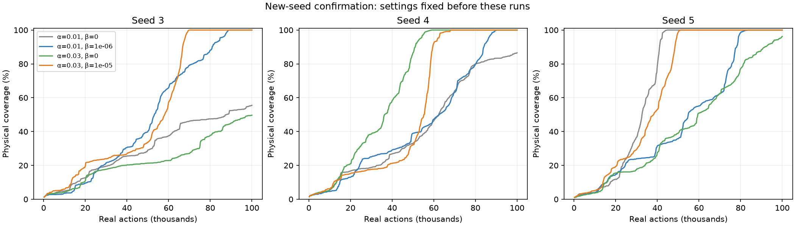
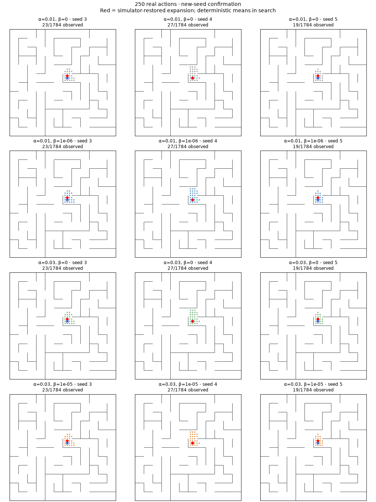
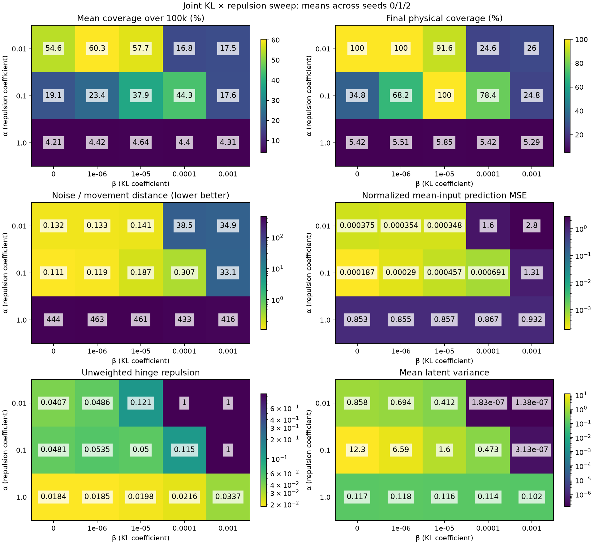
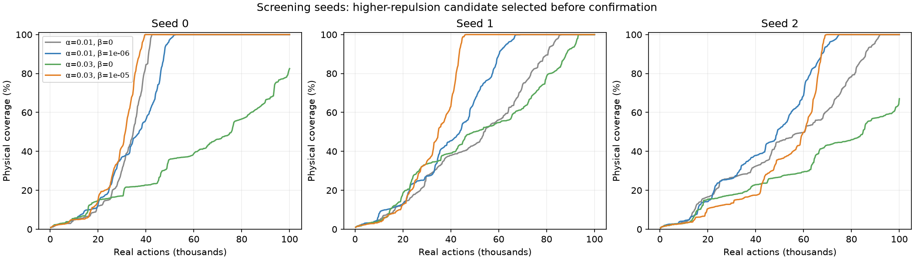

# Joint KL and repulsion sweep

Completed November 10, 2026. **54 new runs, 5.4 million actions, 222,048 joint gradient updates**, plus 15 reused controls. Primary grid: 15 conditions × three seeds; intermediate follow-up: four conditions × three seeds; fresh-seed confirmation: four conditions × three seeds. All 69 comparison rows passed the independent audits. Every run continued to the fixed 100k-action budget, even after achieving full coverage.

## Result to carry forward

Use **repulsion coefficient α=0.03 and KL coefficient β=1e-5** as the next experimental setting. This is three times the original repulsion and ten times the previously selected β. It reached full coverage faster than the previous best (α=0.01, β=1e-6) in all six paired seeds. Three of those seeds were used for selection; the other three were run only after the candidate and controls were fixed.

| Setting | Screening completion actions: seeds 0 / 1 / 2 | Confirmation completion actions: seeds 3 / 4 / 5 |
|---|---|---|
| Original stochastic baseline: α=0.01, β=0 | 42,498 / 86,192 / 91,846 | >100k / >100k / 44,572 |
| Previous best: α=0.01, β=1e-6 | 52,472 / 69,202 / 74,798 | 88,667 / 90,208 / 83,031 |
| Increased repulsion only: α=0.03, β=0 | >100k / 94,554 / >100k | >100k / 58,813 / >100k |
| **Joint setting: α=0.03, β=1e-5** | **39,513 / 46,292 / 69,533** | **69,768 / 67,992 / 51,028** |

On the fresh confirmation seeds, mean completion cost improves from **87,302 to 62,929 actions: 27.9% fewer**. Mean coverage across the full 100k-action run improves from **47.2% to 56.7%**. Screening mean completion cost improves from 65,491 to 51,779 actions (20.9%). Across all six seeds the means are 76,396 versus 57,354 (24.9% fewer), but the confirmation-only comparison is the cleaner evidence because it excludes selection seeds.

The joint setting does not dominate every β=0 seed: original β=0 seed 5 completes faster, and increased-repulsion-only seed 4 completes faster. It improves reliability in this sample: 6/6 complete, versus 4/6 for original stochastic β=0 and 2/6 for α=0.03, β=0. Do not assign an observed completion time of 100k to incomplete runs.





Animation rows: original stochastic β=0, previous best, increased-repulsion-only control, joint setting. Columns: confirmation seeds 3/4/5. Points are cumulative observed physical states. Red markers show simulator-restored expansions, not an executable continuous trajectory. All four rows use deterministic encoder means in search. The animation runs through 100k actions.

## What the joint sweep teaches

**The earlier collapse result depended on the repulsion coefficient.** At β=1e-4, α=0.01 collapsed in all three screening seeds and reached 24.6% final coverage on average. Raising α to 0.1 preserved useful variation and reached full coverage in two seeds at 62,409 and 60,661 actions. The third stalled at 629/1,784 positions. Stronger repulsion can rescue larger β, but this particular rescue is not reliable across all three seeds.

**Increasing repulsion alone is not a solution.** With β=0, mean final coverage falls from 100% at α=0.01 to 34.8% at α=0.1, and 5.4% at α=1 on the screening seeds. Every tested α=1 setting performs poorly, across β=0 through 1e-3. At α=1, β=0, mean latent variance is about 0.117 and unweighted repulsion is only 0.018: the representation is spread out rather than collapsed. But same-position nuisance distance is about 444 times adjacent-position distance, and normalized prediction MSE is about 0.853. It predominantly separates nuisance variation, which gives the queue poor navigation priorities. This is a different failure from nearly constant mean latents under excessive KL.

**The new setting still has not demonstrated stronger nuisance invariance.** On confirmation seeds, final nuisance/movement ratios average 0.160 for the joint setting versus 0.137 for the previous best, 0.109 for the original β=0 control, and 0.109 for the increased-repulsion-only control. Lower is better. Mean-input normalized replay MSE is 0.000415 for the joint setting versus 0.000336 for the previous best; sampled-input normalized MSE is 0.000425 versus 0.000352. Both predict accurately by these probes, but the exploration gain is not accompanied by an improvement in these average metrics. These online agents collect different replay distributions, so the MSE comparison is descriptive rather than an identical-data causal test.

The evidence supports a better balance of prediction, compression, and separation. It does not identify the exact mechanism of the gain, prove that noise was removed from the means, or establish an optimal coefficient. Compression applies to sampled latents while the queue reads noiseless means. Residual mean distinctions can remain available to the queue. Changing α and β together also changes their strength relative to the fixed prediction loss; the ratio β/α alone does not specify the objective.

## Complete screening results

The figure below covers the original 3×5 grid (α=0.01/0.1/1). The adaptive α=0.03 settings are included in the [complete per-condition tables](kl-repulsion-tables.md), along with all confirmation outcomes and failures. Each heatmap cell is a mean over the three screening seeds; the curves below show individual seeds. Logarithmic color scales are used for the diagnostic panels. None of these plots treats a small latent variance alone as proof of collapse.





## Protocol and adaptive decisions

Primary grid: β ∈ {0, 1e-6, 1e-5, 1e-4, 1e-3}, α ∈ {0.01, 0.1, 1}, seeds 0/1/2. Fifteen matching α=0.01 runs are reused from the original Gaussian sweep; 30 primary runs are new. Their mean encoder/dynamics initial weights, pre-training experience, and complete successor-noise streams match within seed.

After α=0.1 runs showed poor β=0 exploration but a two-seed rescue at β=1e-4, add α=0.03 with β=0/1e-5/3e-5/1e-4 on seeds 0/1/2 (12 new screening runs). This tests an intermediate balance rather than changing the training schedule. Its β=1e-5 candidate completed all three seeds faster than the previous best. At that point, while the remainder of the primary grid was still running, fix four confirmation arms: (α,β)=(0.01,0), (0.01,1e-6), (0.03,0), (0.03,1e-5). Run each on new seeds 3/4/5 (12 new runs). No selection or coefficient changes follow inspection of these confirmation outcomes. The less successful intermediate β=3e-5/1e-4 settings remain in the full results.

All runs use the same coordinate-plus-eight-Gaussian-nuisance observations, deterministic maze physics, 1,784 reachable positions, exact simulator restoration, and persistent nearest-visited-mean priority queue. No physical-ID deduplication, merging threshold, imagined rollout, or trained RL policy. All observations are retained. All five real actions, including stay, are executed per expansion. The maze layout is fixed; model and observation-noise seeds vary.

Same learned diagonal Gaussian prior, initial posterior std 0.01, width 256, three hidden layers, eight latent dimensions, and three dynamics heads. Loss:

`mean squared coordinate prediction error + α × mean max(0, 1 − squared pair distance) + β × mean KL(q(z|o) || p(z))`.

KL is summed over latent dimensions (nats/observation), while prediction MSE averages heads, batch entries, and dimensions. Reparameterized samples enter dynamics inputs during training only; targets, repulsion, and queue inference use means. Both prediction endpoints and repulsion endpoints retain encoder gradients. Prior mean/scale are learned; β=0 leaves the prior inactive. This study changes no prior architecture, learning rate, or activation schedule.

Each run: 100k actions, 20k expansions, 4,112 updates, 1,050,000 transition presentations per head. Training/refresh occurs every 100 expansions/**500 actions**, with one accumulated-replay epoch apportioned over every 1,000 expansions/5,000 actions. No extra updates. Coverage AUC uses the common 250-action logging grid and divides by 100k.

## Checks, artifacts, and reproduction

**70 tests pass.** Independent audits cover all 69 comparison rows: specified coefficients, action/update/exposure budgets, identical initial mean/variance/dynamics weights, same-seed 500-action pre-training prefixes, complete matching successor-noise streams, deterministic mean inference without sampling RNG consumption, and all final frontier scores reconstructed from raw observations. Queue-rank diagnostics are also retained at 50k and 100k actions. Different policies have different archives; final productive-entry density is zero after complete coverage and must not be interpreted as poor ranking. Audit continuation reuses already-verified immutable completed runs; no experimental output is overwritten.

The implementation change is a validated `--repulsion-weight` override in `scripts/persistent_frontier.py`. Defaults remain unchanged. The new manifest runner supports Cartesian grids and explicit confirmation pairs. Every run retains resolved config, source snapshots, checkpoints, replay, frontier, diagnostics, and animation frames. New roots are `runs/kl-repulsion-20261110`, `runs/kl-repulsion-intermediate-20261110`, and `runs/kl-repulsion-confirm-20261110`.

```sh
.venv/bin/python scripts/run_kl_repulsion.py --out runs/kl-repulsion-NEW --reuse-original --jobs 3
.venv/bin/python scripts/run_kl_repulsion.py --out runs/kl-repulsion-intermediate-NEW --repulsions 0.03 --betas 0,1e-5,3e-5,1e-4 --jobs 3
.venv/bin/python scripts/run_kl_repulsion.py --out runs/kl-repulsion-confirm-NEW --pairs 0.01:0,0.01:1e-6,0.03:0,0.03:1e-5 --seeds 3,4,5 --jobs 6
.venv/bin/python scripts/audit_kl_repulsion.py --roots runs/kl-repulsion-NEW runs/kl-repulsion-intermediate-NEW runs/kl-repulsion-confirm-NEW
MPLCONFIGDIR=/tmp/map-learning-mpl XDG_CACHE_HOME=/tmp/map-learning-cache .venv/bin/python scripts/report_kl_repulsion.py --root runs/kl-repulsion-NEW --extra runs/kl-repulsion-intermediate-NEW --confirmation runs/kl-repulsion-confirm-NEW
```

Omit `--reuse-original` to run the entire primary grid fresh. Report and audit output paths are fixed under `docs/assets`; copy them first when preserving a different study. Run directories refuse overwrite. To try the selected agent directly, use `scripts/persistent_frontier.py --arm interleaved100 --seed 6 --repulsion-weight 0.03 --bottleneck-beta 1e-5 --out runs/selected-NEW`.

Portable [summary](assets/kl-repulsion-summary.json) and [independent audit](assets/kl-repulsion-audit.json). No background experiments remain. This is six paired seeds on one discrete, noisy-observation maze with simulator restoration; continuous-position performance and transfer to other maze layouts remain untested here.

See [KL and variance diagnostics](kl-variance-diagnostics.md) for training trajectories, per-coordinate sampling ratios, and the decomposition of logged KL into a moment-fitted Gaussian bound and prior mismatch.
