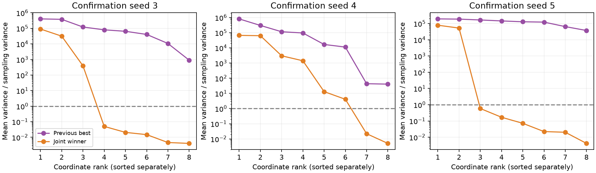
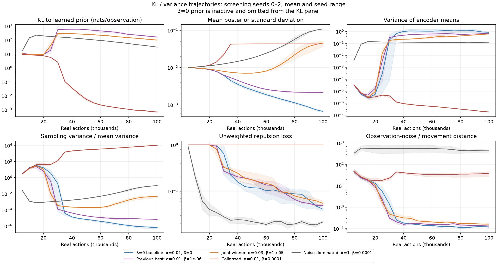

# KL, variance, and prior-fit diagnostics

Post-hoc analysis of all 69 joint-sweep checkpoints, November 10, 2026. No new training or environment interactions. Source: saved block diagnostics and final checkpoints; reproduce with `scripts/analyze_kl_variance.py`. Each final checkpoint uses the same isolated 2,048 replay-observation draws as the existing bottleneck diagnostic.

## What the quantities mean

- **Posterior sampling variance:** E over observations and coordinates of σ²(o), the noise injected during training. This is not environmental observation noise. Mean σ is also reported; squaring mean σ is not generally E σ².
- **Mean-latent spread:** average over coordinates of Var over observations of μ(o). This is the deterministic representation the queue sees.
- **Observed nuisance sensitivity:** distance between means for independent noisy observations of the same position, divided by adjacent-position centroid distance. This is a different quantity from sampling variance.
- **KL:** average KL(q(z|o)||p(z)), summed over eight coordinates, in nats/observation. Raw KL is an information upper bound, not mutual information itself. With β=0 the prior is not trained, so its large logged KL to the initial reference is not used as a fitted information measure.

## Successful conditions, final confirmation seeds 3–5

| Setting | KL to learned prior | Mean posterior σ | E σ² | Var μ | E σ² / Var μ |
|---|---:|---:|---:|---:|---:|
| Original β=0, α=0.01 | inactive | 0.000692 | 5.8e-7 | 1.756 | 3.8e-7 |
| Previous best, α=0.01 β=1e-6 | 186.7 | 0.00218 | 4.90e-6 | 0.696 | 7.11e-6 |
| Joint winner, α=0.03 β=1e-5 | 100.3 | 0.0385 | 0.00232 | 0.686 | 0.00339 |

Values are three-seed means; the last column averages each seed's ratio, rather than dividing the displayed group means. The winner has about 18× larger mean σ and roughly 470× larger sampling variance than the previous best, while keeping very similar mean-latent spread. Its effective stochastic bottleneck is substantially stronger, even though average environmental nuisance sensitivity is slightly worse (0.160 versus 0.137).

Per-coordinate ratios Var(μ_j)/Eσ_j² show that all eight previous-best coordinates have ratios above one in every confirmation seed. The winner has **5 / 2 / 6 coordinates below one** for seeds 3/4/5. These coordinates are dominated by training-time sampling noise according to this variance measure. This is not a proof of exactly 3/6/2 informative dimensions, a mutual-information estimate, or proof that environmental nuisance features were removed. Correlations, observation-dependent variance, and tiny noiseless mean differences still matter; the queue reads those noiseless means. Coordinates are sorted separately in the figure and do not represent matched axes across models.

## Evolution during training

The trajectory figure uses the three original screening seeds for all five conditions. Lines are means and shading is the seed range. Horizontal position is environment actions, not gradient steps; cumulative optimization increases nonlinearly with actions under this replay schedule. All vertical axes are logarithmic.

Useful representations emerge around 25–35k actions in these runs: mean-latent spread increases sharply and observation-noise sensitivity falls. KL initially rises during that emergence; it is not expected to decrease monotonically while the encoder also learns new distinctions. Subsequently the previous-best KL falls from about 558 at 50k to 165 at 100k, while posterior σ shrinks from 0.0033 to 0.0022. The joint setting's KL falls from about 257 to 101, but σ **grows** from 0.0071 to 0.0455. Its late compression uses increased posterior overlap rather than simply shrinking the mean map. These are descriptive aggregate trajectories on changing replay, not a fixed-data causal test.

Collapsed α=0.01, β=1e-4 runs end near KL=0.000708, mean variance=1.83e-7, and σ=0.0432, approximately matching the prior scale. Sampling variance overwhelms differences in means; repulsion remains near its maximum. In contrast, the noise-dominated α=1, β=1e-4 condition has mean variance 0.114, KL=31.3, σ=0.109, low repulsion, and observation-noise/movement ratio ~433. A spread-out representation and nonzero KL do not establish navigational usefulness.

## Much of the raw KL is prior mismatch

For each frozen encoder, fit a diagonal Gaussian p* analytically to the empirical aggregate posterior moments: mean E μ, variance Var μ + E σ² per coordinate. This minimizes average KL over diagonal Gaussian priors on this sampled replay distribution. No model or agent is changed.

For diagonal Gaussian q and p, the moment fit gives the exact empirical decomposition:

`E KL(q||p) = E KL(q||p*) + KL(p*||p)`.

The first term still includes the mismatch between the aggregate posterior and a diagonal Gaussian; it is **not** I(O;Z). The second term measures the avoidable mismatch of the learned prior relative to the best-fitting member of the same family. The implementation checks the identity in float64 at every checkpoint and reproduces the logged KL within float32 tolerance.

| Confirmation condition | Logged/prior KL | After moment fitting the prior | Avoidable prior mismatch |
|---|---:|---:|---:|
| Previous best | 186.7 | 42.9 | 143.8 |
| Joint winner | 100.3 | 15.8 | 84.5 |

Thus the logged KL is dominated by incomplete prior adaptation on this final empirical replay probe. The stronger winner also has a lower moment-fitted Gaussian bound, consistent with a stronger stochastic bottleneck, but differences between these upper bounds do not prove the same ordering of actual mutual information. β times raw KL averages 0.000187 for the previous best and 0.001003 for the joint winner on confirmation seeds; a smaller raw KL does not imply a smaller weighted penalty.

This introduces a mechanism to distinguish experimentally: gains from posterior noise/information restriction versus pressure from an imperfectly adapted prior. Earlier 10×-prior-learning-rate runs used different coefficient settings and failed; they do not settle what would happen with an analytically fitted prior at the newly selected joint setting. No such training experiment is included in this diagnostic.

## All final conditions

| Seeds | α | β | Learned-prior KL | Best diagonal-prior KL | Prior mismatch | E σ² | Var μ |
|---|---:|---:|---:|---:|---:|---:|---:|
| confirmation | 0.01 | 0 | inactive | 58.729 | inactive | 5.8394e-07 | 1.7558 |
| screening | 0.01 | 0 | inactive | 58.055 | inactive | 5.3492e-07 | 0.85753 |
| confirmation | 0.01 | 1e-06 | 186.72 | 42.888 | 143.83 | 4.9034e-06 | 0.69554 |
| screening | 0.01 | 1e-06 | 164.97 | 40.901 | 124.07 | 4.7741e-06 | 0.69449 |
| screening | 0.01 | 1e-05 | 63.371 | 9.0251 | 54.346 | 0.002283 | 0.41215 |
| screening | 0.01 | 0.0001 | 0.00070807 | 0.00065193 | 5.6139e-05 | 0.0018679 | 1.8339e-07 |
| screening | 0.01 | 0.001 | 0.0006078 | 0.00050376 | 0.00010404 | 0.0021448 | 1.3833e-07 |
| confirmation | 0.03 | 0 | inactive | 61.186 | inactive | 1.2888e-06 | 3.0043 |
| screening | 0.03 | 0 | inactive | 62.718 | inactive | 1.4638e-06 | 3.3288 |
| confirmation | 0.03 | 1e-05 | 100.32 | 15.803 | 84.513 | 0.0023188 | 0.68642 |
| screening | 0.03 | 1e-05 | 100.79 | 13.291 | 87.5 | 0.0029756 | 0.6268 |
| screening | 0.03 | 3e-05 | 61.551 | 9.0469 | 52.504 | 0.0027427 | 0.33607 |
| screening | 0.03 | 0.0001 | 34.215 | 4.1706 | 30.045 | 0.0022519 | 0.21562 |
| screening | 0.1 | 0 | inactive | 70.927 | inactive | 2.5753e-06 | 12.338 |
| screening | 0.1 | 1e-06 | 766.41 | 45.674 | 720.74 | 7.2778e-06 | 6.5851 |
| screening | 0.1 | 1e-05 | 230.33 | 28.451 | 201.87 | 0.00017367 | 1.6018 |
| screening | 0.1 | 0.0001 | 60.958 | 7.2364 | 53.721 | 0.0032005 | 0.4732 |
| screening | 0.1 | 0.001 | 0.00093903 | 0.00084207 | 9.6953e-05 | 0.0021568 | 3.1273e-07 |
| screening | 1 | 0 | inactive | 29.833 | inactive | 6.9317e-05 | 0.11712 |
| screening | 1 | 1e-06 | 50.326 | 29.21 | 21.115 | 8.2106e-05 | 0.11823 |
| screening | 1 | 1e-05 | 44.506 | 23.794 | 20.712 | 0.00034525 | 0.11629 |
| screening | 1 | 0.0001 | 31.286 | 9.495 | 21.791 | 0.01209 | 0.11402 |
| screening | 1 | 0.001 | 25.593 | 8.0731 | 17.52 | 0.015744 | 0.10215 |

Machine-readable [diagnostics](assets/kl-variance-diagnostics.json) include all 69 runs and per-coordinate variances. Original [joint sweep](kl-repulsion.md) supplies coverage, prediction, and noise-sensitivity outcomes. All prior run artifacts remain unchanged.
