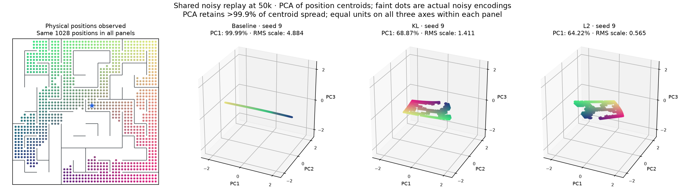
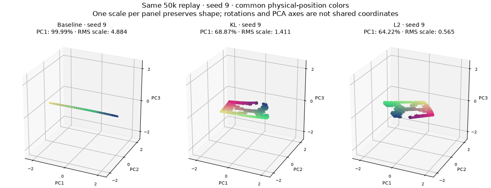
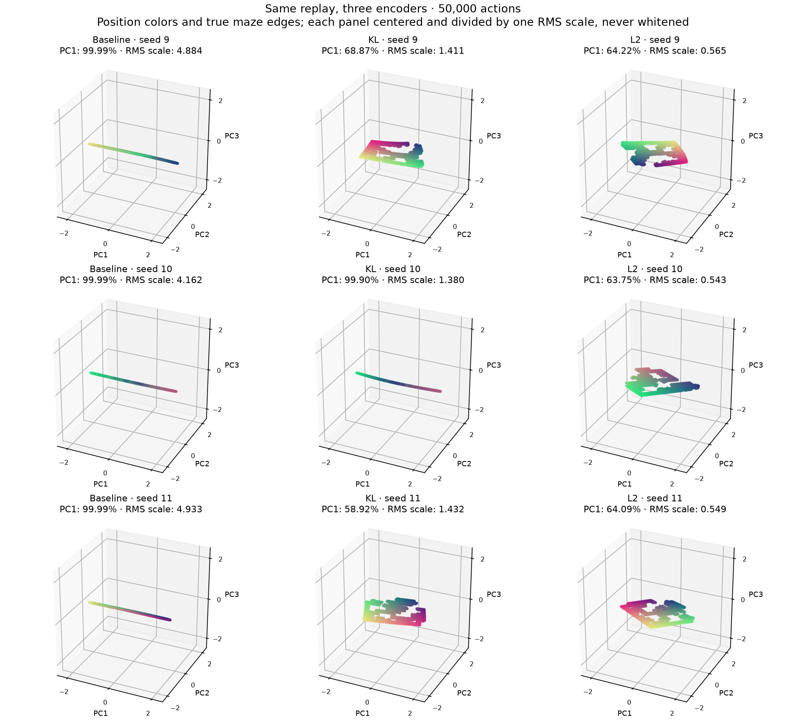
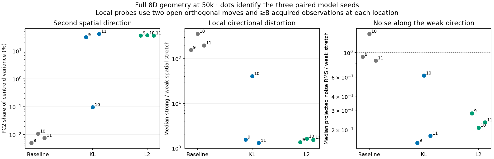
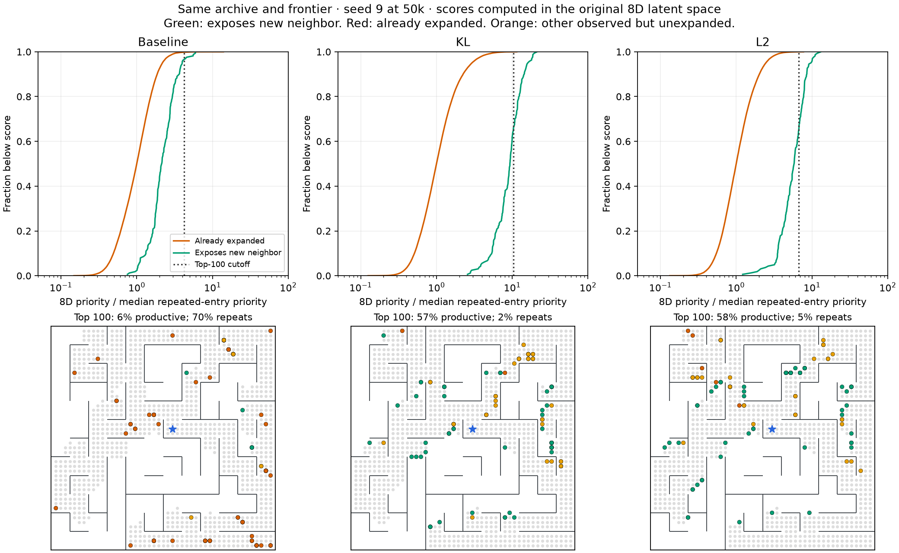

# Geometry of baseline, KL, and L2 on identical replay

November 10, 2026. Analysis of existing checkpoints; no new representation training for these figures.

**The baseline largely squeezes the two-dimensional maze into one long latent direction. L2 preserves two substantial directions.** This provides a more concrete explanation for improved queue ordering despite a worse average noise/movement ratio.



The figure uses the first paired model seed, 9, at 50k source interactions. All three models were trained on the same chronological observations and transition batches from source seed 6. All panels depict the same 1,028 observed physical positions. Colors identify x/y location in the physical maze. Gray edges are true simulator adjacency, provided only for visualization, not predicted edges or training labels.

Each position is represented by the centroid of its actual acquired noisy encodings. Faint dots show up to 12 actual observations per position. Each new observation counts once: repeated use of a restored observation as a transition source does not count as another independent noise draw. No nuisance is resampled or removed for these figures.

PCA is fitted separately to the equally weighted position centroids. We center each representation and divide all its coordinates by **one** RMS scale. We do not whiten or stretch individual axes: the thin baseline shape is real. The figure prints the original RMS scale. PCA retains more than 99.9% of centroid spread in this example; all distance and local-geometry measurements below use the original eight dimensions. Different panel orientations have no intrinsic meaning.



## The pattern across seeds and checkpoints

The analysis covers baseline/KL/L2 × model seeds 9/10/11 × 50k/75k checkpoints, with source replay seeds 6/7/8. It uses the shared-data fits from the previous study, not each online agent's different replay. All 18 cases and saved projected/raw geometry are retained in `runs/l2-geometry-20261110`; [metrics](assets/l2-geometry-results.json) retain individual values.

At 50k:

| Model | PC1 share of spatial spread, seeds 9 / 10 / 11 | Median local strong/weak stretch, seeds 9 / 10 / 11 |
|---|---|---|
| Baseline | 99.99% / 99.99% / 99.99% | 155.9 / 358.8 / 198.6 |
| KL | 68.87% / 99.90% / 58.92% | 1.55 / 40.8 / 1.30 |
| L2 | 64.22% / 63.75% / 64.09% | 1.36 / 1.63 / 1.54 |

These are nearly one-dimensional representations, not constant encoders: distinctions persist in small directions. KL seed 10 remains narrow at 50k but becomes two-dimensional by 75k. All three L2 fits have two substantial dimensions already at 50k. The baseline remains narrow at 75k, with median stretch ratios 21.6 / 308.9 / 85.3. This is shared-data evidence; it does not identify the exact opening time along the different online trajectories.



[All three paired seeds at 75k](assets/l2-geometry-75k.png).

## Why average noise divided by average movement misled us

Consider an illustrative encoding

\[
f(x,y)=(100(x+y),\;0.01(x-y)).
\]

Moving east or north each makes a large latent change. But those changes are almost parallel: the two resulting positions are separated only by the tiny second coordinate. Average single-step length can therefore be large while distinctions between nearby physical states are highly noise-sensitive.

We measured this directly with local two-direction maps. At positions with open +x and +y moves, form an 8×2 matrix whose columns are the two centroid displacement vectors. Its singular values give the strongest and weakest local spatial stretch. We require at least eight acquired observations at the source and both neighbors, and use identical qualifying positions across models. This is a finite-difference diagnostic on empirical centroids, not an exact encoder Jacobian.

We also project the actual within-position encoding residuals onto the weak latent direction. Divide their RMS by the weak spatial stretch. The three per-seed medians at 50k are:

| Model | Seed 9 | Seed 10 | Seed 11 |
|---|---:|---:|---:|
| Baseline | .916 | 1.480 | .849 |
| KL | .152 | .620 | .176 |
| L2 | .282 | .209 | .233 |

Unlike the old average noise/movement ratio, this directional diagnostic puts baseline noise near or above its weak spatial separation. It also identifies KL seed 10's lag. The numerator differs from the previous pairwise-noise statistic, so the values should not be numerically equated; the purpose is to measure signal and noise along the same direction.



Among the position centroids, the nearest *different* centroid lies more than two grid spacings away physically for roughly 67–100% of baseline positions at 50k. This is zero for the L2 fits and KL seeds 9/11. The thin geometry places spatially separated positions close together even before considering their noisy observations. These are Euclidean physical distances, not shortest-path distances around walls.

This suggests that L2 helps by discouraging a long, narrow arrangement and allowing repulsion to spread useful spatial distinctions into another direction. That optimization explanation remains an inference. The observed geometry and its directional noise sensitivity are measured; we have not proved a unique cause of the complete online performance gain or that L2 always learns the right dimensionality.

## Queue ordering in the original eight dimensions

For seed 9 at 50k, the baseline's top 100 queue entries are 6% productive and 70% already expanded. KL reaches 57% productive / 2% repeats; L2 reaches 58% / 5%. Productive means expanding the queued position exposes an unobserved neighbor. The averages across all three seeds remain the previously reported 7.0% / 58.3% / 73.7% productive for baseline/KL/L2.



The top row plots cumulative score distributions for productive and already-expanded entries. Scores are exact eight-dimensional nearest-visited distances, divided by each model's median repeated-entry score for display. More separation to the right helps productive entries win the queue. The vertical line is that model's top-100 threshold. The bottom row shows the physical locations of those entries; duplicate entries can overlap in the graphic. No PCA distance drives this calculation.

## A bounded post-hoc geometry intervention

After seeing the narrow representations, we checked whether simply rescaling existing axes repairs the queue. This is a static reranking experiment on all 18 frozen cases, with covariance fitted only to stored visited latents. It uses no physical labels to fit the transform and no additional environment interactions. Five fixed transforms: identity, uniform ×2 scaling, projection onto the top two PCs, equalization of those two PCs, and whitening all eight PCs. Equalization divides by the visited-coordinate standard deviations; the only floor is 1e-12 for numerical safety. No coefficient or dimension was tuned on these outcomes.

Mean top-100 productive fractions at 50k:

| Transform | Baseline | KL | L2 |
|---|---:|---:|---:|
| Original eight dimensions | 7.0% | 58.3% | 73.7% |
| Uniform ×2 | 7.0% | 58.3% | 73.7% |
| Top two PCs | 3.3% | 59.0% | 73.3% |
| Top two, equalized | 18.3% | 66.0% | 73.3% |
| All eight, whitened | .3% | 1.0% | 1.0% |

Equalizing two directions helps some narrow fits but does not reliably repair the baseline: its per-seed results are 14%, 2%, 39%, versus original 6%, 7%, 8%. KL seed 10 improves from 41% to 72%. L2 changes little. At 75k the mean equalized fractions are 33.7% / 66.3% / 69.0%, versus original 24% / 64% / 68%.

Whitening all eight directions is harmful here: it gives very small directions equal weight, including nuisance-sensitive variation. This is evidence against a blanket inference-time whitening fix. It also limits the causal interpretation of anisotropy: geometry is part of the problem, but amplifying an already noisy weak direction is not equivalent to learning a robust one. These are static rankings, not new online-policy results. [Complete transform results](assets/l2-geometry-transforms.json).

## Reproduction and validation

```sh
.venv/bin/python scripts/analyze_l2_geometry.py --out runs/l2-geometry-new
.venv/bin/python scripts/report_l2_geometry.py --root runs/l2-geometry-new
.venv/bin/python scripts/audit_l2_geometry_transforms.py \
  --geometry runs/l2-geometry-new --out /tmp/l2-geometry-transforms-new.json
```

The analysis requires the archived shared-data fits/replay from the previous study. New output directories/files are required. Reports can be regenerated; existing models and replay are never mutated. The transform audit independently re-encodes queue/archive observations and checks raw priorities against the geometry artifacts. Uniform scaling doubles every score without changing rankings. All figures and sampled frames of the 40-frame rotation were inspected.

The accompanying code cleanup introduces the [plain deterministic formulation](deterministic-formulation.md): z=f(o), residual dynamics, MSE, repulsion, optional L2. It retains historical KL models separately and includes tested checkpoint migration. No geometry-derived loss or whitening transform was added to training or the exploration agent.
