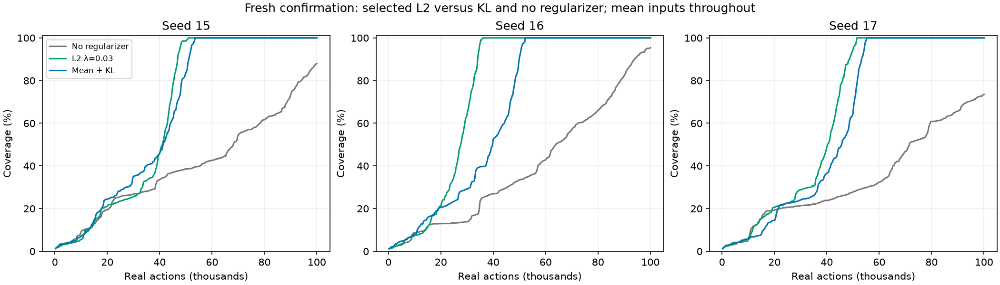
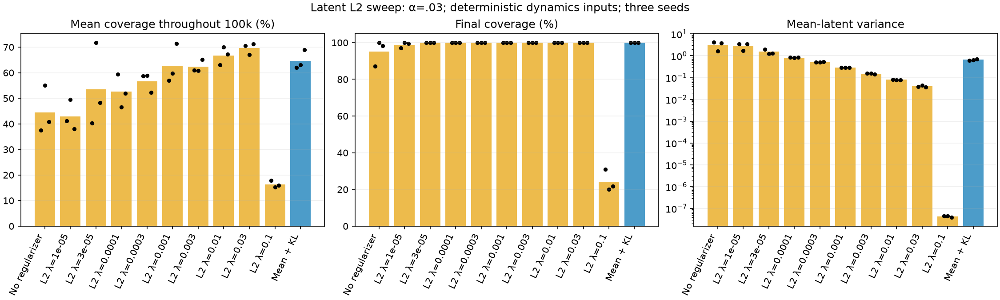
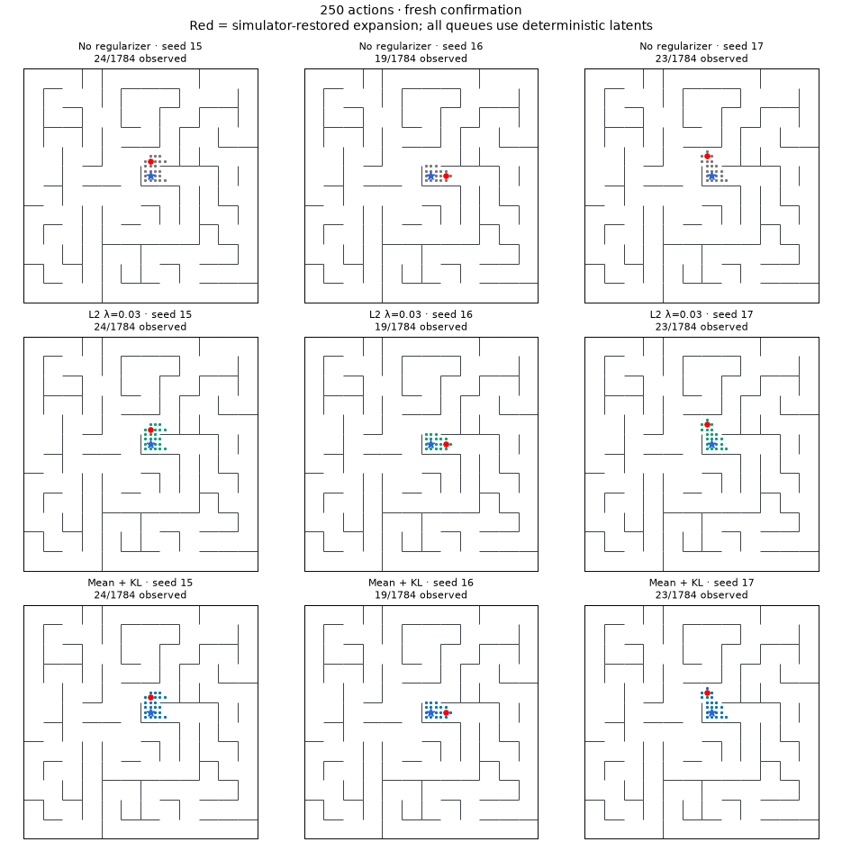
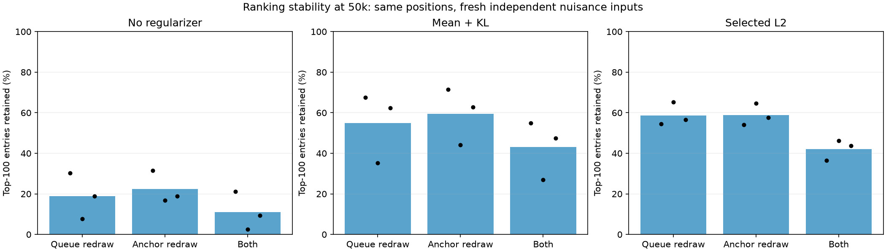
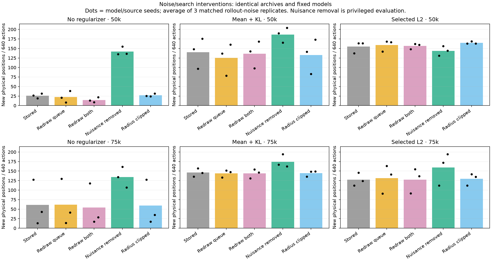

# Latent L2 regularization and observation noise

November 10, 2026. Completed sweep, fresh-seed confirmation, and shared-data diagnostics.

**A simple latent L2 penalty improves this noisy-maze explorer.** The selected coefficient, λ=.03, completed all three fresh seeds in 36–51k actions, versus 52–56k for the KL comparator. None of the three unregularized controls completed within 100k. L2 required **14.3% fewer actions on average than KL** in confirmation, improving each paired seed, although most of that average advantage comes from seed 16.

The mechanism is not established as nuisance-information removal. L2 reduces absolute noise displacement, but reduces adjacent-position separation even more. Nevertheless, its queue is substantially better at selecting positions that expose new territory. This is evidence that **relative geometry and queue ranking matter more than our average noise/movement ratio**.

All training used ordinary noisy replay. Noise redraws, physical state identities, and known-noise removal were used only for diagnostics. The explorer still requires simulator restoration; these results do not establish continuous-position or reset-free exploration.

## Experiment and loss

The environment is the existing maze, layout seed 7, with 1,784 reachable positions at step size .25. Each observation contains normalized x/y and eight independent standard-normal nuisance coordinates. Every successor gets fresh noise. The agent retains its raw visited observations and frontier across training, and orders the frontier by distance to the nearest visited encoder mean. Each expansion restores the cached physical state and tries all five actions, including stay. There is no physical-state deduplication, learned policy, or imagined rollout in this experiment.

For latent dimension d=8 and M=3 dynamics heads, the L2 arms optimize

\[
L = \mathbb E_{(o,a,o^+)}\frac{1}{Md}\sum_{m=1}^{M}
\|g_m(\mu(o),a)-\mu(o^+)\|_2^2
+\alpha\,\mathbb E_{o_i,o_j}[1-\|\mu(o_i)-\mu(o_j)\|_2^2]_+
+\lambda\,\mathbb E_o\|\mu(o)\|_2^2.
\]

Here α=.03 throughout. Dynamics and repulsion differentiate through the encoder; dynamics also differentiates through the target encoder. L2 sums coordinates, averages observations, and uses the same 512 replay observations already drawn for repulsion. It is a penalty on latent means, not weight decay. L2 arms use β=0 and deterministic mean dynamics inputs. The comparator uses learned-Gaussian-prior KL with β=1e-5 and the same deterministic inputs; its posterior and prior still train through KL. No sampled posterior input enters dynamics in any arm here.

Encoder/dynamics widths remain 256 with three hidden layers. Encoder LR is 9e-5; dynamics LR is 3e-4. Shared transition batches are used across heads. Training occurs every **100 expansions / 500 actions**. One replay epoch is causally apportioned over each 1,000-expansion / 5,000-action block: each new transition is presented once within its block, plus a partition of old replay at each event. This is **not a new full epoch every 500 actions**. Every 100k-action run receives 4,112 joint updates and 1,050,000 transition presentations per head. All visited/frontier latents and priorities are recomputed after training.

We screened λ={0, 1e-5, 3e-5, 1e-4, 3e-4, .001, .003, .01, .03, .1} on seeds 9/10/11. Matching zero/KL controls were reused; a fresh complete λ=0 run exactly reproduced its previous replay and final encoder/dynamics weights. Selection used maximum mean coverage AUC over 100k actions, then fixed λ=.03 before testing fresh seeds 15/16/17. The [selection record](assets/l2-noise-selection.json) and [protocol](l2-noise-protocol.md) preserve this adaptive decision.

## Online results

| Arm | Completion actions, seed 15 | Seed 16 | Seed 17 | Mean coverage over 100k | Final mean coverage |
|---|---:|---:|---:|---:|---:|
| No regularizer | >100k | >100k | >100k | 37.8% | 85.6% |
| KL, β=1e-5 | 53,929 | 52,243 | 55,568 | 63.3% | 100% |
| **L2, λ=.03** | **50,856** | **36,289** | **51,397** | **68.1%** | **100%** |

Mean completion cost is 46,181 actions for L2 versus 53,913 for KL. Unfinished runs are censored, not assigned an observed 100k completion time. Final unregularized coverage was 87.9%, 95.4%, and 73.5%.



Screening completion costs for λ=.03 were 43,247 / 46,002 / 43,569 versus KL's 56,036 / 53,514 / 46,698. The selected L2 setting thus beats KL on all six paired seeds, but only the last three are independent of coefficient selection. Positive coefficients from 3e-5 through .03 all completed the screening seeds; 1e-5 did not reliably help. λ=.1 collapsed. [Complete tables](l2-noise-tables.md) retain every arm.



The animation includes all fresh confirmation arms/seeds through the full 100k actions. Red markers are simulator-restored expansion locations, not a continuous navigation trajectory. Rows: no regularizer, L2, KL. Columns: seeds 15, 16, 17.



## Same experience, different representations

To separate representation effects from improved data collection, we trained λ=.03 on the exact chronological replay streams used by the previous no-regularizer/KL controls. The three source streams use seeds 6/7/8 and model seeds 9/10/11. Initial networks, transition minibatches, source observations, update counts, and sample exposures match. The source is the earlier β=0 family, not the new L2 agent's experience.

At each 50k and 75k checkpoint, we reconstruct the same raw visited archive and queue for all three models. An entry is **productive** if expanding its physical position exposes at least one position not yet observed. This is an evaluation label, never a queue input. At 50k each queue has 40,001 entries; only 0.41–0.57% are productive before sorting.

| On the common 50k archive | No regularizer | KL | L2 |
|---|---:|---:|---:|
| Productive fraction in top 100 | 7.0% | 58.3% | **73.7%** |
| Already-expanded fraction in top 100 | 80.7% | 18.7% | **4.0%** |
| New physical positions in 640-action frozen continuation | 25.8 | 140.2 | **154.9** |
| Nearest memory has correct physical identity, conditional on a true revisit | 67.8% | 90.8% | 90.7% |

For L2, the per-seed top-100 productive fractions are 58%, 87%, 76%; for no regularizer they are 6%, 7%, 8%. Frozen continuations average three matched observation-noise replicates per trained model, with no learning and 128 expansions / 640 actions each. These replicates are not independent model seeds.

At 75k the corresponding productive fractions are 24%, 64%, 68%, while continuation discoveries are 61.2, 146.0, 127.2. **L2 does not dominate KL at every fixed checkpoint.** In particular, static top-100 purity is not equivalent to eventual yield: expansions change the queue and can lead to different downstream territory. Correct physical nearest-memory identity rises to 83.9%, 99.8%, 90.2% respectively at 75k, so that diagnostic also does not by itself determine the online winner.

## What observation noise does to search

We independently redraw nuisance coordinates on queued observations, visited anchors, or both while preserving physical positions and archive membership. Each model/checkpoint gets ten paired ranking redraws. We also test frozen continuations with three matched noise replicates. These are controlled simulator diagnostics; they do not assume we can resample nuisance in an arbitrary real environment. Redrawing stored observations also removes any selection bias in their original noise realizations, so it is not a pure variance-only intervention.

At 50k, redrawing both archives retains only **11% of the baseline's top-100 entries**, versus 43% for KL and 42% for L2. The physical-position Jaccard similarities are .154 / .385 / .442, so the change is not merely switching between duplicate entries from the same position. Redrawing either queue observations or visited anchors alone also changes the head substantially.



However, giving the baseline a different noise draw does not rescue it. Its 640-action discovery yield changes from 25.8 with stored observations to 22.6 with a queue-only redraw and 14.7 with both archives redrawn. L2 remains at 154.9 / 158.8 / 156.4. The precise queue ordering is noise-sensitive even in successful models, but productive enrichment can survive substantial entry churn. This is a systematic representation/search interaction rather than just one unlucky noise draw.

Two additional evaluation interventions help narrow the explanation:

* **Known nuisance removal:** set the eight nuisance inputs to zero in the entire queue, visited archive, and every new observation. At 50k, discovery changes from 25.8→142.0 for the baseline, 140.2→186.3 for KL, and 154.9→143.7 for L2. At 75k it changes from 61.2→134.0, 146.0→174.3, and 127.2→159.3. The baseline is clearly harmed by nuisance, but this intervention is not uniformly beneficial to a regularized model. It restores exact identical encodings for physical revisits by construction and changes the evaluation input distribution. It is neither a deployable solution nor a guaranteed upper bound on performance.
* **Large-radius clipping:** cap latent displacement from the visited-latent centroid at its 95th-percentile radius, consistently for the queue, anchors, and future observations. The baseline yields 27.2 instead of 25.8 discoveries at 50k and 59.7 instead of 61.2 at 75k. This particular geometric clipping intervention does not reproduce the regularization gain.



The baseline's top-100 entries average only the **51st percentile of latent norm** and 43rd percentile of centered radius at 50k. They are not predominantly the largest-norm entries. They do have elevated nuisance residuals: the 68th percentile overall, and 75th among the already-expanded entries in the queue head. Here residual means distance between the original encoding and the encoding with its nuisance inputs zeroed; it is not a direct measurement of mutual information or a conditional-mean residual.

Thus, “outlier” is more plausibly local to the stored observations than simply far from the global origin. Noise can make a familiar position insufficiently close to its memories, while geometric folding can bring distinct positions too close. Incorrect nearest-memory identity diagnoses confusion but can cause either type of ranking error; we have not isolated their individual causal contributions.

## Better search does not require a smaller average noise ratio

On the **same 50k training data**, these probe measurements are:

| Quantity | No regularizer | KL | L2 |
|---|---:|---:|---:|
| Same-position noise-pair distance | .0325 | .0197 | .0126 |
| Moving-neighbor centroid distance | .2382 | .0761 | .0314 |
| Mean noise/movement ratio | .137 | .260 | .400 |
| Normalized dynamics MSE | .000351 | .000686 | .001412 |

Noise-pair distance compares independent nuisance draws at the same position. Movement distance compares neighboring-position centroids, using common nuisance draws to reduce Monte Carlo error. Probes use 64 evaluation positions with 16 nuisance draws each. Normalized MSE divides latent prediction MSE by that model's latent variance; it is not physical transition classification accuracy.

L2 reduces noise displacement, but spatial distances contract more. The final fresh online ratio likewise goes from .114 without regularization to .378 with L2. Therefore neither lower average nuisance sensitivity relative to movement nor lower normalized training error explains the improvement. We also cannot infer how many bits of nuisance remain encoded from these distances.

A global rescaling of all latents preserves every nearest-neighbor distance ordering. Consequently, simple shrinkage at inference cannot explain the gain. L2 changes training and the relative arrangement of representations. One plausible interpretation is that its competition with bounded repulsion encourages a more useful arrangement of limited latent spread, but the exact geometric mechanism remains unresolved. The shared-data results establish the representation effect without identifying a unique cause.

## Why the strongest L2 setting collapses

There is a useful analytical boundary for this exact objective. Let Z and Z′ be independent latent draws from the replay-state distribution, with mean m and total variance V=tr Cov(Z). Then

\[
\mathbb E[1-\|Z-Z'\|^2]_+\geq 1-2V,
\qquad \mathbb E\|Z\|^2=V+\|m\|^2.
\]

Since dynamics MSE is nonnegative,

\[
L\geq \alpha+(\lambda-2\alpha)V+\lambda\|m\|^2.
\]

For λ≥2α, a zero encoder and zero dynamics predictions achieve L=α, the global minimum of the expected objective. At λ>2α every nonzero mean/variance incurs a strictly higher lower bound. This statement assumes the independent replay sampling and sum-of-coordinate L2 convention used here; it does not claim a sharp practical optimization boundary below that value.

With α=.03, the bound is λ=.06. Our λ=.1 arm is beyond it and collapses to mean-latent variance around 4e-8, with only 24.3% average final coverage. Increasing training cannot fix an objective whose optimum is collapse. The selected λ=.03 is below the bound; it remains an empirical choice, not a proven optimum.

## Artifacts, validation, and reproduction

New work comprises 36 scientific online runs, one full zero-control reproduction, and three shared-data fits: **40 full-budget fits / 164,480 joint updates**. Six old online controls are reused. Main noise diagnostics contain 18 model/seed/checkpoint cases × 15 frozen continuations × 640 actions =172,800 evaluation actions. The shared-data runner additionally produces nine 35k continuations, or 5,760 actions. Total newly collected actions, including the zero reproduction and all evaluation, are 3,878,560. Replay-only fits collect no training actions.

**80 tests passed.** The independent [audit](assets/l2-noise-audit.json) checked all 43 online manifest entries, 18 noise cases, and three shared-data fits: budgets, matched initialization, first data prefixes, complete paired successor-noise streams, exact final priorities recomputed from raw observations, and fixed-replay/batch hashes. The full λ=0 reproduction exactly matches the old replay and final encoder/dynamics. The [nearest-memory audit](assets/l2-noise-neighbors.json) and [full summary](assets/l2-noise-summary.json) retain per-seed values. The 100-frame GIF and scientific figures were visually inspected.

Study roots:

* `runs/l2-noise-screen-20261110`: coefficient screen and full zero reproduction.
* `runs/l2-noise-confirm-20261110`: nine fresh online confirmations.
* `runs/l2-noise-fixed-20261110`: three selected-L2 shared-data fits.
* `runs/l2-noise-controls-20261110` and `runs/l2-noise-selected-20261110`: conditional nuisance diagnostics.

Each online run retains raw replay, intermediate/final checkpoints, frontier, training logs, settings, and animation frames. Existing outputs are preserved. Source replay/checkpoints under `runs/` are local artifacts, not assumed to be in Git.

From the repository root, a fresh selected-arm run is:

```sh
.venv/bin/python scripts/persistent_frontier.py \
  --arm interleaved100 --seed 15 --out runs/l2-example-new \
  --repulsion-weight .03 --bottleneck-beta 0 \
  --dynamics-input mean --latent-l2 .03
```

Repeat the entire screen and confirmation into unused directories:

```sh
.venv/bin/python scripts/run_l2_sweep.py --out runs/l2-screen-new --jobs 6
.venv/bin/python scripts/run_l2_sweep.py --out runs/l2-confirm-new \
  --lambdas 0,.03 --seeds 15,16,17 --jobs 3
```

`run_l2_sweep.py` automatically includes the mean-input KL comparator. `--reuse` uses the old matching controls for seeds 9/10/11; omit it for an entirely new run. `scripts/finish_l2_noise.py` records the one-time selection/orchestration used for this study and intentionally refuses to overwrite its recorded selection/output directories.

Recreate diagnostics using retained shared-data fits, with new output directories:

```sh
.venv/bin/python scripts/noise_search_diagnostics.py --out runs/l2-noise-controls-new --jobs 4
.venv/bin/python scripts/noise_search_diagnostics.py --out runs/l2-noise-selected-new \
  --l2-root runs/l2-noise-fixed-20261110 --jobs 4
.venv/bin/python scripts/audit_l2_neighbors.py
```

Rebuild the retained-study audit and figures:

```sh
.venv/bin/python scripts/audit_l2_noise.py \
  --roots runs/l2-noise-screen-20261110 runs/l2-noise-confirm-20261110 \
  --noise-roots runs/l2-noise-controls-20261110 runs/l2-noise-selected-20261110 \
  --fixed runs/l2-noise-fixed-20261110 --out docs/assets/l2-noise-audit.json
.venv/bin/python scripts/report_l2_noise.py \
  --screen runs/l2-noise-screen-20261110 --confirm runs/l2-noise-confirm-20261110 \
  --noise-roots runs/l2-noise-controls-20261110 runs/l2-noise-selected-20261110
```

The supported next baseline is deterministic dynamics + repulsion α=.03 + latent L2 λ=.03. KL remains a strong comparator. We have three fresh confirmation seeds on one maze, one nuisance distribution, and one training cadence; no claim of universal optimality or solved continuous exploration is warranted.
