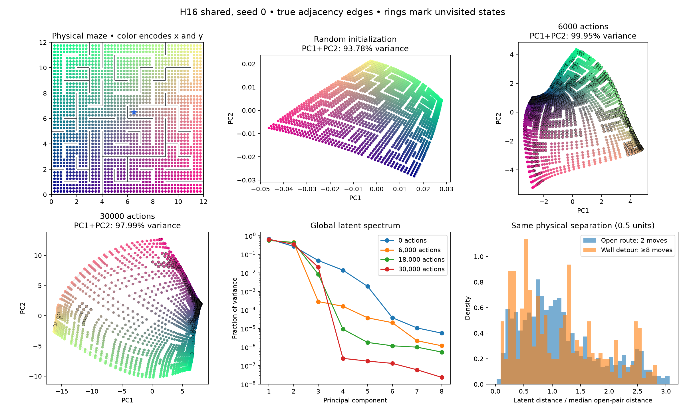
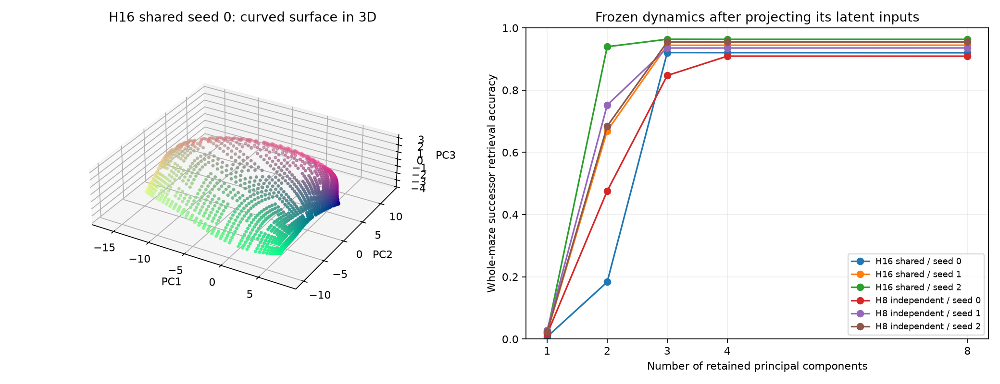
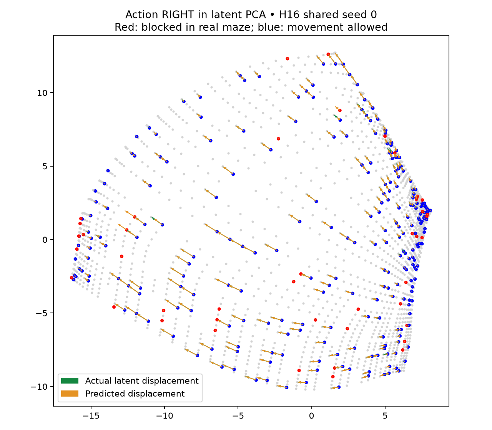

# Latent geometry and action structure

Audited H8 independent and H16 shared, seeds 0–2, at initialization and 6k/18k/30k interactions. Observations are two-dimensional coordinates. All maze geometry, shortest paths, linear probes, and labels are post-hoc evaluation only.

**The learned latent is a distorted coordinate surface, with small but consequential extra directions.** At 30k, the first two principal components explain 98.0–100.0% of variance across six models. This does not mean two coordinates suffice for the existing dynamics: removing lower-variance directions can sharply reduce successor accuracy. Three components restore nearly all accuracy in five models; the sixth needs four. This is an input ablation without retraining, not a minimal-dimensionality theorem.

## What the pictures show

Colors encode physical x/y consistently across panels. Gray edges are actual simulator adjacency, overlaid for evaluation; they are not an extracted learned graph. Rings mark states unvisited at that checkpoint. PCA axes are fitted separately at each checkpoint, so rotations/reflections are not evidence of meaningful representation drift.

A maze-like layout is already visible at random initialization: a smooth MLP applied to coordinates preserves substantial spatial structure, and wall-shaped gaps exist in the evaluated free-space coordinates themselves. The picture alone is not evidence that the encoder learned walls. Initialization uses the original seed and architecture; its diagnostic coordinate probe uses the corresponding final visited set.

## Euclidean latent distance does not encode maze distance

| Model (mean of three seeds) | PC1+PC2 variance | Latent–physical distance Spearman | Latent–shortest-path Spearman | Across-wall/open distance ratio |
|---|---:|---:|---:|---:|
| h16_shared_30k, 0 | 96.15% | 0.946 | 0.691 | 0.986 |
| h16_shared_30k, 6,000 | 99.96% | 0.918 | 0.690 | 1.017 |
| h16_shared_30k, 18,000 | 99.67% | 0.870 | 0.676 | 0.948 |
| h16_shared_30k, 30,000 | 99.24% | 0.889 | 0.651 | 0.940 |
| h8_independent_30k, 0 | 96.15% | 0.946 | 0.691 | 0.986 |
| h8_independent_30k, 6,000 | 98.44% | 0.827 | 0.664 | 0.993 |
| h8_independent_30k, 18,000 | 99.70% | 0.849 | 0.680 | 0.952 |
| h8_independent_30k, 30,000 | 99.72% | 0.886 | 0.677 | 0.974 |

Pair correlations use all distinct pairs in the 1,784-state maze, with each model seed aggregated equally. Physical Euclidean distance itself has Spearman 0.718 with shortest-path distance. Learned latent distances do not improve that relationship.

The last column compares median latent distances for pairs physically 0.5 units apart: open pairs require two moves; barrier pairs require at least eight. Ratios near one show no consistent wall-dependent expansion. These pairs are matched on physical separation, not on location or local encoder stretching; this is not proof that every wall is ignored.

A diagnostic linear coordinate decoder fitted on 80% of visited states recovers coordinates less accurately after learning than at initialization. The embedding becomes nonlinear rather than simply a rotated/scaled copy of x/y. Full probe errors and nearest-neighbor graph distances are retained in JSON. Neither a failed linear decoder nor increased distortion implies lost state information.

Because the encoder maps two coordinate inputs into eight outputs, its smooth image can be a curved two-dimensional surface spanning three or more principal components. Global PCA dimension is different from intrinsic dimension.

Local scale is also nonuniform: across the six final models, the 95th-percentile local moving-edge length is 3.5–8.9 times the 5th percentile. A single latent-distance threshold therefore represents different physical tolerances in different regions. Local spacing is positively correlated with visitation in all six models (Spearman 0.31–0.64). Per-model local spacing and its correlation with visitation are retained in `latent-local-spacing.json`; these associations do not isolate the cause of the distortion.

## Small directions carry predictive information

| Model / seed | Full 8D input | Keep PC1–2 | Keep PC1–3 | Keep PC1–4 |
|---|---:|---:|---:|---:|
| h16_shared_30k / 0 | 92.0% | 18.3% | 92.1% | 92.0% |
| h16_shared_30k / 1 | 94.4% | 66.9% | 94.4% | 94.4% |
| h16_shared_30k / 2 | 96.3% | 94.0% | 96.4% | 96.3% |
| h8_independent_30k / 0 | 90.9% | 47.6% | 84.7% | 90.9% |
| h8_independent_30k / 1 | 93.6% | 75.2% | 93.5% | 93.5% |
| h8_independent_30k / 2 | 95.5% | 68.4% | 95.5% | 95.5% |

Inputs are projected onto the top components and reconstructed back into eight dimensions before entering the unchanged dynamics. Targets and nearest-state retrieval catalogue retain all eight dimensions. Accuracy is over **all maze states and four directional actions**, including unexplored regions; it is not the earlier seen-transition ~99% metric. Off-manifold inputs and lack of retraining are limitations of this ablation.

## Dynamics encode action-dependent obstacles

For the six final models, a blocked directional action predicts median displacement only 0.020–0.034 times the median actual moving-edge length; an allowed move predicts 0.96–0.99 times that scale. Predicted displacement separates blocked from allowed actions with AUROC 0.92–0.96 across the whole maze. That supports the interpretation that obstacle structure lives substantially in the action-conditioned dynamics, even though Euclidean latent distances do not encode detours.

This figure shows every sixth state for one action (right), projected to PCA2. Red sources are physically blocked, blue sources can move. Green arrows are true latent displacements; orange arrows are ensemble-mean predictions. The important third component is hidden here.

## Can latent distances identify loops?

For each frozen final model, 256 persistent-random trajectories of length 32 start at visited states. Recursively predicted states are compared to **earlier imagined states on the same path**. The score is negative minimum latent distance; labels use whether the true simulator path revisits any earlier position. Stationary steps are excluded, so this tests moving returns rather than just stay actions or wall collisions.

| Model | Revisit AUROC through H16 | Through H32 | H16 recall at 5% false-positive rate |
|---|---:|---:|---:|
| h16_shared_30k | 0.987 | 0.970 | 96.1% |
| h8_independent_30k | 0.973 | 0.940 | 88.0% |

This makes a path-local loop penalty plausible. It does not yet validate a threshold or a benefit under MCTS-selected trajectories. The recall threshold was chosen post hoc from the same diagnostic samples, separately per model; its normalization uses an oracle median edge length. No such threshold, oracle graph, or loop penalty was fed to the live experiments. Detection is less reliable at longer horizons.

Because observations are coordinates, an encoder is already a function of two inputs and exact revisits have identical encodings. These findings do not establish state equivalence under pixel noise, partial observability, or continuous non-repeating observations.

## Reproduction

Run `scripts/analyze_latent_geometry.py`, `scripts/audit_geometry_dynamics.py`, then `scripts/report_latent_geometry.py` with the repository virtualenv. The first refuses an existing `runs/latent-geometry-20261110`; preserve or choose a fresh output directory to recompute. Portable metrics: `docs/assets/latent-geometry-results.json` and `docs/assets/geometry-dynamics-results.json`. Per-state latent arrays and PCA projections: `runs/latent-geometry-20261110/*.npz`.
