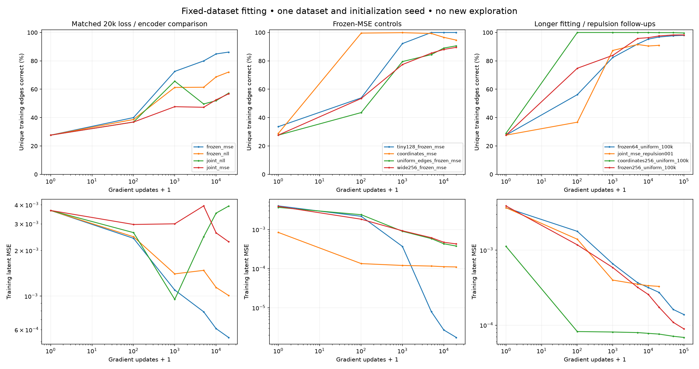

# Fixed-data memorization experiments — 2026-11-09

All experiments fit the same saved seed-0 coordinate-maze replay: 10,000 transitions, 2,606 unique state-actions, 762 observed states. Identical observed state/actions have no conflicting targets. The pretrained encoder has 762 distinct float32 outputs on those states, with minimum separation 0.00957. No new exploration is performed.

The fixed dataset is much easier to fit than the online results suggested, but we have not achieved exact memorization of the entire set. The 128-edge control reaches 100% retrieval for every member; longer frozen-encoder MSE reaches 98.0–98.3% of all 2,606 distinct edges. A fixed-coordinate control reaches 99.65%. These do not mean zero continuous prediction residual.

The cleanest joint-training result is the single-factor repulsion ablation: lowering its weight from 10 to 0.01 raises unique-edge accuracy from 56.75% to 90.94% at the same 20k budget, above frozen-MSE’s 86.19%. Joint training itself is not ruled out; objective balance matters.



## Training-set results

Physical correctness means nearest-latent next-position retrieval against the full maze catalogue, used only by evaluation. It is a discrete correctness criterion, not zero continuous regression error. Uniform-edge runs weight each distinct training edge equally; whole-replay runs retain visitation frequency. Compare the unique-edge column for the common 2,606-edge training set. The tiny control fits only 128 edges.

| Experiment | Updates | Edges | Weighted accuracy | Unique-edge accuracy | Per-member accuracy¹ | Latent MSE | Unseen accuracy² |
|---|---:|---:|---:|---:|---:|---:|---:|
| frozen_mse | 20,000 | 2,606 | 91.25% | 86.19% | 90.55% | 0.000534 | 67.58% |
| frozen_nll | 20,000 | 2,606 | 78.82% | 72.10% | 78.62% | 0.00101 | 63.38% |
| joint_nll | 20,000 | 2,606 | 62.94% | 57.21% | 62.10% | 0.00392 | 50.88% |
| tiny128_frozen_mse | 20,000 | 128 | 100.00% | 100.00% | 100.00% | 1.75e-06 | 62.01% |
| joint_mse | 20,000 | 2,606 | 69.08% | 56.75% | 68.57% | 0.00228 | 23.14% |
| coordinates_mse | 20,000 | 2,606 | 97.56% | 94.63% | 97.57% | 0.00011 | 90.04% |
| uniform_edges_frozen_mse | 20,000 | 2,606 | 90.60% | 90.60% | 90.25% | 0.000377 | 77.05% |
| wide256_frozen_mse | 20,000 | 2,606 | 93.73% | 89.52% | 93.56% | 0.000428 | 66.11% |
| frozen64_uniform_100k | 100,000 | 2,606 | 98.00% | 98.00% | 97.79% | 0.000138 | 81.25% |
| joint_mse_repulsion001 | 20,000 | 2,606 | 94.44% | 90.94% | 94.20% | 0.000328 | 77.54% |
| coordinates256_uniform_100k | 100,000 | 2,606 | 99.65% | 99.65% | 99.67% | 6.86e-05 | 95.21% |
| frozen256_uniform_100k | 100,000 | 2,606 | 98.31% | 98.31% | 98.17% | 8.91e-05 | 78.32% |

¹ Mean over all three members and training examples, with the same weighting as weighted accuracy. Other accuracy columns use the ensemble mean. ² Disjoint state-actions absent from fitting; an evaluator-only sample of up to 1,024 pairs. The tiny condition has a different unseen set.

## What is controlled

- All learned encoders start from the same saved replay-baseline checkpoint. Every dynamics ensemble starts freshly initialized; optimizer state is reset. Seed 7 is shared. The pretrained encoder has already seen this replay, so these are memorization diagnostics, not unsupervised generalization claims.
- Frozen tests precompute inputs and targets once. Joint tests backpropagate through both sides. Coordinate controls repeat the observed normalized x/y to eight dimensions, with no learned encoder or hidden geometric input.
- The four primary conditions use width 64, three single-Gaussian heads, 20k updates, batch size 128, and Adam with cosine learning rate decay from 3e-4 to 1e-5. Training shuffles each member independently and keeps partial batches.
- NLL is negative log likelihood divided by eight latent dimensions. MSE is mean squared error of each member’s predictive mean. For joint runs, add 10 times the original hinge repulsion. This changes the relative loss scale between NLL and MSE; it is intentionally not presented as a scale-matched comparison.
- Frozen/coordinate encoders omit constant repulsion. Gaussian variances are not trained by MSE; MSE runs do not report JS/NLL/variance as meaningful diagnostics.
- Longer runs fit unique edges uniformly for 100k updates at initial learning rate 1e-3, cosine-decayed to 1e-3/30. Width 64 and 256 learned-encoder runs otherwise match. The coordinate control uses width 256.
- The low-repulsion joint follow-up changes only repulsion weight from 10 to 0.01 relative to the 20k joint-MSE condition. It retains the initial 3e-4 learning rate and visitation-weighted replay.
- Wider dynamics contain more parameters, while the frozen learned encoder remains exactly unchanged. The checkpoints, data hashes, fitting indices, source snapshots, and actual options are saved per run.

## Encoder gradient scale audit

At the common initial encoder and fresh dynamics, over 32 minibatches, the median ratio of weighted repulsion gradient norm to prediction gradient norm is **188.4 for MSE at weight 10**, **0.188 at weight 0.01**, and **3.77 for NLL at weight 10**. These are encoder gradients with the same minibatch shared across heads, an initialization diagnostic rather than proof of the mechanism throughout training. The 188× figure applies to the MSE experiment, not the original NLL-based online objective.

Changing NLL to MSE without adjusting the repulsion coefficient is therefore not a neutral objective comparison. The matched coefficient ablation supports loss balance as a cause of poor joint-MSE fitting. Frozen NLL vs frozen MSE omits repulsion and still favors direct MSE on training retrieval.

## Model / representation diagnostics

| Experiment | Dynamics parameters | Encoder drift MSE | Latent variance | Near-bound fraction |
|---|---:|---:|---:|---:|
| frozen_mse | 18,483 | 0 | 0.5105 | 47.8% |
| frozen_nll | 18,483 | 0 | 0.5105 | 47.8% |
| joint_nll | 18,483 | 0.1924 | 0.4764 | 68.7% |
| tiny128_frozen_mse | 18,483 | 0 | 0.5105 | 47.8% |
| joint_mse | 18,483 | 0.1882 | 0.6030 | 79.1% |
| coordinates_mse | 18,483 | 0 | 0.3272 | n/a |
| uniform_edges_frozen_mse | 18,483 | 0 | 0.5105 | 47.8% |
| wide256_frozen_mse | 221,235 | 0 | 0.5105 | 47.8% |
| frozen64_uniform_100k | 18,483 | 0 | 0.5105 | 47.8% |
| joint_mse_repulsion001 | 18,483 | 0.2785 | 0.4095 | 28.6% |
| coordinates256_uniform_100k | 221,235 | 0 | 0.3272 | n/a |
| frozen256_uniform_100k | 221,235 | 0 | 0.5105 | 47.8% |

## Reproduction

```bash
MPLCONFIGDIR=/tmp/map-memorize-mpl .venv/bin/python scripts/run_memorization.py --manifest configs/memorization.json --out runs/memorization-20261109 --jobs 3
MPLCONFIGDIR=/tmp/map-memorize-mpl .venv/bin/python scripts/run_memorization.py --manifest configs/memorization_followup.json --out runs/memorization-followup-20261109 --jobs 3
MPLCONFIGDIR=/tmp/map-memorize-mpl .venv/bin/python scripts/report_memorization.py --runs runs/memorization-20261109 runs/memorization-followup-20261109 --out docs/memorization.md
.venv/bin/python scripts/audit_memorization_gradients.py --checkpoint runs/probabilistic-cadence-20261109/replay-seed0/checkpoint.pt --data runs/probabilistic-cadence-20261109/replay-seed0/replay.npz --out runs/memorization-20261109/gradient-audit.json
```

Use fresh output directories to repeat training; existing experiment directories are never overwritten. Raw runs are ignored by git; [portable numeric results](assets/memorization-results.json) and this report are included in the repo.

This is one exploratory dataset/initialization, with follow-ups chosen after inspecting the first stage. It does not establish a general ranking of algorithms. Physical retrieval can be sensitive to latent geometry; raw MSE comparisons across changing encoders are not common-unit accuracy comparisons.
