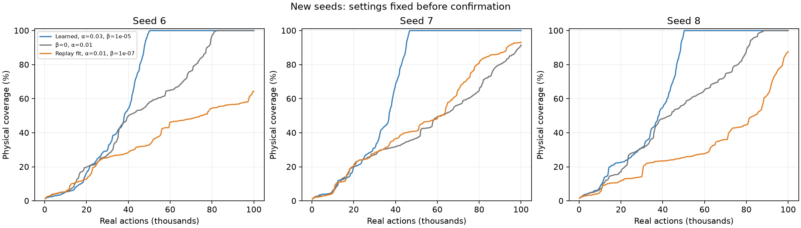
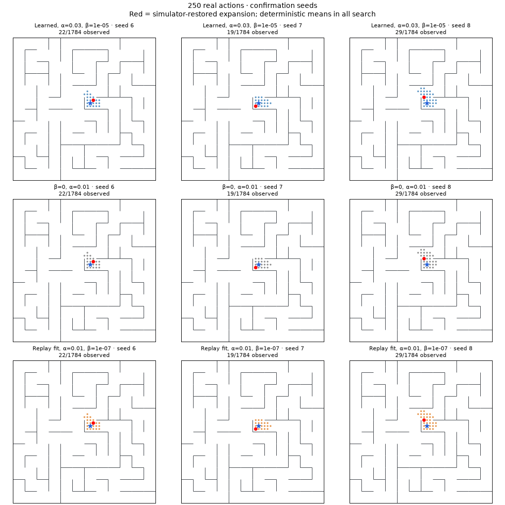
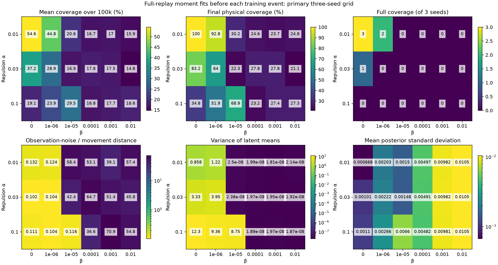
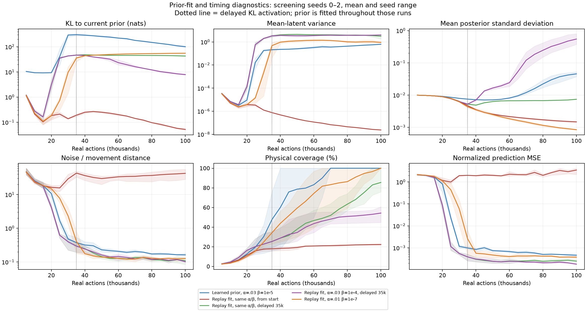

# Moment-fitted Gaussian prior experiments

Completed November 10, 2026. **Replacing the gradient-trained prior with an analytically fitted diagonal Gaussian did not improve exploration in this study.** After a joint β × repulsion screen and timing follow-ups, the selected fitted-prior candidate underperformed both the previous learned-prior winner and β=0 on average on fresh seeds. The learned-prior winner remains the preferred experimental setting.

There were **82 new 100k-action runs**, including one exact β=0 reproduction: 8.2 million real actions and 337,184 joint gradient updates. Nine matching β=0 screening controls and three previously audited learned-prior reference runs were reused. All runs completed; no earlier run was overwritten.

## Fresh-seed result

Settings were selected on seeds 0/1/2, then fixed before candidate runs on seeds 6/7/8. The criterion was maximum mean coverage AUC among positive-β moment-prior variants; the [selection record](assets/moment-prior-selection.json) includes every candidate. “Mean coverage” is normalized area under the coverage-versus-actions curve through 100k actions, using 250-action logs. Higher means faster discovery across the run. It is not final coverage.

| Condition | Repulsion α | β | Full coverage actions, seeds 6 / 7 / 8 | Final coverage, seeds 6 / 7 / 8 | Mean coverage over run |
|---|---:|---:|---|---|---:|
| Previous learned-prior winner | 0.03 | 1e-5 | 50,307 / 46,906 / 50,292 | 100% / 100% / 100% | **66.5%** |
| Stochastic β=0 baseline | 0.01 | 0 | 82,943 / >100k / 88,477 | 100% / 91.5% / 100% | 50.2% |
| Selected replay-moment fit | 0.01 | 1e-7 | >100k / >100k / >100k | 64.3% / 93.1% / 87.6% | 37.0% |

The fitted candidate was slower than the learned winner on all three fresh seeds. It beat β=0 on seed 7's coverage AUC and final coverage, but lost on seeds 6 and 8. None of its three fresh runs completed within budget, versus all three screening runs completing. This is evidence against promoting this candidate, not proof that every moment-prior configuration is inferior. Three new seeds on one maze cannot establish universal rankings.



The animation shows the **entire 100k-action budget**. Rows: learned-prior winner, β=0, selected fitted prior. Columns: seeds 6/7/8. Dots are physically observed positions, red is the current simulator-restored expansion, and the blue cross marks the origin. Restoration jumps are not continuous trajectories. All three methods still order their queues by deterministic encoder means.



## What changed

The stochastic encoder is

`q(z|o) = Normal(μ(o), diag σ²(o))`.

For every latent coordinate j, the replay-fitted prior uses

`m_j = E_replay μ_j(o)`

`v_j = Var_replay μ_j(o) + E_replay σ_j²(o)`

`p*(z) = Normal(m, diag v)`.

Expectations include **every source and successor observation in current replay, with replay multiplicity**, not one observation per physical position. The encoder is current, not a cache of old latents. Float64 streaming central moments avoid cancellation. Posterior variance is included: fitting only the variance of encoder means would be incorrect.

These moments minimize average KL over diagonal Gaussian priors for the frozen encoder and current replay distribution. They are detached during backpropagation. At an exact optimum, the partial encoder gradient equals the gradient of the profiled objective; a numerical gradient test checks this. With the full-replay variant the prior is fitted before each 500-action training event and held fixed during that event's updates, so later updates can experience fitting lag. It is refitted after each 5k-action block for accurate saved checkpoints. The fitted prior has no artificial scale ceiling; the encoder's existing posterior log-standard-deviation bounds [-12, 2] remain.

The loss otherwise remains

`L = E_{heads,batch} [(1/8) ||g_m(μ(o)+σ(o)ε,a) − μ(o_next)||²]`

`    + α E_pairs max(0, 1 − ||μ(o_i)−μ(o_j)||²)`

`    + β E_observations KL(q(z|o) || p(z))`.

ε is standard-normal reparameterization noise. Both dynamics endpoints and repulsion endpoints receive encoder gradients. Dynamics heads share batches and input samples. KL sums over eight coordinates and averages observations, in nats/observation. Only joint training samples the encoder; queue construction, priority refreshes, and agent decisions use deterministic means. There is no reconstruction objective, physical-state deduplication, or change to exploration policy.

## Controlled protocol and cost

Same maze layout seed 7, 1,784 reachable positions, normalized coordinates plus eight fresh Gaussian nuisance inputs. Every restoration expansion executes five actions, including stay. Persistent raw-observation visited set and frontier are re-encoded after each training event, with exact nearest-visited Euclidean priorities recomputed.

Every run uses 100k actions, 20k expansions, **4,112 updates**, and **1,050,000 transition presentations per dynamics head**. Training occurs every 100 expansions, which is **500 actions**. Each event trains its causally available portion of an accumulated replay epoch; each 1,000-expansion/5k-action block completes one epoch. These are continuing joint updates, not network reinitializations. All variants retain latent dimension 8, encoder and three dynamics heads of width 256 with three hidden layers, encoder LR 9e-5, dynamics LR 3e-4, and initial posterior standard deviation 0.01. The gradient-trained prior starts with standard deviation 0.05 and uses LR 3e-4.

Full-replay fitting adds forward-pass work, not gradient updates: **220 fits and 22.2 million endpoint-observation encodings per run**. For the selected fresh runs, fitting took 20.2–20.8 seconds out of 85.0–85.6 seconds total. Wall times varied with concurrent load; they are not a controlled throughput benchmark. Environment-interaction budgets remain matched.

## Sweep and adaptive decisions

| Stage | Conditions, each on seeds 0/1/2 unless stated | New full runs |
|---|---|---:|
| Primary replay-fit grid | α={.01,.03,.1}, β={0,1e-6,1e-5,1e-4,1e-3,1e-2}; nine β=0 controls reused | 45 |
| Exact β=0 reproduction | α=.03, seed 0, full 100k budget | 1 |
| Per-update batch fit | (α,β)=(.01,1e-6),(.03,1e-5) | 6 |
| Lower/intermediate β refinement | α={.01,.03}, β={1e-7,3e-6} | 12 |
| Delayed KL | α=.03, β=1e-5, off through 35k actions | 3 |
| Stronger delayed KL | α=.03, β={1e-4,1e-3}, same 35k prefix | 6 |
| Fresh confirmation | Selected candidate, previous learned winner, β=0; seeds 6/7/8 | 9 |

The primary sweep showed a sharp collapse boundary, motivating the finer β grid. The best positive-β moment candidate was α=.01, β=1e-7: screening completions 70,188 / 65,137 / 97,758 actions and 53.1% mean coverage. It already trailed β=0's 54.6% and the learned winner's 62.0% on the screening mean. Fresh confirmation tested whether its three successful screening completions generalized; they did not.



Increasing repulsion to .1 allowed β=1e-5 to avoid collapse, but none of those three runs completed: final coverage averaged 68.9%, mean coverage 29.5%. A spread-out map alone did not produce good exploration. Larger β values again collapsed. All conditions, including failed and intermediate ones, are in the [complete tables](moment-prior-tables.md).

### Fitting cadence

Last-minibatch KL mismatch against that minibatch's own optimal diagonal prior was typically about .01 nat in the α=.01, β=1e-6 replay-fit runs, but briefly reached 12.0 / 21.5 / 24.7 nats. This mixes within-event encoder drift and minibatch sampling mismatch; it does not measure pure global-prior lag. It motivated fitting before every gradient update using the same 512 replay observations already sampled for KL and repulsion.

Per-update batch fitting at α=.01, β=1e-6 completed all three screening seeds (72,758 / 91,851 / 87,137), compared with two completions for replay-event fitting at those coefficients. Mean coverage rose from 44.8% to 51.9%, still below β=0's 54.6%. At the old winning α=.03, β=1e-5, batch fitting also collapsed. This follow-up changes **both cadence and estimator**, so it does not isolate the effect of fitting frequency. Full-replay fitting before every gradient update was not tested.

### Delayed compression

At α=.03, β=1e-5, replay fitting from the start ended with mean-latent variance about 2.4e-8, fitted KL about .051 nat, and only 22.3% mean final coverage. Delaying KL until after 651 updates/35k actions preserved mean spread and reached 85.5% mean final coverage, with one full completion. The entire 35k-action prefix exactly matches the corresponding β=0 run. This supports an early optimization barrier at these coefficients.

Stronger delayed β values lowered the information bound substantially and increased posterior sampling variance without collapsing the means:

| Delayed β | Final mean coverage | Full-replay fitted KL (nats) | Mean Var μ | Mean E σ² | Mean noise / movement distance |
|---:|---:|---:|---:|---:|---:|
| 1e-5 | 85.5% | 42.94 | 3.16 | 0.0000551 | .108 |
| 1e-4 | 54.3% | 7.82 | 4.00 | .720 | .102 |
| 1e-3 | 45.7% | 4.37 | 3.17 | 1.080 | .119 |

These KL/moment values are independently computed over full replay; noise/movement uses fixed physical probes. None of the six stronger delayed runs completed. The sampled bottleneck can become much tighter while the deterministic means retain a spread-out map, without improving the queue's decisions.



## What the diagnostics establish

**The prior fit is correct.** Independent sum/second-moment recomputation on all 50k and 100k checkpoints agrees with the trainer's streaming-central-moment fit. The largest absolute avoidable prior gap among new replay-fit checkpoints was 5.3e-12 nats. This is after refitting, not a claim of zero gap throughout training.

**A lower numerical KL is not automatically a gentler encoder objective.** At the first training event, fitted prior standard deviations were .0133–.0251, versus the learned prior's initial .05. The KL mean-gradient coefficient contains inverse prior variance, which is therefore 4–14× larger initially. This coefficient comparison is an optimization clue, not a measurement that every total encoder gradient is 4–14× larger or a causal explanation by itself. The [initial-scale measurements](assets/moment-prior-initial-scale.json) retain all coordinates and seeds.

**Better average nuisance suppression did not ensure a better queue.** On fixed physical probes, the selected fresh fitted runs had noise/movement ratio .0835 versus .1275 for β=0 and .1444 for the learned winner. Nevertheless they explored much more slowly. This ratio compares average latent displacement from new observation noise with average displacement between neighboring physical positions; it does not assess extreme nearest-neighbor queue rankings or local geometric distortions. The learned winner also has slightly higher normalized mean-input prediction MSE (.000401 versus .000209 for the fitted candidate), but those errors are on different on-policy replay distributions and latent geometries. They are not directly comparable physical prediction accuracies.

**The successful weak-β fit was barely a stochastic compression regime.** On fresh seeds its fitted bound was 54.24 nats, close to β=0's post-hoc fitted 56.74, and average posterior standard deviation was .000925 versus .000759. The learned winner's fitted bound was 12.39 nats, posterior standard deviation .0540, and raw KL 94.15 nats, including 81.76 nats of prior mismatch. Different bounds do not establish an ordering of true mutual information. Removing avoidable prior mismatch changed the optimization behavior; these experiments do not establish that mismatch itself is beneficial.

For the empirical replay distribution, the exact diagonal-Gaussian decomposition is

`E KL(q||p) = E KL(q||p*) + KL(p*||p)`.

Even the first term remains an upper bound on I(O;Z): the aggregate posterior need not be a diagonal Gaussian. Also, this bound concerns sampled z, while exploration reads μ(o). No compression guarantee for the deterministic means follows from it.

## Validation, artifacts, and reproduction

All **91 audited manifest entries** (82 new, nine reused) passed matched initialization, common initial 500-action prefix, successor-noise-stream, and budget checks. The separate β=0 reproduction exactly matches all 100k replay transitions and final encoder/dynamics weights of its original control. Delayed runs match the entire 35k β=0 prefix. Audits reconstruct frontier membership and priorities at checkpoints, verify final saved priorities exactly, and verify mean inference does not consume posterior RNG. The earlier three learned-prior screening references retain their existing audits.

**75 tests pass**, including full posterior moment fitting, detached-prior gradient equivalence, β=0 equivalence, delayed activation, and checkpoint continuation. All plots and animation frames were visually inspected. The animation contains 100 frames through 100k actions. No experiments remain running. Existing defaults and preexisting work are preserved.

Artifacts: [all tables](moment-prior-tables.md), [summary](assets/moment-prior-summary.json), [audit](assets/moment-prior-audit.json), [selection](assets/moment-prior-selection.json), [screening curves](assets/moment-prior-screen.png), [final confirmation maps](assets/moment-prior-final.png). Run directories contain configs, manifests, replay, model/optimizer/RNG checkpoints, progress, training diagnostics, and frontier snapshots.

Commands below use new output names to preserve completed runs. The launcher rejects an existing output directory. Reused controls require the prior study's artifacts; omit `--reuse-zero` to rerun every β=0 condition.

```bash
cd /Users/brycesandlund/GitHub/map-learning
# Primary grid and full-length equivalence check
.venv/bin/python scripts/run_moment_prior.py \
  --out runs/moment-prior-reproduce --reuse-zero --reproduce-zero

# Coefficient refinement
.venv/bin/python scripts/run_moment_prior.py \
  --out runs/moment-prior-fine-reproduce \
  --repulsions 0.01,0.03 --betas 1e-7,3e-6

# Batch-fit cadence/estimator follow-up
.venv/bin/python scripts/run_moment_prior.py \
  --out runs/moment-prior-batch-reproduce \
  --specs batch_moments:0.01:1e-6,batch_moments:0.03:1e-5

# Delayed arms (651 updates = 35k-action uncompressed prefix)
.venv/bin/python scripts/run_moment_prior.py \
  --out runs/moment-prior-delayed-reproduce --repulsions 0.03 \
  --betas 1e-5,1e-4,1e-3 --kl-warmup-updates 651

# Fixed fresh-seed comparison
.venv/bin/python scripts/run_moment_prior.py \
  --out runs/moment-prior-confirm-reproduce --seeds 6,7,8 \
  --specs learned:0.03:1e-5,learned:0.01:0,replay_moments:0.01:1e-7

# Re-audit the completed study without relying on cached checks
.venv/bin/python scripts/audit_moment_prior.py --roots \
  runs/moment-prior-20261110 runs/moment-prior-batch-20261110 \
  runs/moment-prior-fine-20261110 runs/moment-prior-delayed-20261110 \
  runs/moment-prior-delayed-strong-20261110 \
  runs/moment-prior-confirmation-20261110

# Regenerate figures/tables and animation from saved runs
MPLCONFIGDIR=/tmp/map-learning-mpl .venv/bin/python scripts/report_moment_prior.py \
  --screen-roots runs/moment-prior-20261110 runs/moment-prior-batch-20261110 \
    runs/moment-prior-fine-20261110 runs/moment-prior-delayed-20261110 \
    runs/moment-prior-delayed-strong-20261110 \
  --confirmation runs/moment-prior-confirmation-20261110 \
  --selected replay_moments:0.01:1e-7
MPLCONFIGDIR=/tmp/map-learning-mpl .venv/bin/python scripts/report_moment_dynamics.py
.venv/bin/python -m pytest -q
```

The one-off `finish_moment_prior.py` records the original selection and orchestrated its confirmation. It is intentionally not rerunnable over those immutable output names. General reproduction uses the launcher and commands above.
