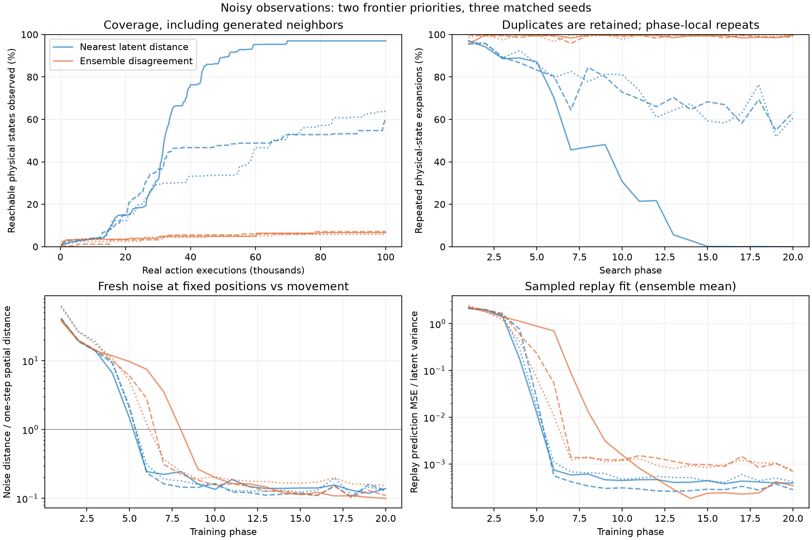
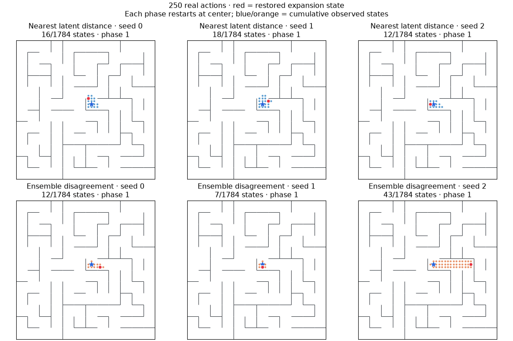

# Noisy-observation frontier search — November 10, 2026

Two arms, three paired seeds, trained from scratch. **All six runs completed.**

| Priority | Observed states, seeds 0 / 1 / 2 | Mean coverage | Final-phase repeated expansions, seeds 0 / 1 / 2 |
|---|---|---|---|
| Nearest latent distance | 1730 / 1081 / 1139 | 73.8% | 0.0% / 63.3% / 60.7% |
| Ensemble disagreement | 118 / 127 / 103 | 6.5% | 99.6% / 98.8% / 99.5% |





## Findings

Nearest-latent distance reaches **73.8% mean coverage**, versus **6.5%** for incoming-edge disagreement. The advantage appears in all three seeds; distance coverage still varies substantially (60.6–97.0%).

The encoder learns strong nuisance invariance under the existing joint loss. At random initialization, independent noise at the same position produces latent distances 92–142 times the mean adjacent-position centroid distance. After training, the ratio is 0.13–0.14 for distance search and 0.10–0.15 for disagreement search. No new invariance loss was needed in this coordinate-input experiment. The contrastive pressure did not force the encoder to preserve nuisance information here.

Disagreement's failure is compatible with accurate fitting and noise suppression. In the final phase it expands only **4 / 12 / 5 distinct physical positions** out of 1,000 pops; one seed expands a single position 966 times. Distance expands **1,000 / 367 / 393 distinct positions**. Frozen incoming-edge scores do not decrease when a transition is collected again during a phase, whereas distance scores immediately decrease near each added visited latent. Thus disagreement has no within-phase mechanism to retire familiar high-scoring branches. These measurements support that failure mode, but do not establish that adding a novelty gate or changing training cadence would fix it.

Distance still has repeats in two seeds, and phase restarts discard search memory. This is neither exhaustive graph search nor evidence of perfect state equivalence. Models trained under the two arms receive different spatial data. There is no frozen-random-encoder arm in this two-arm study, so the before/after invariance measurements are stronger evidence for representation change than coverage alone is for its causal benefit.

All six runs total 600,000 real actions, 120,000 expansions, and 24,672 gradient updates. Paired initial parameter hashes, action/update budgets, and every successor-noise draw were checked identical across arms. All 61 repository tests pass, including queue reprioritization, duplicate retention, brute-force distance agreement, and noise/physics isolation.

## Protocol

Same 12×12-room maze, seed 7, step .25, 1,784 reachable physical positions. Observations are normalized (x,y) plus eight independent standard-normal values, newly sampled on each successor observation. Clean coordinates remain observable features: this tests nuisance rejection, not learning geometry from pixels. Physical transitions are deterministic.

Each run has 20 phases × 1,000 expansions × five executed actions = 100,000 real action executions and 20,000 expansions. Start from a random encoder/dynamics ensemble with no warmup. Every phase freezes the networks, resets to the center and clears the frontier and phase-local visited latents. All raw transitions remain in replay across phases. After each phase, train **one complete accumulated-replay epoch**, batch 256, shared shuffled batches across three heads. This is 4,112 gradient updates per run (including the final training block, which does not affect final coverage).

The encoder and each dynamics head use width 256, three SiLU hidden layers, latent dimension eight, residual mean dynamics. Joint loss = mean per-head next-latent MSE + 0.01 × mean max(0, 1 − squared latent pair distance). Gradients pass through both encoded transition endpoints and both repulsion endpoints. Encoder LR 9e-5, dynamics LR 3e-4. No reconstruction, codebook, compression, or new loss.

Expand every popped state with all five actions, including stay. Simulator snapshots contain only physical position; the previously sampled observation is cached with each frontier entry and used as the source observation when expanded. Restoring does not rewind the observation-noise RNG. Each action generates fresh noise. No physical-state, observation-byte, or latent duplicate removal; no radius cutoff. Physical positions are passed only to restoration and evaluation. Each replay transition receives a separate episode ID because consecutive records are branching edges, not a trajectory.

**Distance:** actual successor latent's Euclidean distance to the nearest expanded latent in this phase. Eagerly decrease all active keys after adding a visited latent. A vector-backed maximum-priority queue implements the exact rule. Newly generated states are in the frontier, not the visited set, until expanded.

**Disagreement:** variance across the three predicted means for the incoming parent observation/action, averaged across latent dimensions. Keys stay fixed within each frozen phase. Raw variance and normalized variance give identical ordering within a phase. This is disagreement, not observed prediction error, and does not promise calibrated epistemic uncertainty. Exact ties use an isolated seeded RNG.

Every phase ends with 4,001 unexpanded frontier entries, which are discarded on restart. Models/optimizer, replay, training and noise RNG streams persist. Within each seed, both arms start with bit-identical weights and have equal interactions, noise-draw counts, and gradient-update counts. Their collected datasets diverge.

## Diagnostics and interpretation

Coverage includes all physically observed successors, even those never popped. Repeat fraction counts repeated physical positions among expansions within a phase; position labels do not influence the queue. It does not measure repeats against lifetime experience. An animation jumps between restored states; it is not an executable navigation path.

Noise probes use 64 fixed evaluation positions with 16 independent noise samples each, separate RNGs, and no training use. Noise/movement ratio compares mean latent distance between independent noisy observations of the same position against mean neighboring-position centroid distance. Neighbor centroids use common nuisance draws, avoiding a finite-sample noise floor in the spatial denominator. Whole-maze probe locations can be unvisited; these are diagnostics, not a clean generalization benchmark. Noise variance fraction is within-position variance divided by within-plus-between-position variance. Representation diagnostics are measured after each phase’s training, while that phase’s coverage was collected before training. Replay MSE is a 2,048-transition sample normalized by latent variance, not discrete-state accuracy.

No claim of statistical significance: three seeds and one maze. The comparison evaluates incoming-edge disagreement specifically, not every uncertainty-based frontier strategy. Nearest-distance search benefits from receiving clean coordinates as part of its input. Continuous position, image observations, stochastic physical transitions, and navigation without restoration remain untested here.

## Reproduction

```sh
.venv/bin/python -m pytest -q
.venv/bin/python scripts/run_noisy_frontier.py --out runs/noisy-frontier-NEW --jobs 3
.venv/bin/python scripts/report_noisy_frontier.py --root runs/noisy-frontier-NEW
```

Existing run directories are never overwritten. Full replay, initial/intermediate/final checkpoints, per-phase diagnostics, source snapshots, and animation data are in `runs/noisy-frontier-20261110`. Portable results: [JSON](assets/noisy-frontier-results.json). Pilot smoke run is separate and excluded from results.
