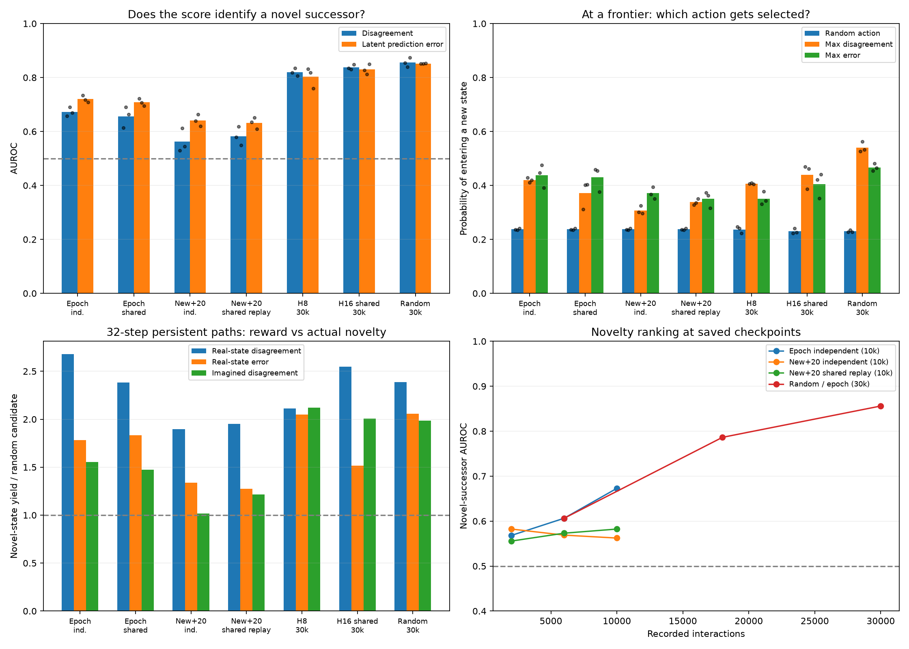

# Does prediction error or disagreement identify novel exploration?

72 saved-checkpoint audits across 24 runs, three seeds per condition. No retraining or new agent experience. Novelty labels use only the replay prefix available at the checkpoint; simulator geometry supplies evaluation labels, never agent inputs.

## Findings

**Prediction error and ensemble disagreement both contain information about novel exploration.** At the learned agents’ 30k checkpoints, latent error identifies transitions into new states with AUROC 0.80–0.83, and disagreement with AUROC 0.82–0.84. This remains above chance when considering only untried actions at visited states. The earlier near-chance result used a different label: whether an action had ever been tried, not whether it enters a new state.

This association is useful but incomplete. At a frontier, the largest-disagreement action enters novelty only 41–44% of the time, versus 23–24% for a random action. About 88% of transitions into new states are nevertheless predicted correctly by nearest-state retrieval: increased latent error does not necessarily imply a wrong physical successor.

On matched 10k random-behavior data, full epochs give a stronger disagreement–novelty association than new-once + 20 replay updates (AUROC 0.67 versus 0.56, independent batches). Sharing replay batches changes the latter to 0.58; after restricting to untried actions, the values are essentially unchanged (0.606 versus 0.607). The earlier improvement in temporal reward stability therefore does not establish a corresponding improvement in novelty discrimination. Path-selection results are mixed.

Long-path diagnostics separate three potential limitations: candidate paths may never reach new territory, accumulated reward may rank an unproductive path highest, and imagined rollouts may distort that ranking. All three occur in these diagnostics; their relative importance varies across checkpoints. They do not establish the causal contribution of each limitation to the online MCTS runs.

## One-step novelty

Here “novel” means the action enters a previously unvisited physical state. AUROC ranks novel against non-novel successors; 0.5 is chance. Rows below consider actions whose **source state was already visited**. This avoids confusing distant unvisited regions with choices the agent could make at a known state. Errors are ensemble-mean latent MSE or nearest-latent-decoded physical position error.

| Condition | Disagreement→novelty AUROC | Latent error→novelty AUROC | Physical error→novelty AUROC | Disagreement↔latent error Spearman |
|---|---:|---:|---:|---:|
| Epoch independent (10k) | 0.673 | 0.720 | 0.621 | 0.471 |
| Epoch shared (10k) | 0.656 | 0.708 | 0.615 | 0.473 |
| New+20 independent (10k) | 0.562 | 0.641 | 0.599 | 0.254 |
| New+20 shared-all (10k) | 0.583 | 0.629 | 0.606 | 0.247 |
| New+20 shared replay (10k) | 0.582 | 0.632 | 0.602 | 0.232 |
| H8 independent (30k) | 0.820 | 0.803 | 0.548 | 0.697 |
| H16 shared (30k) | 0.838 | 0.830 | 0.554 | 0.756 |
| Random / epoch (30k) | 0.856 | 0.852 | 0.598 | 0.794 |

The earlier action-history label and the actual novelty label give different answers:

| Condition | Disagreement→untried action AUROC | Disagreement→new successor AUROC (seed range) |
|---|---:|---:|
| Epoch independent (10k) | 0.499 | 0.658–0.691 |
| Epoch shared (10k) | 0.496 | 0.614–0.690 |
| New+20 independent (10k) | 0.437 | 0.529–0.613 |
| New+20 shared-all (10k) | 0.450 | 0.556–0.621 |
| New+20 shared replay (10k) | 0.471 | 0.549–0.619 |
| H8 independent (30k) | 0.469 | 0.807–0.834 |
| H16 shared (30k) | 0.557 | 0.830–0.848 |
| Random / epoch (30k) | 0.586 | 0.839–0.874 |

Physical mistake rates use the nearest latent in the full maze catalogue; the true successor is available solely for evaluation. These are ensemble-mean predictions, not a requirement that all individual heads be correct.

| Condition | Wrong successor when entering a new state | Wrong successor when entering a visited state |
|---|---:|---:|
| Epoch independent (10k) | 36.1% | 11.8% |
| Epoch shared (10k) | 35.7% | 12.5% |
| New+20 independent (10k) | 42.5% | 22.5% |
| New+20 shared-all (10k) | 44.0% | 22.7% |
| New+20 shared replay (10k) | 42.6% | 22.2% |
| H8 independent (30k) | 11.9% | 2.2% |
| H16 shared (30k) | 11.9% | 1.1% |
| Random / epoch (30k) | 22.1% | 2.4% |

A second control compares only **untried actions at visited states**, so “untried” itself cannot explain the separation:

| Condition | Disagreement AUROC | Latent-error AUROC |
|---|---:|---:|
| Epoch independent (10k) | 0.679 | 0.703 |
| Epoch shared (10k) | 0.663 | 0.699 |
| New+20 independent (10k) | 0.606 | 0.678 |
| New+20 shared-all (10k) | 0.622 | 0.673 |
| New+20 shared replay (10k) | 0.607 | 0.674 |
| H8 independent (30k) | 0.792 | 0.756 |
| H16 shared (30k) | 0.754 | 0.740 |
| Random / epoch (30k) | 0.758 | 0.748 |

## A useful score is not a reliable direction

A frontier state is visited but has at least one action entering an unvisited state. Compare a uniform random action with the maximum-disagreement or maximum-error action, averaging states uniformly then seeds equally. Ties are broken uniformly in expectation. This is an evaluation of a greedy one-step selector, not the online MCTS policy.

| Condition | Frontier states / seed | Random enters novelty | Max disagreement | Max latent error |
|---|---:|---:|---:|---:|
| Epoch independent (10k) | 399 | 23.8% | 42.0% | 43.8% |
| Epoch shared (10k) | 399 | 23.8% | 37.2% | 43.0% |
| New+20 independent (10k) | 399 | 23.8% | 30.8% | 37.1% |
| New+20 shared-all (10k) | 399 | 23.8% | 31.4% | 35.9% |
| New+20 shared replay (10k) | 399 | 23.8% | 33.8% | 35.0% |
| H8 independent (30k) | 153 | 23.7% | 40.7% | 35.0% |
| H16 shared (30k) | 145 | 23.0% | 43.9% | 40.5% |
| Random / epoch (30k) | 250 | 23.0% | 54.1% | 46.7% |

Directional scores at 2–4, 5–16, and 17+ actions from the closest unvisited state are retained in JSON. These use true graph distances as labels only. Some early far-distance strata contain very few states, so they should not be overinterpreted.

## Does accumulated reward select paths that explore?

For each final model: 64 uniformly sampled visited starts × 128 candidate paths, horizons 4/8/16/32/64. Two path banks: IID actions and persistent actions (80% probability to keep the previous action). Every candidate is executed in the true maze for evaluation. Outcome is **number of distinct previously unvisited states encountered**, counting revisits only once. All three scoring rules use the same candidate bank:

- Real-state disagreement: discounted disagreement evaluated along the actual states reached by that candidate. This uses privileged true transitions and is diagnostic, not a deployable planner.
- Real-state error: discounted latent prediction MSE on those actual transitions; also privileged diagnostic information.
- Imagined disagreement: discounted disagreement along recursive ensemble-mean latent predictions—the same kind of imagined reward used by our planner.

Scores use discount 0.99; novelty count is undiscounted. Selection maximizes one score per start; uniform tie breaking. Random means selecting a candidate uniformly from the same bank. The candidate banks are not actual MCTS trees and the models do not learn during these hypothetical paths.

### IID paths, horizon 32

| Condition | Random novel states | Max real disagreement | Max real error | Max imagined disagreement | Best novelty in bank |
|---|---:|---:|---:|---:|---:|
| Epoch independent (10k) | 2.24 | 4.21 | 3.71 | 2.93 | 8.10 |
| Epoch shared (10k) | 2.24 | 4.71 | 3.96 | 3.20 | 8.10 |
| New+20 independent (10k) | 2.24 | 3.30 | 3.07 | 2.70 | 8.10 |
| New+20 shared-all (10k) | 2.24 | 3.64 | 2.97 | 2.59 | 8.10 |
| New+20 shared replay (10k) | 2.24 | 3.34 | 2.91 | 2.27 | 8.10 |
| H8 independent (30k) | 0.76 | 1.86 | 1.45 | 1.59 | 3.19 |
| H16 shared (30k) | 0.60 | 1.48 | 1.10 | 1.01 | 2.50 |
| Random / epoch (30k) | 1.00 | 1.92 | 1.78 | 1.69 | 3.98 |

### PERSISTENT paths, horizon 32

| Condition | Random novel states | Max real disagreement | Max real error | Max imagined disagreement | Best novelty in bank |
|---|---:|---:|---:|---:|---:|
| Epoch independent (10k) | 1.85 | 4.95 | 3.30 | 2.88 | 11.08 |
| Epoch shared (10k) | 1.85 | 4.41 | 3.39 | 2.72 | 11.08 |
| New+20 independent (10k) | 1.85 | 3.51 | 2.47 | 1.88 | 11.08 |
| New+20 shared-all (10k) | 1.85 | 3.97 | 2.26 | 2.01 | 11.08 |
| New+20 shared replay (10k) | 1.85 | 3.61 | 2.36 | 2.24 | 11.08 |
| H8 independent (30k) | 0.74 | 1.57 | 1.53 | 1.58 | 4.71 |
| H16 shared (30k) | 0.58 | 1.47 | 0.88 | 1.16 | 3.82 |
| Random / epoch (30k) | 0.79 | 1.88 | 1.62 | 1.56 | 5.26 |

### Within-start path correlations

Spearman correlation between discounted score and the number of distinct new states, across the 128 persistent candidates at horizon 32. Correlations are computed separately for each start, omitting starts with constant outcomes or scores, then averaged within seed and across seeds. The last columns condition on at least one candidate actually reaching novelty; they measure selecting a zero-novelty path despite that opportunity.

| Condition | Real disagreement correlation | Real error correlation | Imagined disagreement correlation | Zero novelty: max real disagreement | Zero novelty: max imagined disagreement |
|---|---:|---:|---:|---:|---:|
| Epoch independent (10k) | 0.320 | 0.320 | 0.197 | 26.2% | 46.3% |
| Epoch shared (10k) | 0.336 | 0.312 | 0.207 | 25.3% | 39.0% |
| New+20 independent (10k) | 0.163 | 0.176 | 0.068 | 41.6% | 57.3% |
| New+20 shared-all (10k) | 0.188 | 0.170 | 0.085 | 35.8% | 53.7% |
| New+20 shared replay (10k) | 0.148 | 0.168 | 0.059 | 35.3% | 53.7% |
| H8 independent (30k) | 0.349 | 0.305 | 0.257 | 39.9% | 49.7% |
| H16 shared (30k) | 0.298 | 0.290 | 0.214 | 46.0% | 64.2% |
| Random / epoch (30k) | 0.361 | 0.350 | 0.300 | 41.9% | 51.3% |

### Candidate generation misses reachable novelty

Counts pooled over three seeds (192 sampled starts per condition). “Reachable” uses the true shortest distance to any unvisited state; “found” means at least one of the 128 candidate paths visits a new state. The persistent bank keeps its previous action with probability 0.8, otherwise drawing uniformly. Counts measure candidate coverage, before any reward-based selection.

| Condition, horizon 32 | Starts with reachable novelty | IID bank finds novelty | Persistent bank finds novelty |
|---|---:|---:|---:|
| Epoch independent (10k) | 192/192 | 189/192 | 190/192 |
| Epoch shared (10k) | 192/192 | 189/192 | 190/192 |
| New+20 independent (10k) | 192/192 | 189/192 | 190/192 |
| New+20 shared-all (10k) | 192/192 | 189/192 | 190/192 |
| New+20 shared replay (10k) | 192/192 | 189/192 | 190/192 |
| H8 independent (30k) | 184/192 | 103/184 | 127/184 |
| H16 shared (30k) | 190/192 | 99/190 | 136/190 |
| Random / epoch (30k) | 192/192 | 137/192 | 147/192 |

For H8/H16 at 30k, all 192 sampled starts can reach novelty within 64 actions, yet the IID bank finds such a path from only 121/126 starts, and the persistent bank from 150/160. A longer horizon alone does not make random candidate paths cover reachable destinations. These banks do not reproduce MCTS expansion, so these figures are not an MCTS failure rate.

At horizon 32 with persistent paths on the matched independent full-epoch models, selecting by real-state disagreement yields 4.95 new states per path versus 1.85 for random selection; imagined disagreement yields 2.88. This illustrates lost reward-ranking utility under imagined rollouts. It is not universal: H8 at 30k yields about 1.57 with either real-state or imagined disagreement.

Bars show three-seed means; black dots in the upper panels show individual seeds. The lower-left panel divides the mean selected yield by mean random yield. The first four plotted conditions are matched random-behavior models at 10k interactions; H8/H16 are active-agent models at 30k.

## Interpretation limits

The statistics are means across three model seeds, not independent samples across thousands of adjacent states. One maze, deterministic observations and exact discrete-state novelty; they do not establish behavior with continuous non-repeating observations. Different active-agent runs have different visited sets; only the matched-random controls hold the data fixed. Checkpoint comparisons change both fitting and the definition of what remains unvisited.

A state can be unvisited yet predicted correctly. Tiny latent errors can rank novelty well even when nearest-state retrieval stays correct; therefore latent-error association is not equivalent to frequent physical mistakes. AUROC also does not establish that the single best action is novel, nor that navigating to it is easy.

Path outcomes are counterfactual frozen-model diagnostics. They do not measure closed-loop exploration performance or prove the cause of previous MCTS failures. Real-state-scored paths show what reward ranking could do with exact rollouts, not an achievable policy with the current model. No learning-progress experiment was performed.

Scores are normalized by one full-catalogue latent-variance scalar per checkpoint. This differs from the online replay-based normalization but cannot change the AUROC, Spearman correlations, or maximizing action/path within that checkpoint. The per-seed values and sample counts, including undefined correlations, are retained in the portable JSON.

## Reproduction

`scripts/analyze_novelty.py` with `configs/novelty_matched.json` and `configs/novelty_duration.json`, output `runs/novelty-audit-v2-20261110`; then `scripts/report_novelty.py`. Portable per-checkpoint output: `docs/assets/novelty-results.json`. The initial smaller 24-start/64-candidate pilot is retained separately in `runs/novelty-audit-20261110`; only the expanded 64-start/128-candidate audit is reported here.
