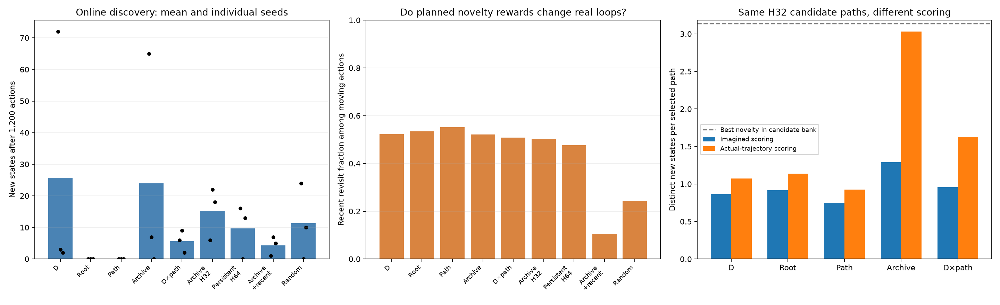
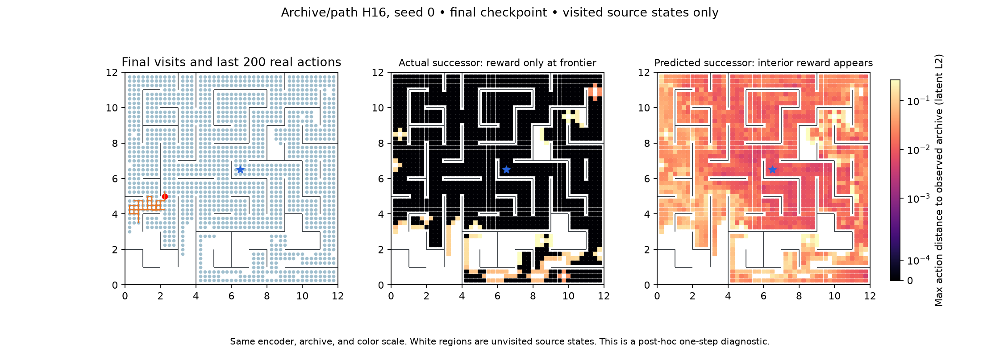

# Archive novelty, path novelty, and loop-aware search

Three model seeds in one deterministic coordinate maze. Each condition starts from exactly the same H16/shared 30k checkpoint and replay within seed, resets at the center, and receives 1,200 additional actions. Full raw-replay epoch every ten actions; model, optimizer and representation losses unchanged. All MCTS conditions use 24 simulations and discount 0.99. The persistent-shooting follow-up uses 128 candidate sequences, horizon 64, and probability 0.8 of keeping the previous action.

## What we learned

**No new condition consistently beat the disagreement baseline.** Archive/path H16 roughly matched it on mean discovery (24.0 versus 25.7 new states), while H32 improved two seeds and hurt the productive seed 0. Root and path distance found no new states in any seed despite frequent movement. These are short continuations from mature models, not complete from-scratch comparisons.

**Remembering real history fixes a local behavior without fixing global exploration.** Recent revisits among moving actions fell from 52.3% to 10.4%, but mean new states fell to 4.3. Its equal-weight mixture and 16-observation memory are only one design choice; this does not rule out better shaping weights or windows.

**There are two separate obstacles.** With real trajectories, archive novelty selects nearly the most exploratory available paths. Imagined scoring assigns much of its reward to physically non-new steps. Separately, even perfect-dynamics search fails to generate a route to novelty from the reset. The evidence favors testing a destination that persists across replans and a way to traverse familiar territory toward it, alongside improving imagined novelty estimates. It does not establish that a new encoder loss or multistep training is necessary.

All conditions retain about 99.4–99.6% final seen-edge retrieval accuracy. Weak exploration coexists with accurate fitting of visited transitions.

## Online results

| Reward / search | New states, seeds 0 / 1 / 2 | Mean | Mean cumulative new states | Recent revisit given movement | Seen-edge accuracy |
|---|---|---:|---:|---:|---:|
| Disagreement H16 | 72 / 3 / 2 | 25.7 | 16.5 | 52.3% | 99.42% |
| Root distance H16 | 0 / 0 / 0 | 0.0 | 0.0 | 53.5% | 99.53% |
| Path distance H16 | 0 / 0 / 0 | 0.0 | 0.0 | 55.2% | 99.40% |
| Archive + path H16 | 65 / 7 / 0 | 24.0 | 10.8 | 52.1% | 99.42% |
| Disagreement × path gate H16 | 6 / 9 / 2 | 5.7 | 2.9 | 50.9% | 99.56% |
| Archive + path H32 | 6 / 22 / 18 | 15.3 | 3.3 | 50.1% | 99.47% |
| Archive persistent H64 | 16 / 0 / 13 | 9.7 | 5.3 | 47.6% | 99.53% |
| Archive + recent + path H16 | 1 / 7 / 5 | 4.3 | 3.4 | 10.4% | 99.52% |
| Persistent random | 24 / 0 / 10 | 11.3 | 1.8 | 24.3% | 99.51% |

New states are relative to the original 30k replay. Initial visited counts are 1,429/1,533/1,621 of 1,784 states, so opportunities differ across seeds. Mean cumulative discovery averages the number found over all 1,200 actions. Recent revisit counts moving actions returning to any source position in the last 16 transitions; stationary actions are excluded from that denominator. Accuracy is nearest-latent retrieval of the ensemble mean on tried state–action pairs.

## Reward definitions

Let h be all earlier imagined latents, A all observed states encoded by the current encoder, and R the last 16 real observations encoded by that same encoder. Distances below are Euclidean.

- Root distance: distance of each successor to the current search root, accumulated along the path. It is not an episode-start anchor or a terminal-only displacement reward.
- Path distance: minimum distance from the successor to h.
- Archive + path: minimum distance to A ∪ h.
- Disagreement × path gate: disagreement multiplied by d(successor,h)/(d(successor,h)+s), with s the median positive encoded transition length from a deterministic sample of replay. This is a smooth gate, not a binary revisit threshold.
- Archive + recent + path: d(successor,A ∪ h) + d(successor,R ∪ h), equal weights in the same units. R lasts across replans and clears at episode reset. It is re-encoded after training. The recent term provides a reward for movement through familiar territory without immediately returning.

Distance rewards share a global latent-variance normalization. UCT exploration uses the maximum of root reward and an observed-step-length floor, times the discounted horizon sum. The floor avoids a vanishing search bonus when root archive novelty is near zero. Gated disagreement uses its root reward scale. Thus these are practical objective comparisons with a disclosed exploration-scale choice, not proof that results are independent of UCT tuning.

The archive stores raw observations, refreshed after every model update block. New observations enter immediately. Exact duplicate observation bytes are removed only from the nearest-neighbor cache, a lossless optimization of a minimum; raw replay remains intact and no nearby observations are merged. No geometry labels are used by online agents.

## Same paths, imagined versus actual rewards

For the three original checkpoints, 32 visited starts × 64 persistent-random candidate sequences are held fixed across rewards. Reward is scored either recursively in imagined latents or using the true simulator trajectory encoded by the same model. Actual-trajectory scoring is privileged evaluation only. Outcome counts distinct states outside the initial archive, once each.

| Reward, horizon 16 | New states: imagined selection | New states: actual-trajectory selection |
|---|---:|---:|
| disagreement | 0.646 | 0.531 |
| root_distance | 0.396 | 0.635 |
| path_distance | 0.427 | 0.448 |
| archive_path | 0.906 | 1.458 |
| disagreement_path | 0.740 | 0.927 |

At H16, random selection finds 0.232 new states per path; selecting by actual novelty count finds 1.562. Actual-trajectory archive reward finds 1.458, close to that bank maximum; imagined archive reward finds 0.906. At H32 the corresponding archive values are 3.031 versus 1.292; at H64, 5.750 versus 1.646. These quantities are conditional on the candidate generator finding useful paths.

For paths selected by imagined archive reward, 86% of reward mass at H16 and 95% at H64 is assigned to transitions that actually enter archived states or repeat a position already reached on the path. This measures fictitious state novelty, not necessarily disagreement or exact nearest-state misclassification. Finite prediction error can produce positive distance to the archive even for familiar transitions. It is not a measurement of distance to the continuous encoder manifold.

The figure uses the final archive/path H16 seed-0 model at visited source states. Both panels use the same latent space, archive, and color scale. Left reward panel uses actual successors; right uses model predictions. Interior reward in the latter is a prediction artifact for this state-novelty objective. This post-hoc image is not the contemporaneous reward map for earlier actions.

## Even perfect dynamics can fail to find the frontier

The shortest routes from the reset to an unvisited state are 20/24/23 actions. With perfect dynamics, all H16 archive/path returns are initially zero. We also tested privileged perfect-dynamics UCT at horizons 32 and 64, with 24/96/384 simulations: none of 15 searches per setting encountered a new state (three checkpoints × five search RNG seeds). Longer horizons alone did not generate the required directed routes. The perfect-dynamics diagnostic was never an online policy.

Independent-action shooting banks of 128 candidates also found no novel route in 15 reset trials at H32 or H64. Persistent banks found a route in 1/15 trials at H32 and 5/15 at H64. This motivated the online persistent H64 follow-up; it changes horizon, search strategy and budget together, so its result is not a single-factor ablation.

## Adaptive decisions and limitations

The initial four reward variants were followed by H32 archive novelty after measuring frontier distances, persistent H64 shooting after evaluating candidate reachability, and recent-real-history shaping after observing that path-only avoidance did not survive repeated replanning. No additional representation loss, multistep training, graph merging, or spatial threshold was introduced. A temporal window and a smooth scale remain design choices.

The original disagreement control was rerun for seed 0 and reproduced replay arrays and final model/dynamics weights bit-for-bit. Other disagreement and random controls reuse the preceding matched-branch study. All conditions retain the exact original replay prefix and apply 28,751 additional joint updates. Three short branches on one maze do not establish continuous-space or noisy-observation performance. More global novelty can still lack a direction while navigating a familiar region; imagined rewards can be positive for physically familiar states.

## Artifacts and reproduction

[Initial reward trajectory comparison](assets/novelty-rewards-paths.gif) and [adaptive follow-up comparison](assets/novelty-followups-paths.gif), seed 0, actions 30,000–31,200. Reward snapshots saved by the runner are explicitly **disagreement probes**, not heatmaps of the new objectives; the archive-specific figure above is generated separately.

Manifests: `configs/novelty_rewards.json`, `novelty_horizon.json`, `novelty_persistent.json`, `novelty_recent.json`. Launcher: `scripts/run_novelty_rewards.py --manifest MANIFEST --out NEW_DIRECTORY`; existing directories are refused. Each run saves its runner and production-source snapshot. Reward mode is in metadata/result and the runner arguments, not the legacy planner configuration factory.

Diagnostics: `scripts/audit_novelty_rewards.py`, `audit_oracle_novelty_search.py`, `audit_persistent_candidates.py`, `plot_archive_reward.py`. Report: `scripts/report_novelty_rewards.py`. Portable JSONs in `docs/assets/` retain online per-seed results, candidate outcomes, oracle search trials, and reset candidate counts.
