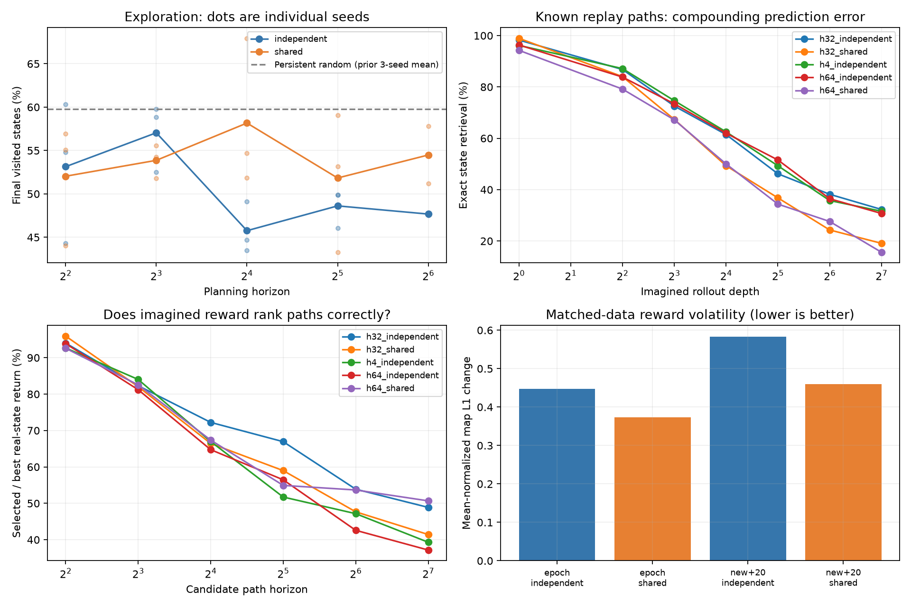
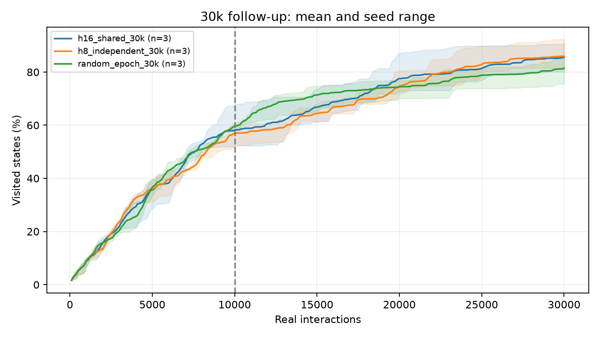
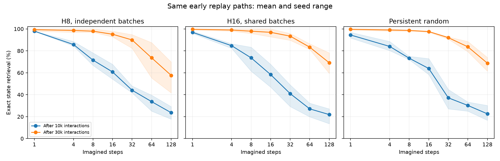
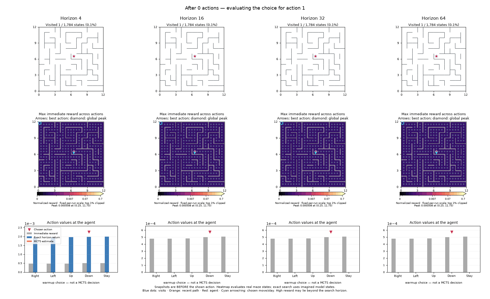

# Overnight map-learning findings — November 10, 2026

**Longer planning alone did not solve exploration. Continued full-replay training did bring online memorization above 98%, and shared ensemble batches made the reward map more stable.**

Completed all 55 runs: 730,000 real interactions and 4,854,377 joint gradient updates. Same 12×12 maze, 1,784 reachable positions, coordinate observations, three independent initialization/action seeds except the horizon-64 extension (two). No actor, reconstruction, state merging, pretrained representation or oracle information entered learning/planning.

## Horizon and search budget

Full epoch every ten actions, three width-256/three-layer dynamics members and encoder, eight unbounded latents, joint mean MSE + 0.01 repulsion. Each action uses 24 MCTS simulations, discount 0.99 and 10% persistent-random epsilon. Mean visited-state coverage after 10k actions:

| Horizon | Independent batches | Shared batches |
|---|---:|---:|
| 4 | 53.1% | 52.0% |
| 8 | 57.0% | 53.9% |
| 16 | 45.8% | 58.2% |
| 32 | 48.6% | 51.8% |
| 64 | 47.7% | 54.5% |

Persistent random: **59.8%**. There is no monotonic horizon benefit, and no learned condition exceeds that control in mean 10k coverage. H64 has only two seeds. The prior H4 experiments used discount 0.9; these within-sweep comparisons all use 0.99.

Increasing H16 independent MCTS from 24 to 96 simulations changes coverage from 45.8% to 46.6%: one seed improves and two decline. H32 random shooting with 256 IID action sequences reaches 42.8%. Neither is a convincing search-budget rescue. Total planning work grows with horizon; elapsed times were measured under varying concurrent load, not as isolated performance benchmarks.

## More data and training: 30k interactions

The strongest 10k learned configurations were selected for a longer comparison. This is an adaptive follow-up on the same maze, not a new validation benchmark. Each longer run reproduces its original 10k replay prefix exactly.

| Condition | Final coverage (seed range) | Coverage AUC | Seen-edge accuracy |
|---|---:|---:|---:|
| H8, independent batches | 85.9% (81.6%–92.3%) | 59.7% | 98.9% |
| H16, shared batches | 85.6% (80.1%–90.9%) | 60.6% | 99.6% |
| Persistent random | 81.4% (75.6%–85.8%) | 60.5% | 99.3% |

The learned agents finish about 4–5 percentage points ahead of random in mean coverage, winning in two of three seeds each. This is a late gain, not decisive overall superiority: coverage AUC is essentially tied for H16 shared and slightly lower for H8 independent.

Both learned configurations now exceed 98% mean visited-edge accuracy. Full epochs imply **39,158 updates at 10k versus 352,721 at 30k**: three times as many interactions yield about nine times as many updates. Additional training and additional data are coupled, so this does not isolate which causes the improvement.

## How far do faithful rollouts extend?

To avoid changing the evaluation paths, compare the 10k and 30k checkpoints on identical first 10k replay sequences: 96 reset-free sequences per seed. Every edge was already observed. Accuracy decodes an imagined latent to its nearest encoded physical state; no decoder is trained or used by the agent.

| Model | Exact 32-step retrieval, 10k → 30k | Exact 64-step retrieval, 10k → 30k |
|---|---:|---:|
| H8, independent batches | 44.1% → 89.9% | 33.7% → 73.6% |
| H16, shared batches | 41.0% → 93.4% | 27.1% → 83.3% |
| Persistent random | 37.2% → 92.0% | 30.2% → 83.7% |

This is substantial progress on known paths, not proof of reliable imagination beyond the frontier. A separate candidate-bank audit starts at visited states and can traverse unseen edges. Its reward ranking remains imperfect even when known-path fitting is excellent. “True-state return” there means frozen-ensemble disagreement evaluated at actual states, not an environment reward or newly visited-state count.

One H32 shooting checkpoint has a severe extrapolation failure in a 128-step audit: selected imagined states reach 383 times the maximum encoded-state radius. Other models can remain within ordinary latent magnitudes while predicting the wrong states. Neither bounded norms nor high one-step accuracy alone establish a safe rollout horizon. I therefore stopped the online horizon extension at 64. Details and robust optimism measures: [rollout audits](latent-rollout-audits.md).

## Shared versus independently sampled batches

On identical persistent-random replay streams, sharing transition minibatches reduces mean-normalized reward-map L1 changes in all six seed/cadence comparisons: **16% with full epochs, 21% with new+20**. Spatial rank correlations rise 0.758→0.835 and 0.582→0.748 respectively. This measures changes in which actions look rewarding, rather than merely a smaller overall reward scale.

Seen-edge accuracy is about one percentage point lower with shared batches in both matched controls. Sharing stabilizes the signal but does not establish more correct uncertainty. Because the encoder is shared, synchronized batches also reduce the diversity of its per-update gradients; this is not an isolated head-only noise ablation. [Batch experiment and animation](ensemble-batch-findings.md).

## Interpretation and next experiment

The continuous joint representation can fit visited dynamics very accurately without explicit graph merging. The harder remaining issue is using uncertainty for planning: an uncertain transition is an exploration target, but imagined successors beyond it can generate fictitious additional reward. More search can then optimize that error. The present experiments support testing longer routes through well-modeled regions while truncating or penalizing continuation beyond uncertain transitions; they do not yet validate that remedy.

A second candidate is increasing planning horizon only as model fidelity improves. The strong difference between 10k and 30k known-path rollout accuracy motivates this, but the current sweep used fixed horizons throughout. Neither proposal was silently added to the experiments.

## Visualizations, provenance and limitations

The [30k reward-map animation](assets/duration-rewards.gif) compares both learned agents with persistent random on seed 0.

Animation uses contemporaneous reward snapshots; colors are fixed within a run, not a calibrated common uncertainty scale. Arrow/diamond show best immediate action/global peak; lower bars compare MCTS estimates with exact enumeration only where horizon≤5. Real-state heatmaps and imagined search nodes are distinct.

Three seeds on one maze do not establish broad benchmark superiority. Both 30k configurations were selected using 10k results. Physical retrieval depends on the learned metric; latent MSE, teacher-forced error, manifold distance, physical error and reward-ranking diagnostics are retained alongside it. Full replay retains visit-frequency weighting.

Full per-condition tables and all 55 portable results: [experiment appendix](horizon-experiments.md) and [JSON](assets/horizon-results.json). Manifests: `configs/horizon_{pilot,confirm,long,search_followup,duration}.json` and `configs/ensemble_matched.json`. Raw run folders preserve configs, source snapshots/hashes, replay, checkpoints, and per-run audits. Regenerate summaries with `scripts/report_horizon.py`, then this synthesis with `scripts/report_overnight_findings.py`. All scripts run from the repository root.
