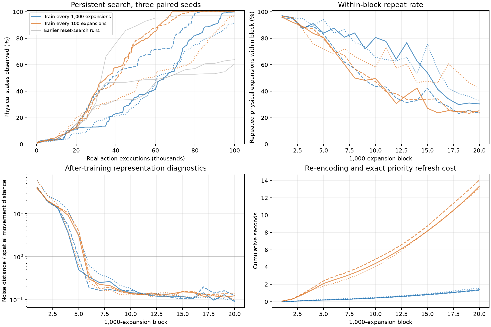
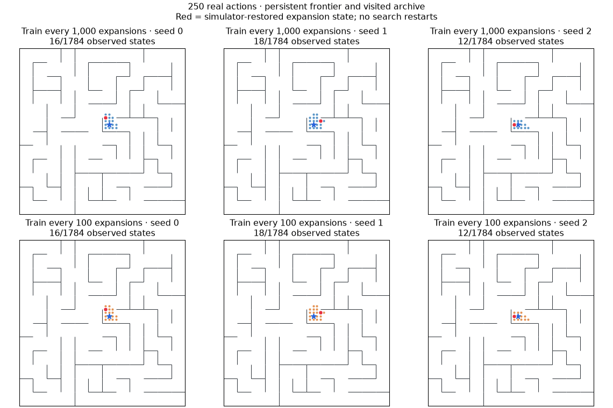

# Persistent noisy-maze frontier — November 10, 2026

Six completed runs: two distance-priority arms, three paired seeds. Same noisy discrete maze and losses as [the previous study](noisy-frontier.md). No ensemble-disagreement search runs.

| Cadence | Observed states, seeds 0 / 1 / 2 (of 1,784) | Mean coverage | Actions to first 100% coverage, seeds 0 / 1 / 2 |
|---|---|---|---|
| Train every 1,000 expansions | 1782 / 1784 / 1632 | 97.1% | not reached / 82,733 / not reached |
| Train every 100 expansions | 1784 / 1784 / 1741 | 99.2% | 68,628 / 77,266 / not reached |





## Findings

**Keeping search state improves final coverage across all three seeds.** At the previous cadence, persistent search reaches 97.1% mean coverage (1,782 / 1,784 / 1,632 states), versus 73.8% (1,730 / 1,081 / 1,139) in the earlier restart-after-training runs. Persistence does not uniformly improve the entire learning curve: seed 0 discovers substantial territory later than its restarted counterpart, then overtakes it by the final budget.

**Frequent interleaving improves the matched persistent comparison further:** 99.2% mean coverage (1,784 / 1,784 / 1,741). Two seeds finish the maze at 68,628 and 77,266 actions; the third is 43 states short at 100,000 actions. The experiment does not establish complete exploration in every seed.

| Seed | Actions to 90%, epoch every 1,000 expansions | Actions to 90%, interleaved every 100 |
|---|---:|---:|
| 0 | 88,868 | 61,778 |
| 1 | 76,549 | 64,002 |
| 2 | 96,814 | 94,263 |

Frequent training reaches 90% coverage earlier in every seed: mean 73,348 actions versus 87,410, a 16.1% reduction. This is evidence from three seeds on one maze, not a statistical significance claim. It does not dominate at every earlier milestone (seed 1 reaches 50% later). Both conditions receive the same transition presentations and gradient steps; minibatch partitioning differs as described below.

No loss changes were required. Exact physical-state identity and raw coordinates are not used for duplicate removal or ranking. However, clean coordinates remain observation features, and simulator restoration still supplies navigation. This is a stronger result for noisy-coordinate exploration, not yet a continuous-position or no-restoration result.

## Protocol

Keep the entire frontier and visited observation archive from initialization through all 20,000 expansions (100,000 executed actions). Five real actions per expansion, including stay. No state/observation deduplication, approximate merging, or distance threshold. Exact simulator restoration; observations cached with each frontier entry, new independent standard-normal noise for each successor. Observations still include clean normalized coordinates plus eight nuisance dimensions. All raw replay retained. Models initialized from scratch, unchanged width-256/three-layer encoder and three dynamics heads, latent eight. Joint mean-MSE + 0.01 hinge repulsion, same optimizer and learning rates as before.

After training, re-encode **every visited observation and active frontier observation**, then rebuild all nearest-visited distance keys. An exact SciPy cKDTree index (eps=0, one worker) accelerates this calculation without merging observations. Newly visited points immediately decrease active priorities. Newly generated observations enter the frontier; only expanded observations enter the visited archive. Nothing resets when training occurs.

**Every 1,000 expansions:** one shuffled full epoch over all accumulated replay, batch 256 with a final partial batch. This retains the previous training cadence and changes search persistence.

**Every 100 expansions:** distribute that same full epoch across ten intervals. At each 1,000-expansion block start, shuffle the old replay and partition it into ten disjoint slices. Every interval trains on one old slice plus all 500 new transitions, shuffled together. Allocate exactly ceil(5,000 × block_number / 256) gradient steps across the ten intervals. Both arms therefore train on every accumulated transition **exactly once per block per ensemble head**, and take the same gradient-step count at each block boundary. All new transitions are trained by the next training event. Shared batches across ensemble members.

The frequent arm uses variable minibatch sizes (250–300) to match both exposure and update counts; the epoch arm uses 256 with partial tails. Temporal ordering and batch sizes consequently differ, so this is a matched-budget cadence comparison, not a claim that update timing is the only numerical difference. Repulsion sample count per update remains unchanged. Each run ends with **4,112 updates and 1,050,000 transition presentations per head**. Final training/refresh is included in cost/diagnostics but cannot improve already-collected coverage.

Both arms retain 20,000 visited observation entries and 80,001 frontier entries at the end. Physical labels are evaluation/restoration-only. Coverage includes generated successors; first-full milestones are measured at individual action granularity. Search continues for the full budget after complete coverage, if reached. The animation shows restoration jumps, not a physically executed trajectory.

Initial parameter hashes, successor-noise streams, sample counts, and gradient counts are paired and verified. Unlike the earlier restarted search, there is only one initial environment observation; no extra reset-noise draws between blocks. Earlier reset-search runs are shown as contextual references, not rerun as a third arm. Within the new comparison, each pair receives identical nuisance draws in execution order.

## Computational cost

Mean measured wall-clock seconds per run (three concurrent workers; hardware/runtime dependent):

| Cadence | Expansion/search | Training | Latent/priority refresh | Total including diagnostics/I/O |
|---|---:|---:|---:|---:|
| Train every 1,000 expansions | 22.3 | 34.0 | 1.4 | 60.0 |
| Train every 100 expansions | 22.1 | 33.8 | 13.5 | 75.6 |

Exact nearest-neighbor refresh is an acceleration only. Audit re-encodes all saved final frontier entries and visited observations and verifies every priority, plus 32 independent brute-force nearest-distance checks per run. Tests cover archive persistence under changing geometry, incremental priority changes after refresh, and exact causal epoch coverage and gradient budgets across all 20 blocks.

## Scope and reproduction

Three seeds, one maze, coordinate observations, simulator restoration. No change to losses, continuous position, or physical stochasticity. Diagnostic noise/movement ratio uses the same fixed independent probe as before; neighboring-position centroids share nuisance draws. Post-training diagnostics do not describe the weights that collected the preceding block. Full replay and checkpoint/source artifacts remain in `runs/persistent-frontier-20261110`.

```sh
.venv/bin/python -m pytest -q
.venv/bin/python scripts/run_persistent_frontier.py --out runs/persistent-frontier-NEW --jobs 3
.venv/bin/python scripts/report_persistent_frontier.py --root runs/persistent-frontier-NEW
```

SciPy is now an explicit dependency (installed version 1.18.1). Launchers refuse existing output directories. A tiny smoke trial with an insufficient update budget failed before scientific runs; input validation was tightened and a separate valid smoke trial passed. Neither smoke trial contributes to these results.

Portable [results](assets/persistent-frontier-results.json) and [audit](assets/persistent-frontier-audit.json). All 64 tests pass.
