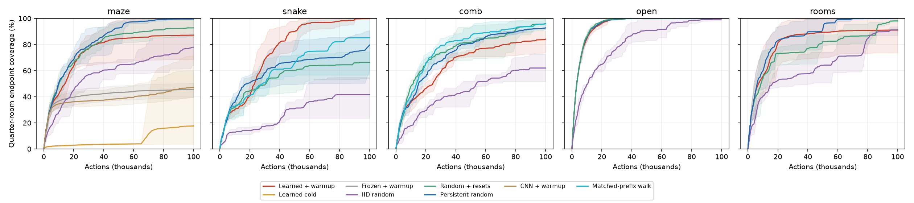
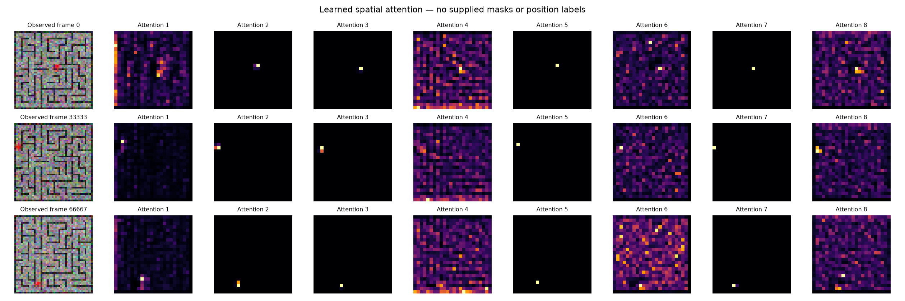
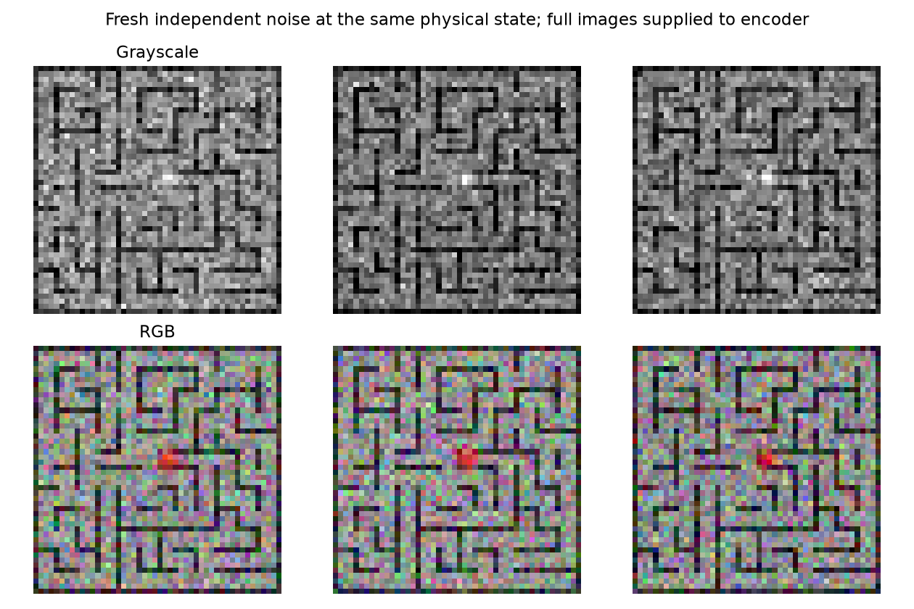
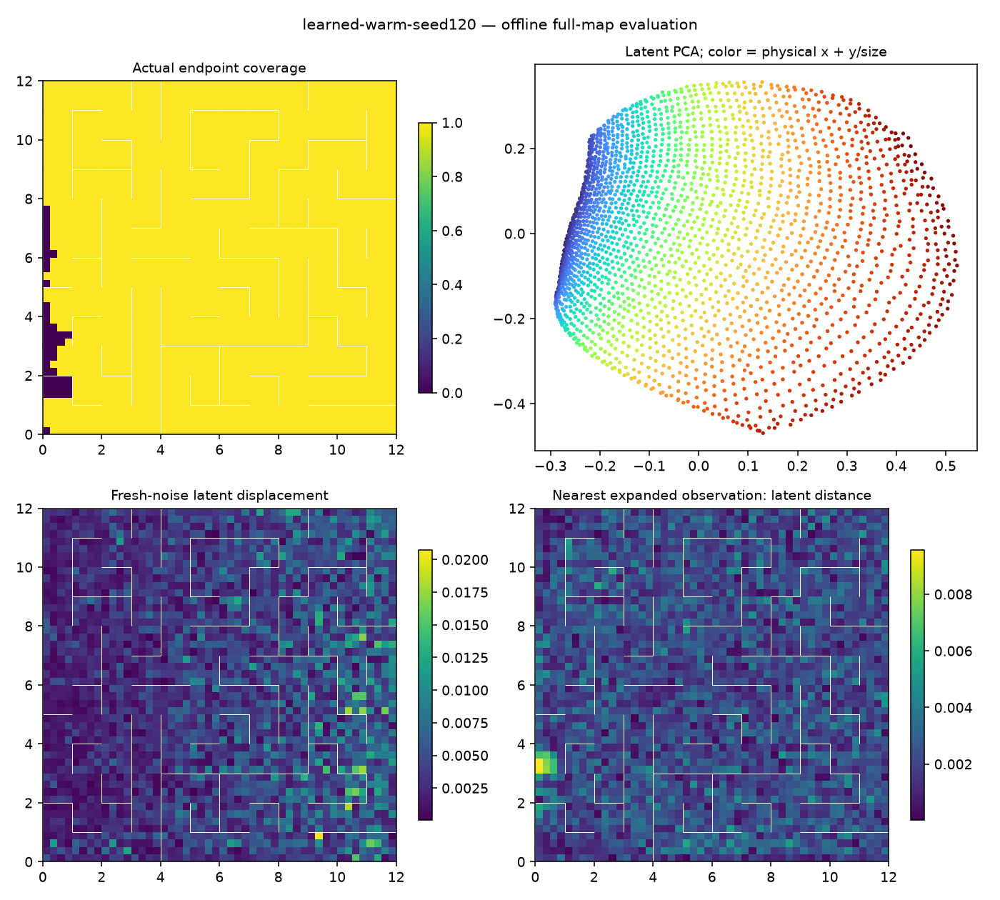
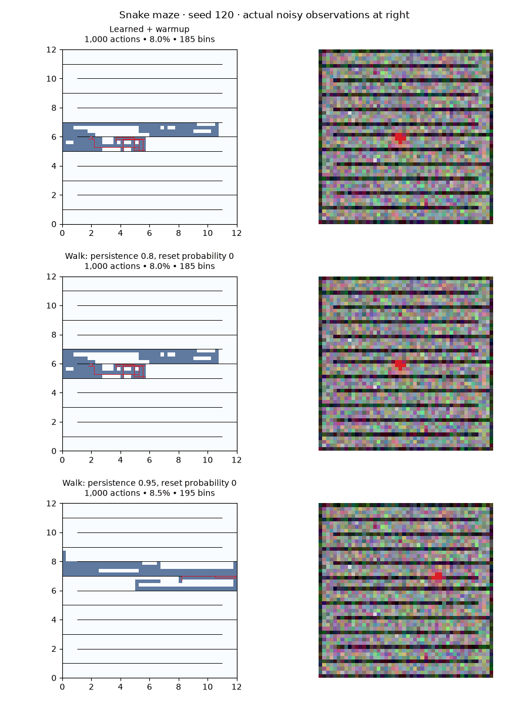
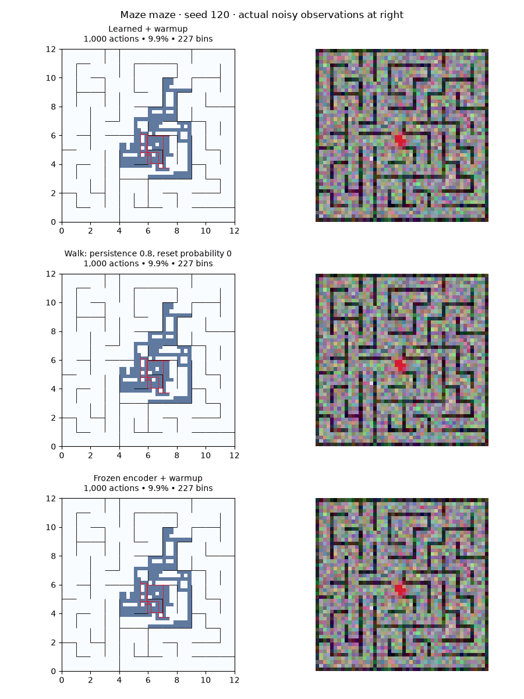

# Exploration from noisy pixels

The pixel front end works: a learned spatial-attention encoder develops a useful, noise-robust position map without coordinate labels, a decoder or pretraining. Exploration efficiency remains dependent on maze geometry. The learned frontier does well in winding corridors, but a competent nonreactive walk beats it on the original maze and branching dead ends.

Completed November 11, 2026: **372 full runs, 17.63 million actions**, including 87 held-out comparison runs. All completed runs passed replay/physics/image/coverage audits; 126 tests pass. Earlier experiments are unchanged. The selected model and all comparisons are reproducible from the saved configurations.

## Main results

Every confirmation run receives 100,000 actual actions. Values below are mean endpoint coverage of 2,304 quarter-room bins. The original maze uses five fresh seeds; each other geometry uses three. “100%” means every evaluation bin has an observed endpoint, not every point in continuous space.

| Environment | Learned frontier + warmup | Nonreactive walk, persistence 0.8 | Nonreactive walk + resets | IID walk |
|---|---:|---:|---:|---:|
| Original maze | 87.2% | **99.6%** | 92.8% | 78.0% |
| Winding corridor | **99.9%** | 85.3% | 66.3% | 41.7% |
| Branching dead ends | 84.1% | 95.9% | **96.0%** | 62.0% |
| Open space | 100.0% | 100.0% | 100.0% | 99.7% |
| Bottleneck rooms | 91.1% | **100.0%** | 98.1% | 91.2% |

Reset walks use persistence 0.8 and independent reset probability 0.001 per action. The tuning-selected noreset walk uses persistence 0.95 in the corridor and dead-end environments; it reaches 79.6% and 92.8%, respectively. The stronger 0.8 controls are shown above and retained in the full tables. They exactly match the learned agent's initial experience.



AUC is time-averaged coverage across the action budget, estimated at 500-action checkpoints. It rewards earlier discovery. In the corridor, learned AUC is 75.8% versus 62.0% for the matched 0.8 walk: a mean gain of 13.8 percentage points, with 2/3 paired wins. Against the tuning-selected 0.95 walk, it gains 15.3 points and wins 3/3. All three learned runs exceed 95% coverage. This is promising evidence on one fixed winding geometry, not a broad statistical claim about all mazes.

The dead-end environment is a counterexample: learned AUC is 65.5% versus 77.6% for the matched walk, losing all three pairs. On the original maze, persistent walking wins 4/5 pairs in AUC; the learned agent reaches 95% coverage in 2/5 runs versus 5/5 for walking. In rooms, two learned runs explore almost completely, but the third stalls at 73.7%. Open space offers little advantage over persistent walking.

All seed outcomes, finer eighth-room coverage, times to 95%, reset use and paired comparisons are in [the detailed tables](assets/pixel-confirmation-details.md). [Aggregate tables](assets/pixel-confirmation.md) and [machine-readable results](assets/pixel-confirmation.json) preserve every control. Curve shading denotes seed minima/maxima, not confidence intervals. Censored times are not treated as actual completion times.

## What made pixels work

The selected model is a small CNN producing eight learned spatial heatmaps. Spatial softmax expectations over an ordinary image-coordinate grid give 16 features, which pass through a 128-wide MLP into a **2D latent**. Several channels learn to track the sprite. Others remain diffuse or respond to background structure.

This is a strong spatial inductive bias, particularly favorable to a fixed-camera, single-object task. It is not a supplied marker detector, segmentation channel or simulator-coordinate label. The encoder has **20,210 parameters**; three residual dynamics heads have **33,922 parameters each**. There is no policy network.

The matched flattened-CNN control retains the same 2D output, RGB input, losses, backend, training schedule and walk prefix. It has 313,586 encoder parameters and reaches 47.1% coverage across seeds 120–122, versus 94.0% for spatial attention on those same seeds. Attention wins all three paired comparisons. This tests the architecture bundle: convolution strides, spatial aggregation and parameter count differ.

| Original-maze control | Seeds | Final coverage | Coverage AUC |
|---|---:|---:|---:|
| Spatial attention + warmup | 5 | 87.2% | 74.8% |
| Frozen spatial encoder + same warmup | 5 | 45.7% | 41.5% |
| Spatial attention, cold start | 5 | 17.6% | 7.3% |
| Flattened CNN + same warmup | 3 | 47.1% | 38.7% |

Warmup is part of the working algorithm. Four cold-start runs approach a constant encoder; one recovers late and reaches 71.4%. The squared-distance hinge does not eliminate collapse as a stationary point: when two latents coincide, their squared-distance gradient is zero despite positive repulsion loss. More optimization alone cannot guarantee escape.



This attention figure applies the final tuning model's weights to three earlier stored frames. It does not show a trained detector at the beginning of the run.

## Images, losses and exploration

The environment is a continuous 12×12 point maze with maximum movement 0.25 room. Walls and an antialiased red sprite are composited into one **48×48 RGB image**. Independent Gaussian noise with standard deviation 0.12 corrupts every channel and pixel; a global brightness offset has standard deviation 0.036. Values are clipped and quantized to uint8. The sprite's Gaussian radius parameter is 1.3 pixels. There is no separate marker channel, and continuous motion is visible through antialiasing.



Early trials used grayscale and a smaller sprite; renderer changes are explicitly recorded. The selected result is not a claim that those visual tasks are identical. The longer grayscale attention replication also works reasonably well—91.0% mean tuning coverage across two seeds—but was not the frozen confirmation model. A separate noisy-border-panel task was tested only as a diagnostic; it is not counted as solving full-image corruption.

For encoder `z=f(o)` and residual dynamics `g_m(z,a)=z+h_m([z,a])`, the selected loss is

\[
\mathcal L=
\frac{1}{3Bd}\sum_{m,i}\|g_m(f(o_i),a_i)-f(o_i')\|^2
+0.3\,\mathbb E_{j,k}[0.25^2-\|f(o_j)-f(o_k)\|^2]_+
+0.03\,\mathbb E_j\|f(o_j)\|^2.
\]

Both transition endpoints receive encoder gradients. Repulsion pairs are sampled from accumulated observations. There is no decoder, pretrained model, stochastic latent, clean-image target, state merging or physical deduplication. The optional `variance` log field is a variance-floor shortfall diagnostic; its coefficient is zero here. The dynamics ensemble shapes the representation but does not supply the exploration score.

Generic per-channel centering removes global intensity offsets. The implementation's historical `temperature` flag is actually an attention **logit multiplier / inverse temperature**, set to 200. It is unrelated to sampling latent states.

The agent first performs 5,000 nonreactive cardinal-walk actions, retaining its direction with probability 0.8. Otherwise it redraws uniformly among all four directions, including its previous one. It learns from this prefix. All encountered occurrences remain available afterward.

Exploration then uses the persistent frontier and expanded-observation archive. A candidate's priority is its Euclidean latent distance to the nearest expanded observation. The agent pops the highest score, restores that simulator state, executes four cardinal controls with independent magnitudes in [0.5,1] plus one stay, and enqueues their actual noisy outcomes. Every action, including stays, counts. There is no imagined planning or trained exploration policy. After training, all queue/archive observations are re-encoded.

Every 5,000 actions, training performs one full causal replay epoch plus 100 additional batches of 128 transitions. At 100k actions this is 10,214 gradient updates and 1.306 million transition presentations per ensemble head. Every new transition is trained at least once. This cadence and architecture differ from earlier coordinate studies; these experiments are not a modality-only comparison with those older runs.

Bulk inference/training uses MPS; tiny queue batches use a synchronized CPU encoder copy. Initial CPU/MPS outputs and loss, and post-update synchronization, are tested. A logging-only optimization introduced during the study deferred metric synchronization; a smoke comparison produced identical trajectories and encoder weights. Long adaptive trajectories need not remain bitwise identical across backends.

## What the latent geometry shows

Offline retrieval encodes two independent noisy images at identical probe positions. Each second image is matched to its nearest first-image latent, then the evaluator measures physical location error. No positions or evaluation labels enter training or queue scoring.

Across five fresh original-maze models, retrieval within half a room on **512 uniformly sampled whole-map positions** averages **97.7%**, ranging from 93.8% to 99.6%. The CNN controls average 40.5%; frozen encoders average 1.13%, with random-location chance 0.98%. The mean fresh-noise/open-move latent-distance ratio is 0.250, 0.546 and 1.004, respectively. Probes use the same positions across models; their online replay datasets differ.



The latent is already 2D, so the PCA panel only rotates it and preserves distances. This is a warped position map. It does not establish that Euclidean latent distance encodes shortest paths across walls, or that the encoder retains keys/inventory and other hidden task variables.

The twelve hard-environment models also retain useful spatial structure: uniform-probe retrieval ranges from 93.8% to 100%. The weaker rooms run still scores 95.1%. Thus poor exploration cannot be equated with complete perceptual failure. [Original-maze probes](assets/pixel-uniform-geometry.json), [hard-maze probes](assets/pixel-hard-geometry.json).

Final-frontier oracle diagnostics provide another useful caution. For comb seed120 and the weaker original-maze seed121, fresh-noise retrieval at encountered positions exceeds 99%, yet exploration remains incomplete. Sparse cardinal probes of random frontier entries plus the top 1,000 found productive candidates at ranks 7 and 1. In the comb, the top 100 had 3% productive entries versus 0.067% in a random sample. The score already enriches some rare productive opportunities.

These probes use simulator information only for evaluation. They are final post-training snapshots, not causal historical audits or exhaustive continuous reachability tests. We therefore cannot attribute all misses to noise outliers, poor ranking or action choice alone. [Frontier diagnostic](assets/pixel-frontier-diagnostic.json).

## Selection, controls and limitations

Random action and reset decisions never depend on pixels or collision outcomes. Complete action/reset streams were independently reconstructed from seeds. Resets sample uniformly from encountered **occurrences**, including the origin, without deduplicating physical positions. Persistence continues across resets.

Random tuning used seeds 110/111 and screened persistence, cardinal/continuous controls and reset rates. Policies were frozen separately by maze family. Learned confirmation was frozen before viewing held-out results, based on the first successful long tuning run and geometry checks. This deviated from the initial plan to await every slow two-seed architecture screen; the second long tuning seed became replication, not a reason to retune confirmation. Freeze timestamps and exact choices are in `configs/pixel-study-20261111/{learned-selection,random-selection}.json`.

Main confirmation uses seeds 120–124; hard families use 120–122. Learned hyperparameters transfer unchanged across families, but every run trains new weights from scratch. These are five fixed geometries with different stochastic-run seeds, not many independently sampled maze layouts. Exact first-5,000-action prefixes—actions, positions, parents and actual noisy images—match across 25 learned/control pairs, including frozen and CNN controls.

The benchmark grants exact simulator restores. Physical positions serve only as opaque restore payloads, physics inputs and evaluation data. Restores do not rewind observation noise. The learned main runs average 88,680 actual physical restore jumps per 100k actions, versus about 103 for the selected random-reset walk and zero for the noreset walk. All methods have access to restores, but use that resource very differently. Budgets count actual actions, not restore calls or compute.

The camera sees the whole fixed map and one colored sprite. The 2D spatial encoder is a strong favorable bias. This study does not establish performance with partial observation, moving cameras, multiple interacting objects, keys, unreliable resets or Atari.

## Targeted augmentation follow-up

After primary confirmation was frozen, we tested coefficients 0.3, 3 and 30 for a training-only consistency term. It adds Gaussian noise of standard deviation 0.12 to stored noisy images, clips them, and minimizes squared distance between original and augmented encodings, with gradients through both. It needs neither clean targets nor fresh simulator observations, but assumes that this chosen image corruption should be irrelevant.

The prospective gate required either at least 2 percentage points more mean AUC with no final-coverage loss, or 3 points more final coverage with no AUC loss, on tuning seeds 110/111. A passing candidate would receive validation on unused seeds 130–132. **None passed**, so no extra confirmation was launched.

| Consistency coefficient | Mean final coverage | Mean AUC |
|---|---:|---:|
| 0, paired tuning baseline | 93.3% | 74.9% |
| 0.3 | 88.1% | 70.9% |
| 3 | 73.0% | 63.3% |
| 30 | 49.5% | 44.9% |

Coefficient 3 reaches 100% in seed110 but 46.1% in seed111, where the encoder collapses. At 30 it collapses in both seeds. A seed110 uniform probe has noise/move ratio 0.232 at 3 versus 0.258 baseline, but approximately 1 at 30 with nearly zero latent spread. Low absolute noise sensitivity is insufficient when motion distinctions disappear too. These results reject the tested settings with repulsion fixed at 0.3; they do not rule out a jointly retuned augmentation/repulsion objective. [Selection record](../configs/pixel-study-20261111/augmentation-selection.json).

## Animations and reproduction

These animations show actual coverage and the actual noisy input through 100k actions. Red segments are real transitions; simulator restores are never drawn as continuous motion. Titles count evaluation bins. Seed120 was chosen as the first confirmation seed, not selected afterward for its outcome.





Run the selected baseline in a fresh output directory:

```sh
.venv/bin/python scripts/run_pixel_study.py \
  --arms configs/pixel-study-20261111/working-baseline.json \
  --out runs/pixel-new-experiment --seeds 200 --workers 1
```

MPS requires a compatible Mac. Copy the arm and set `device` to `cpu` for CPU execution. Other frozen configurations reproduce the full comparison. `scripts/pixel_frontier.py --help` exposes environment, architecture, loss and policy options.

Implementation: `src/map_learning/pixel_exploration.py`, `scripts/pixel_frontier.py`. Raw artifacts are in `runs/pixel-*-20261111/`; manifests and per-run specifications preserve all choices. Confirmation runs have runner/module snapshots. The first 68 tuning runs have runner snapshots but lack the additional module snapshot added later. Checkpoints added to later runs every 25k actions contain weights, not a complete optimizer-resume state.

Final accounting: **198 trained and 174 untrained completed runs**, 754,327 gradient updates, 96,229,800 transition presentations per head. Of the 372 completed runs, 285 are tuning/diagnostics and 87 are held-out comparisons. Four unpromising tuning grids were adaptively pruned: 11 interrupted runs retain logs totaling at least 243,500 actions, and 12 planned jobs were never launched. Interrupted in-memory replay was not saved. These are excluded from completed-run totals. Four 1,000-action smoke runs are also separate. No training failures occurred among completed runs, and no workers remain.

[All tuning arms and seeds](assets/pixel-tuning-all.md) · [Accounting](assets/pixel-accounting.json) · [372-run audit](assets/pixel-audit.json) · [Chronological protocol](pixel-study-state.md) · [Training journal](../training_runs.md).
