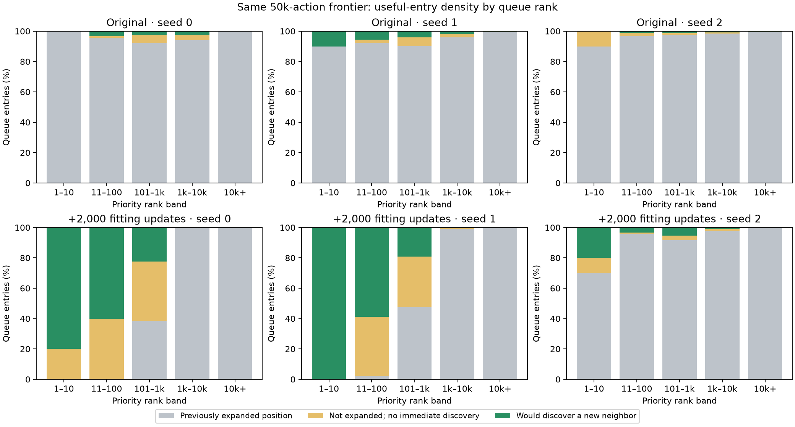
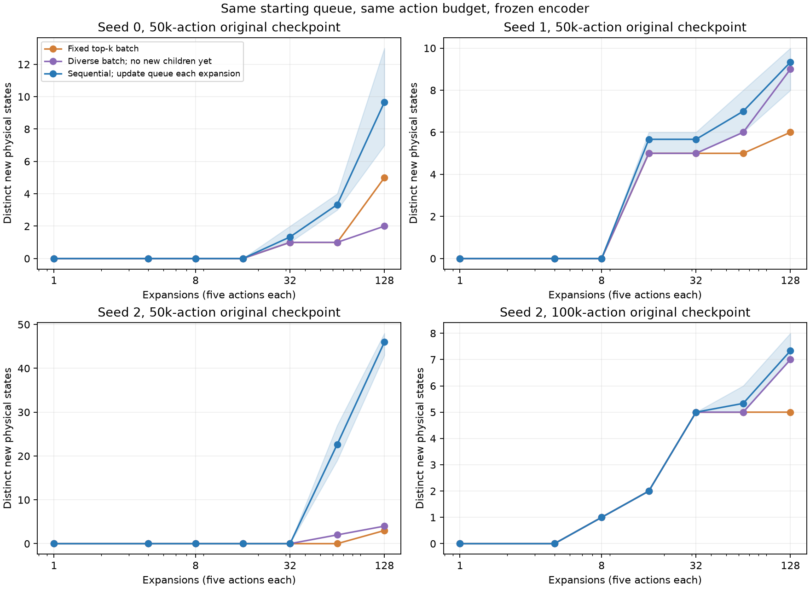

# Queue rank density and top-k expansion

November 10, 2026. Audit of 28 frozen encoder/frontier snapshots: both original cadences, three seeds, checkpoints at 5k/25k/50k/100k actions (24 snapshots), plus four fixed-archive extra-fitting snapshots. No new training or representation changes.

## What counts as useful?

Every queue entry is already a real observed state: it was generated by a prior expansion. We distinguish (1) a physical position already expanded, (2) a position not yet expanded whose neighbors have all been observed, and (3) a position whose expansion would immediately reveal an unobserved neighbor. We call category 3 **productive**. Category 2 can still matter for exploration/training; it just has zero immediate new-position yield. Physical labels and adjacency are exclusively evaluation diagnostics; priorities use latents alone.

A repeated-position entry is not necessarily a pure noise outlier. Its nonzero latent novelty can reflect residual noise sensitivity and geometry. We measure what it represents physically, rather than assuming every repeat has a single cause.

## Density in the ordering

Original frequent-training checkpoints at 50k actions:

| Seed | Productive entries across whole queue | Productive entries in top 100 | Previously expanded entries in top 100 |
|---|---:|---:|---:|
| 0 | 0.66% | 3% | 96% |
| 1 | 0.64% | 6% | 92% |
| 2 | 0.42% | 1% | 96% |

The top 100 are enriched by about 4.5× / 9.3× / 2.4× relative to the whole queue. High repeat percentage does not imply useless ranking: the candidate pool is itself dominated by repeats. Nor is there a generally clean, dense layer of novel entries just below a handful of noisy maxima. For these three checkpoints, productive fractions in ranks 101–1,000 are 2.44% / 4.11% / 1.33%; ranks 1,001–10,000 are 2.43% / 1.73% / 0.74%; ranks 10,001+ are only 0.07% / 0.19% / 0.29%. Individual seeds/bands are not monotonic.

At the original 100k seed-2 queue, the head is even more enriched: 10% productive in the top 100 versus 0.109% overall. Still, those 100 entries contain only 58 distinct positions; ten productive entries correspond to **four distinct productive positions**, yielding only **five distinct new neighboring states** if all 100 are expanded. Counting entries overstates unique information.

Extra fitting changes the same queue's ordering substantially in two of three 50k snapshots: top-100 productive fractions become 62% / 63% / 5%, and repeat fractions 0% / 2% / 93%. But within-batch duplication remains: the first two top-100 sets contain only 49 / 67 distinct physical positions.



## Does expanding top-k together help?

We evaluated three choices on identical frozen snapshots:

- **Fixed top-k batch:** select the current k largest keys, then expand all those entries. Immediate distinct new-state yield is computed exactly from deterministic environment adjacency, with overlapping successors counted once.
- **Diverse batch:** select one largest key, update remaining keys by minimum distance to that selected latent, and repeat k times; defer insertion of generated children until the batch finishes. No physical deduplication or distance threshold. Yield is again exact from adjacency.
- **Sequential expansion:** our existing loop; after every expansion, update visited distances and immediately enqueue newly generated children. Execute actual noisy observations from three paired RNG streams per snapshot. No training during these short comparisons.

The eight comparison snapshots are original and fitted versions of all three 50k queues and seed 2's 100k queue. There are 24 short simulator rollouts, each 128 expansions/640 actions, totaling 15,360 diagnostic actions. Three RNG replicates are observation-noise sensitivity checks, **not additional independent training seeds**. Static/diverse batches require no simulated observation samples to measure immediate physical yield; no future children are used to choose their entries.

Distinct new states from 128 expansions (640 actions), original 50k snapshots:

| Seed | Fixed top 128 | Diverse batch of 128 | Sequential 128, three noise streams |
|---|---:|---:|---:|
| 0 | 5 | 2 | 7–13 |
| 1 | 6 | 9 | 8–10 |
| 2 | 3 | 4 | 43–48 |

The current sequential loop wins in these equal-action comparisons. It can follow a newly opened branch immediately, while either preselected batch is confined to states already queued at the start. Diverse batches reduce some duplication, but are not consistently better than raw top-k in the original snapshots. At k=8, neither batch nor sequential discovers anything new in these original 50k queues; useful entries are too sparse at that scale. No claim is made that every checkpoint or environment has this outcome.

With extra fitting at 50k, fixed top-128 yields 51 / 66 / 12 new states; diverse batching yields 70 / 79 / 11; sequential yields 152–164 / 175–184 / 68–115. Fitting improves candidate quality, but retaining immediate child insertion remains valuable.



## Interpretation

These measurements do not support freezing a large raw top-k batch as an environment-sample-efficiency improvement. It could still improve wall-clock throughput if simulator expansions run in parallel; that was not benchmarked. A batch selected greedily with latent-distance updates is a plausible parallelism compromise, but does not match sequential discovery here. A queue rank density is a snapshot statistic and cannot by itself predict the benefit of newly generated descendants.

If “one step” means doing k sequential expansions before the next neural-network update, the existing frequent arm already does that with k=100: weights are frozen for those 100 expansions, but keys and children update after every expansion. The tested batching change instead freezes the chosen batch membership before executing it.

Limits: one deterministic physical maze with simulator restoration and coordinate-plus-noise observations; post-training snapshots rather than every online decision; short frozen-model comparisons, not a full online batched-policy study. No newly created learning policy is deployed. Oracle labels enter only density and outcome evaluation. Unobserved physical states are never directly present in the current queue; productive queued parents are their reachable frontier.

## Reproduction and artifacts

```sh
.venv/bin/python scripts/audit_queue_density.py --out runs/queue-density-NEW
.venv/bin/python scripts/report_queue_density.py
```

Reporter currently reads the recorded root `runs/queue-density-20261110`; change its root when reporting a new audit. Audit refuses existing output directories and preserves a source copy. Portable [results](assets/queue-density-results.json) contain rank bands, top-k overlap/coverage counts, greedy-diverse selections' yields, and each sequential replicate. Prior runs remain unchanged.
