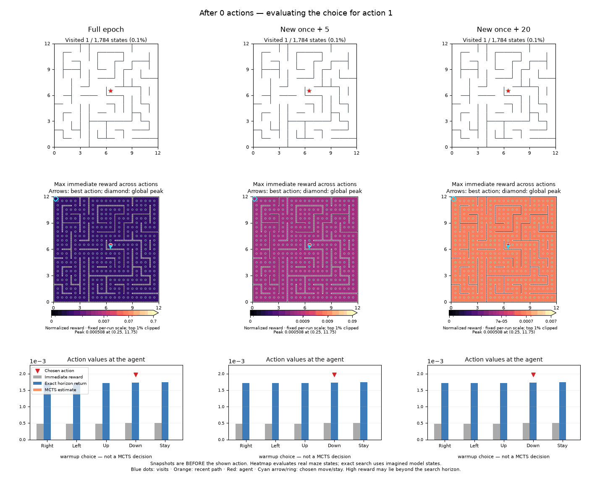

# Exploration reward diagnostics



The top row shows accumulated visited-state counts and recent movement. The middle row shows maximum immediate ensemble-disagreement reward across the five actions at each reachable maze position. Small arrows show the maximizing action, rings indicate stay, and the diamond marks the global maximum. Red marks the agent; cyan shows its actual next action.

The bottom row compares immediate rewards, exhaustive horizon-4 discounted returns in the learned model, and MCTS mean-return estimates. The red triangle identifies the chosen action; n is its root visit count. Exhaustive search measures search approximation under the same model and reward, not true navigational value. A distant bright region can be outside the four-step horizon. MCTS estimates average sampled continuations, so their magnitudes need not equal optimal continuation returns.

Snapshots are recorded every 200 completed actions, before the next action, with the contemporaneous encoder, ensemble, and replay-variance normalization. Maps use all reachable real positions for evaluation only; these positions never enter learning or planning. Frames span 0–9,800 actions. The separate coverage animation includes the final 10,000-action tally.

Each run uses its own fixed logarithmic-like color scale, clipped at the 99th percentile of post-warmup action rewards. Numeric peak rewards remain unclipped. Colors are useful within a run over time; differing latent geometries still confound cross-run uncertainty comparisons. The visited-state tally counts exact reachable grid coordinates, not latent clusters.

## Matched reruns and search check

The three seed-0 reruns exactly reproduced every saved replay array and every encoder/dynamics weight from the original runs. Recording is read-only; it consumes no training or planner randomness.

| Cadence | Sampled MCTS decisions | Within 1% of exhaustive best return | Mean relative return gap |
|---|---:|---:|---:|
| Full epoch | 42 | 71.4% | 1.94% |
| New once + 5 | 40 | 90.0% | 0.45% |
| New once + 20 | 45 | 84.4% | 1.08% |

Median gap is zero in all three. Warmup and epsilon-random actions are excluded. These sparse, single-seed diagnostics suggest that MCTS usually chooses a good action for its current four-step objective; they do not validate the reward, model rollouts, or horizon. Untried actions can legitimately have low disagreement if dynamics generalize correctly.

## Reproduce

```bash
.venv/bin/python scripts/run_probabilistic_sweep.py --manifest configs/reward_visualization.json --out runs/joint-reward-visualization-20261109 --jobs 3
.venv/bin/python scripts/animate_rewards.py \
  runs/joint-reward-visualization-20261109/mcts_epoch-seed0 \
  runs/joint-reward-visualization-20261109/mcts_new-seed0 \
  runs/joint-reward-visualization-20261109/mcts_new20-seed0 \
  --labels 'Full epoch' 'New once + 5' 'New once + 20' \
  --out /tmp/exploration-rewards.gif --still /tmp/exploration-rewards.png --still-step 8000
```

Set `reward_snapshot_every` to enable recording (default 0 disables it). Currently supported: MSE mean dynamics and coordinate observations without nuisance. Exhaustive values are recorded only for horizons up to five to bound exponential cost. Raw runs remain gitignored; the GIF and PNG are included in the repository. Output GIFs refuse overwriting existing files.
