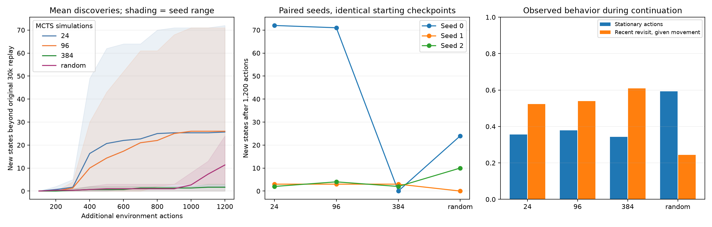
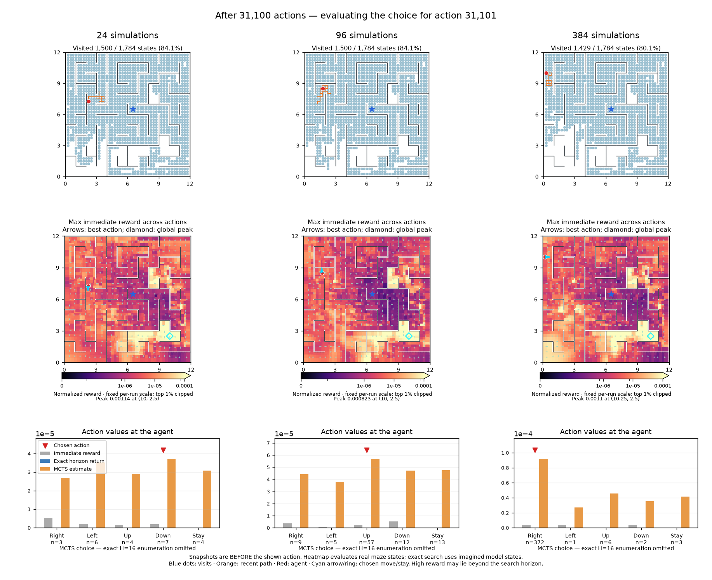

# Larger MCTS budgets from mature checkpoints

Twelve controlled online branches: H16 shared 30k models, three seeds, budgets 24/96/384 plus persistent-random control, each given 1,200 additional real actions. Same horizon 16, discount 0.99, reward, model, optimizer, and full raw-replay epoch every ten actions. No loop penalty or new representation objective.

**Increasing simulations alone did not improve discovery consistently.** Mean additional states were 25.7 at 24 simulations, 26.0 at 96, 1.7 at 384, and 11.3 under persistent random. The large 384-versus-24 drop is driven by seed 0 (72→0); the other two seeds are unchanged. Treat this as a short, seed-dependent result on one maze, not a universal claim that more search hurts.

The 384 condition has more recent revisits among moving actions (61% versus 52% at 24), while final seen-transition accuracy remains about 99.3–99.5% for all conditions and disagreement–novelty AUROC remains about 0.80–0.82. Fitting and a globally informative reward coexist with weak exploration. The fixed-model audit below independently shows that larger searches optimize repeated disagreement without monotonically increasing novelty.

This supports testing a path-local repeat penalty at a moderate search budget. [Latent geometry diagnostics](latent-geometry.md) show that imagined-state distances can identify loops, but local latent scale varies and threshold calibration remains an open design choice. No loop penalty was tested in this study.

All branches restore model parameters, optimizer state, trainer RNG, and full 30k replay. They start at the fixed center, without warmup. Planner, schedule-shuffle and normalization RNGs restart identically per seed across branches. This is a controlled continuation protocol, not a bit-exact extension of the old online process. Higher budgets consume different planner RNG draws, so epsilon decisions are not common random numbers.

| Simulations | New states, seeds 0 / 1 / 2 | Mean new states | Mean cumulative discoveries | Stationary | Recent revisit given movement | Search seconds |
|---|---|---:|---:|---:|---:|---:|
| 24 | 72 / 3 / 2 | 25.7 | 16.5 | 35.6% | 52.3% | 68 |
| 96 | 71 / 3 / 4 | 26.0 | 14.7 | 37.9% | 53.9% | 238 |
| 384 | 0 / 3 / 2 | 1.7 | 0.9 | 34.3% | 61.0% | 635 |
| random | 24 / 0 / 10 | 11.3 | 1.8 | 59.2% | 24.3% | 0 |

“New” is relative to each seed’s original 30k visited set. The three checkpoints initially visited 1,429/1,533/1,621 of 1,784 states, leaving different opportunities. Mean cumulative discoveries is the interaction-averaged count of new states, rewarding earlier discovery. Stationary includes explicit stay and wall collisions. Recent revisit means a moving action returns to any source position in the last 16 transitions. Search seconds include action selection only; measurements share the machine with other workers and are not isolated benchmarks.

## Final fitting

| Simulations | Seen-edge successor retrieval | Disagreement→new successor AUROC |
|---|---:|---:|
| 24 | 99.42% | 0.810 |
| 96 | 99.54% | 0.817 |
| 384 | 99.34% | 0.800 |
| random | 99.51% | 0.820 |

Accuracy uses the ensemble mean and the full maze latent catalogue, restricted to actually tried edges. Novelty AUROC uses actions at visited states; the definition of unvisited differs across branches after exploration. These are final-checkpoint metrics, not proof that fitting stayed equally good at every intermediate update.

## Trajectories and reward maps

Seed 0, all three MCTS budgets: [exploration animation](assets/search-budget-paths.gif) covers actions 30,000–31,200. [Reward-map animation](assets/search-budget-rewards.gif) shows pre-action snapshots every 100 actions through 31,100; it does not include the last 100 actions. These are illustrative single-seed views, while the tables aggregate all seeds.

## Fixed-model MCTS path audit

For each original H16/shared 30k checkpoint, 24 uniformly sampled visited starts are shared across budgets. Extract the path that follows maximum visit counts at each node (root tie-breaking follows the actual planner; deeper ties choose the lowest action index). Each is a 16-step open-loop diagnostic, not the closed-loop online trajectory. The inspection wrapper verifies its root action, visit counts and Q estimates against production MCTS before evaluation.

| Simulations | New states / path | Repeated successor steps / 16 | Unique path states (including start) | Imagined return / 24 baseline | True-state return / 24 baseline |
|---|---:|---:|---:|---:|---:|
| 24 | 0.35 | 8.40 | 8.60 | 1.00 | 1.00 |
| 96 | 0.65 | 9.25 | 7.75 | 3.75 | 2.62 |
| 384 | 0.57 | 9.57 | 7.43 | 5.79 | 3.29 |

Larger budgets find greater imagined reward and greater disagreement along the actual simulator paths, but also more repetition and fewer distinct path states. New-state yield is not monotonic. True-state reward is still the learned disagreement evaluated at actual states, not an oracle novelty reward. Return ratios normalize within each model before averaging seeds. Counts of repeated successors include stationary moves; raw outputs retain stationary counts separately.

## Validation and limits

Every branch preserves all original replay arrays exactly, appends exactly 1,200 transitions, and trains through transition 31,200. Initial reward-map arrays and center positions are bit-identical across budgets for each seed. Configurations differ only in simulation budget/behavior, total duration, and snapshot frequency. All branches perform the same number of joint updates.

These are short online branches from three mature models in one deterministic coordinate maze. They do not establish from-scratch performance, performance at 30k extra actions, or behavior under noisy observations. Search budget changes both behavior and subsequent data; those feedback effects are part of the online comparison. Larger search can optimize a repeated-disagreement objective more thoroughly without necessarily improving discovery.

## Reproduction

`scripts/run_search_branches.py` launches four isolated subprocesses at a time and refuses existing output directories. `scripts/continue_search_budget.py` is the individual-run entry point. `scripts/report_search_budget.py` validates all twelve completed branches and generates this report and portable JSON. Raw logs, source snapshots, replay, checkpoints and reward maps are in `runs/search-budget-20261110`.
