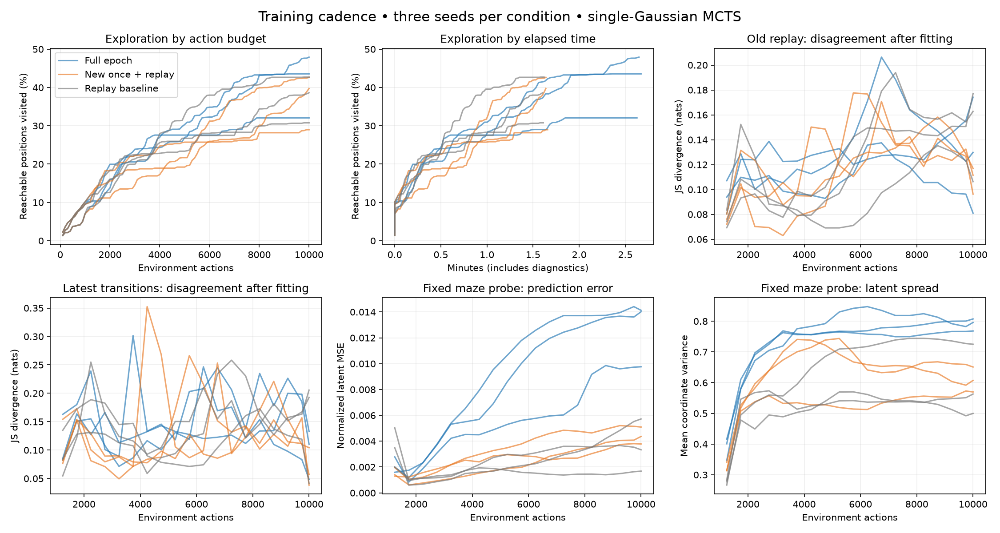
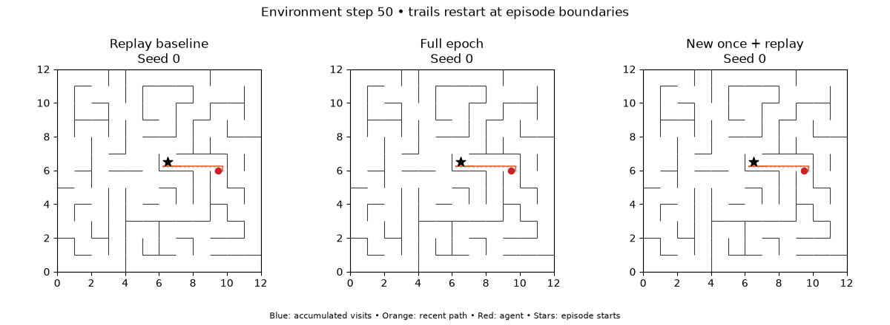

# Training cadence experiment — 2026-11-09

Nine completed 10,000-action runs: three seeds (0–2) per schedule. All use the same 12×12 coordinate maze, fixed-center resets every 2,000 actions, 1,000 random warmup actions, tanh encoder (8 latents, width 64), three single-Gaussian heads, batch size 128, and MCTS horizon 4 / 24 simulations.

- **Replay baseline:** five random replay updates every 10 actions.
- **Full epoch:** every transition once per head, independently shuffled, every 10 actions; replaces random replay updates.
- **New once + replay:** every new transition once per head, then five random replay updates. Includes the full warmup buffer at the first event.

Partial batches are retained. Both new schedules reached all 10,000 transitions in every head. Encoder and dynamics train jointly; each update also samples 128 replay-state pairs for repulsion. No new policy is learned.

Both added-training schedules reduced final mean replay disagreement, but neither improved mean physical next-position retrieval. Full epochs modestly increased mean coverage with mixed per-seed effects; new-once training left mean final coverage essentially unchanged. This does not establish insufficient fitting as the main exploration bottleneck.



## Final results

Means across three seeds; coverage also shows the seed range. Physical readout uses nearest-latent retrieval from a privileged full-maze catalogue, only for evaluation.

| Schedule | Final coverage (range) | Coverage AUC | Updates | Elapsed min | Training min | All-edge exact retrieval | Physical error |
|---|---:|---:|---:|---:|---:|---:|---:|
| Replay baseline | 37.4% (30.8–42.7) | 25.3% | 4,505 | 1.61 | 0.13 | 41.2% | 0.5008 |
| Full epoch | 41.2% (32.1–47.9) | 26.9% | 39,158 | 2.65 | 1.13 | 30.1% | 0.6401 |
| New once + replay | 37.1% (29.0–42.7) | 22.9% | 5,413 | 1.65 | 0.15 | 34.1% | 0.6978 |

For context, always predicting the current position gives 31.9% exact accuracy and 0.1702 mean physical error on this maze. A move is 0.25 units. All three conditions have larger mean physical error under this readout; global latent spread alone does not establish a useful map.

## Final ensemble agreement

| Schedule | Replay JS | Seen-edge JS | Unseen-edge JS | Latent variance |
|---|---:|---:|---:|---:|
| Replay baseline | 0.1449 | 0.1580 | 0.2689 | 0.5933 |
| Full epoch | 0.1220 | 0.1166 | 0.1493 | 0.7873 |
| New once + replay | 0.1026 | 0.1049 | 0.1400 | 0.6001 |

Replay JS is visitation-weighted; seen/unseen edge JS weights distinct physical state-actions uniformly. Final estimates use 32 Monte Carlo draws per member.

## What each training block changes

Pre → post means over the final 100 training events of each seed (actions 9,010–10,000). Both measurements use identical transitions and common Monte Carlo seeds. JS estimates use 8 draws/member, so small differences are noisy.

| Schedule | Latest-10 JS | Older-replay JS | Fixed-probe JS | Fixed-probe normalized MSE |
|---|---:|---:|---:|---:|
| Replay baseline | 0.1557 → 0.1478 | 0.1459 → 0.1454 | 0.2433 → 0.2428 | 0.0034 → 0.0035 |
| Full epoch | 0.1716 → 0.1645 | 0.1265 → 0.1255 | 0.1640 → 0.1635 | 0.0125 → 0.0125 |
| New once + replay | 0.1397 → 0.1249 | 0.1320 → 0.1315 | 0.1552 → 0.1547 | 0.0043 → 0.0043 |

## Interpretation limits

Online trajectories differ between conditions. Maze-wide probes never influence training or planning but may overlap experienced edges; final metrics in the JSON separately report seen/unseen edges. Normalized latent error and NLL still depend on the learned representation. Physical retrieval is a shared readout, not an optimal decoder. Lower disagreement alone does not establish accurate prediction or calibrated uncertainty. Full epochs also increase the number of repulsion updates, not only dynamics fitting. The new-transition batch receives one full optimizer step despite being smaller than a replay batch.

Three workers ran concurrently on one machine, so wall times are observed costs, not isolated throughput benchmarks. Diagnostic overhead is included in elapsed time and excluded from training time. These are three seeds on one deterministic coordinate maze.

## Exploration replay

Seed 0, all three schedules at matched environment steps (50 transitions per frame):



## Reproduction

```bash
MPLCONFIGDIR=/tmp/map-cadence-mpl .venv/bin/python scripts/run_probabilistic_sweep.py --manifest configs/probabilistic_cadence.json --out runs/probabilistic-cadence-20261109 --jobs 3
.venv/bin/python scripts/evaluate_next_state_retrieval.py --summaries runs/probabilistic-cadence-20261109/summary.json --out runs/probabilistic-cadence-20261109/retrieval.json
MPLCONFIGDIR=/tmp/map-cadence-mpl .venv/bin/python scripts/report_cadence.py --runs runs/probabilistic-cadence-20261109 --out docs/training-cadence.md
MPLCONFIGDIR=/tmp/map-cadence-mpl .venv/bin/python scripts/animate_exploration.py runs/probabilistic-cadence-20261109/replay-seed0 runs/probabilistic-cadence-20261109/epoch-seed0 runs/probabilistic-cadence-20261109/new_then_replay-seed0 --labels 'Replay baseline' 'Full epoch' 'New once + replay' --end 10000 --stride 50 --out runs/cadence-exploration.gif
```

Raw runs (ignored by git): `runs/probabilistic-cadence-20261109/`. Portable numeric results: [cadence-results.json](assets/cadence-results.json). Each run includes resolved config, source snapshot, checkpoint, raw replay, before/after diagnostics, coverage, and final full-maze evaluations.
