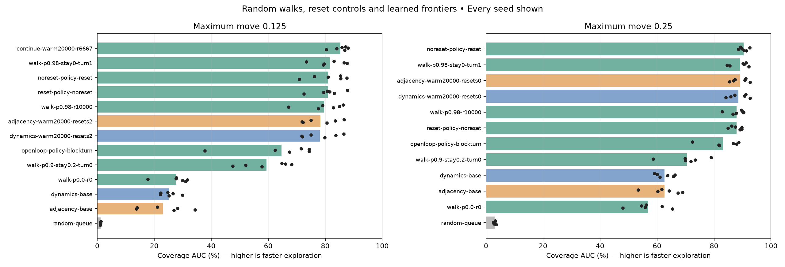
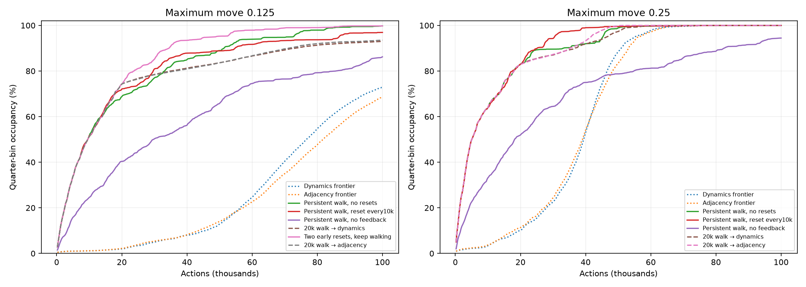
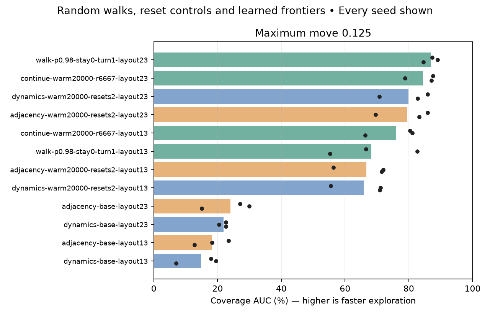
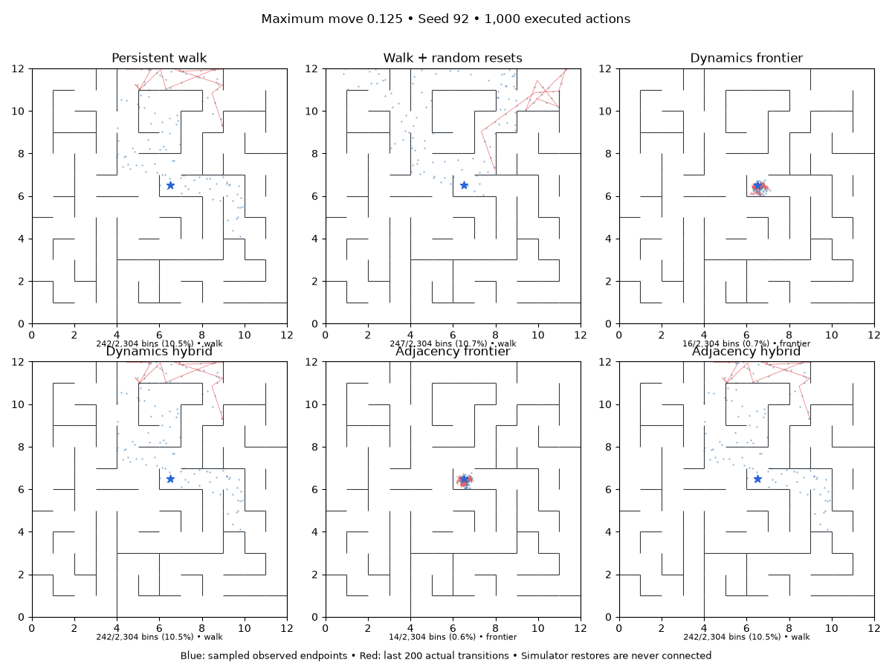
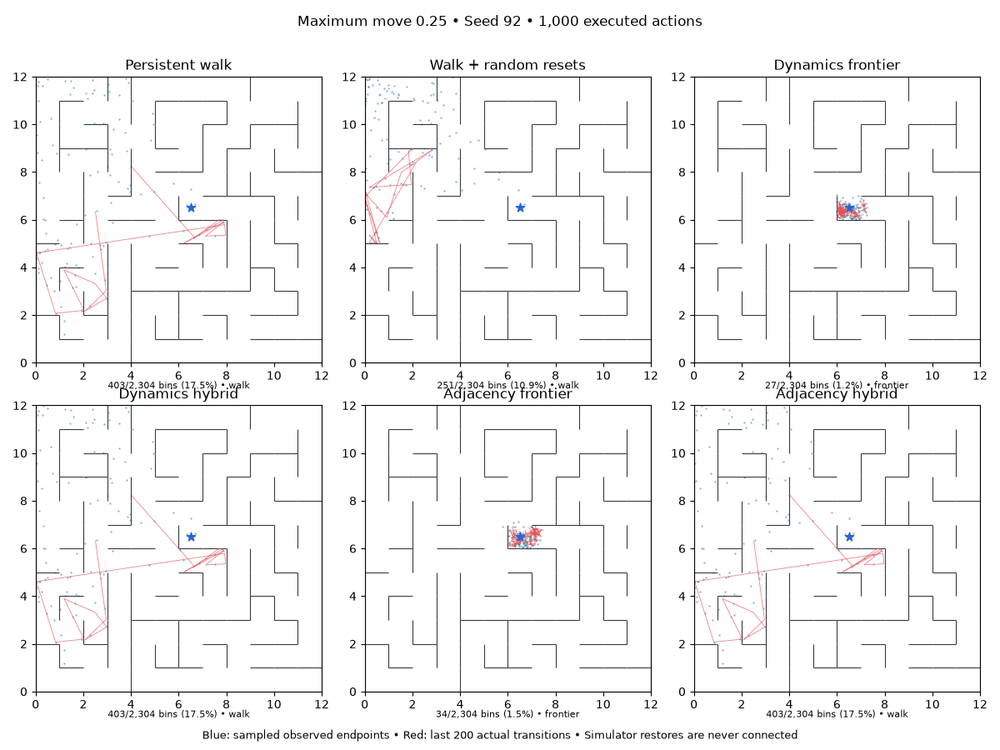

# Random walks, encountered-state resets and learned-frontier hybrids

Completed November 11, 2026: **306 valid runs / 30.6M environment actions**, including120 tuning runs,150 fresh-seed confirmation runs and36 additional-layout runs. The last six layout runs are explicitly adaptive continuation controls. The earlier conclusion that learned exploration was strong relied on a weak random-queue baseline. **Competent persistent random walks are substantially more competitive, and usually better for this task.**

The useful findings:

- A reactive persistent walk reaches99.8% small-step coverage on six fresh seeds, versus72.9% dynamics and68.8% adjacency. It wins coverage AUC in every paired seed at both movement sizes and on both additional layouts.
- An open-loop persistent walk using no observations also beats both small-step learned baselines in AUC on every fresh seed. Collision handling helps, but does not explain the entire result.
- A20k-action walk prefix dramatically helps the learned frontier relative to a cold start. However, with the **exact same prefix**, simply continuing to walk is better on small steps and roughly tied on normal steps. We do not establish an exploration benefit from the learned switch.
- Two early random resets help the small-step walk in these seeds; frequent ongoing resets are not consistently helpful. There is no universal best reset schedule.

## Fresh-seed results

Six untouched seeds92–97, primary layout7. All choices frozen before these outcomes were opened. Coverage is observed endpoint occupancy of0.25-unit bins, not imagined states or physical path segments. AUC averages coverage over the entire100k-action budget; higher is faster exploration. Capped time-to95 assigns100k to an unreached target, so it must be read together with the success count.

Maximum movement **.125**:

| Method | Final coverage | Coverage AUC | Mean capped actions to95 | Reached95 |
|---|---:|---:|---:|---:|
| Random frontier entry | 1.4% | 1.2% | 100,000 | 0/6 |
| IID walk,20% stays | 41.7% | 27.6% | 100,000 | 0/6 |
| Persistent open-loop walk,p=.9,20% stays | 86.2% | 59.4% | 99,457 | 1/6 |
| Reactive persistent walk,p=.98,no stays | 99.8% | 81.6% | 61,897 | 6/6 |
| Same reactive walk,reset every10k | 96.9% | 81.1% | 61,398 | 5/6 |
| Same reactive walk,only two early resets | **99.8%** | **85.4%** | **41,703** | **6/6** |
| Dynamics frontier from start | 72.9% | 25.1% | 100,000 | 0/6 |
| Adjacency frontier from start | 68.8% | 23.1% | 100,000 | 0/6 |
| Walk20k,two resets→dynamics frontier | 93.0% | 78.1% | 82,545 | 3/6 |
| Walk20k,two resets→adjacency frontier | 93.5% | 78.3% | 82,093 | 3/6 |

Maximum movement **.25**:

| Method | Final coverage | Coverage AUC | Mean capped actions to95 | Reached95 |
|---|---:|---:|---:|---:|
| Random frontier entry | 3.7% | 3.1% | 100,000 | 0/6 |
| IID walk,20% stays | 80.6% | 56.9% | 100,000 | 0/6 |
| Persistent open-loop walk,p=.9,20% stays | 94.5% | 70.4% | 81,284 | 5/6 |
| Reactive persistent walk,p=.98,no stays | 100.0% | 89.1% | 34,106 | 6/6 |
| Same reactive walk,reset every10k | 100.0% | **90.3%** | **28,310** | 6/6 |
| Dynamics frontier from start | 100.0% | 62.7% | 54,610 | 6/6 |
| Adjacency frontier from start | 100.0% | 62.6% | 52,100 | 6/6 |
| Walk20k→dynamics frontier | 100.0% | 88.6% | 36,316 | 6/6 |
| Walk20k→adjacency frontier | 100.0% | 89.1% | 33,567 | 6/6 |

The smallest normal-step mean completion time belongs to a periodic-reset walk, but its paired advantage over the no-reset policy is not consistent:3/6 AUC wins, +1.26percentage points, exploratory95% bootstrap interval[−.72,+3.38]. The table's best mean is not proof of a universally superior schedule.





[All fresh-seed tables](assets/walk-confirmation.md), [all matched effects](assets/walk-effects.json). Bootstrap intervals are paired by seed, conditional on layout and unadjusted for multiple comparisons. Six primary seeds and two additional layouts do not establish universal performance.

## What matters in the walk

**Persistence and collision response are distinct.** In tuning, very persistent walks that did not change direction after a blocked movement could waste many actions pushing into a wall. On fresh seeds, adding collision response to the matched p=.9,20%-stay policy raises AUC59.4→64.6 on small steps (4/6 wins; interval includeszero), and70.4→83.2 on normal steps (5/6wins; interval+3.94 to+20.84points). The stronger selected p=.98,no-stay policy was selected from tuning, not from this matched ablation.

**The advantage is not just removing stay actions or ignoring noise via collision detection.** A reactive p=.98 walk retaining20% stays still reaches95.8% small-step coverage and80.9% AUC. An open-loop p=.9 walk, with20% stays and no observation feedback, reaches86.2% and59.4% AUC. That open-loop walk beats both small-step learned baselines in AUC6/6 and final coverage5/6. At normal steps it explores faster early but finishes less completely than the learned frontier; it is not a blanket Pareto improvement.

**Reset effects depend on timing.** Frequent100/1000-action resets often hurt during tuning, especially with small moves. In fresh matched policies, reset-every10k changes AUC by−.53points at small steps and+1.26 at normal steps for the selected no-stay policy; neither interval excludeszero. The20%-stay policy gives similarly mixed reset effects. Uniform occurrence sampling can return repeatedly to familiar territory; this is not a novelty-aware reset rule.

Two early resets, at action counts6,667 and13,334, followed by uninterrupted walking, give the strongest observed small-step result: mean time to95 falls61,897→41,703actions, winning5/6 paired seeds. Mean AUC rises3.75points, but its exploratory interval[−.23,+8.06] includeszero; the time-to95 difference interval is[−31,079,−5,931]actions. This schedule comes from the selected hybrid prefix and was tested as its continuation control, rather than selected by searching confirmation outcomes. It is promising, not a general reset theorem.

## Does the hybrid switch help?

The selected prefixes are20k actions for both objectives and both step sizes. Small-step prefixes include exactly two random resets; normal-step prefixes include none. Mean coverage at switching is74.3% and82.9% respectively. None of these fresh-seed prefixes has already reached95% at the switch.

On small steps, continuing the **identical** prefix walk beats switching to dynamics or adjacency in AUC6/6 for each objective. The hybrid-minus-continuation differences are−7.22points (interval[−10.23,−3.99]) and−7.07points ([−10.06,−3.86]). Continuing also reaches95 in6/6, versus3/6 for each hybrid. These results isolate the effect of switching after matched collected experience; both learned hybrids trained throughout their prefixes.

On normal steps, hybrid-minus-continuing-walk AUC is−.46points for dynamics and−.02 for adjacency, each winning3/6. Their mean time-to95 is36.3k/33.6k versus34.1k for continuing. The switch does not establish an exploration gain, although it preserves the ability to finish and trains a map.

Warm-starting therefore helps **our current learned algorithm**, but that does not establish a benefit over an unlearned explorer. The large improvement over a cold frontier includes the prefix's coverage, broader replay and different frontier contents; we cannot attribute it solely to a better representation. The continuation control is the stronger comparison.

## Additional layouts

Small maximum movement .125, three new seeds98–100 per layout, no retuning:

| Method | Layout13 final / AUC | Layout23 final / AUC |
|---|---:|---:|
| Dynamics frontier | 51.1% /14.8% | 78.1% /21.9% |
| Adjacency frontier | 60.2% /18.2% | 77.9% /24.0% |
| Selected no-reset reactive walk | 80.8% /68.2% | 100.0% /87.0% |
| Two early resets,keep walking | **97.6% /75.9%** | 98.7% /84.5% |
| Same prefix→dynamics frontier | 79.4% /65.8% | 98.1% /79.9% |
| Same prefix→adjacency frontier | 81.7% /66.6% | 97.7% /79.6% |

The no-reset walk beats both native learned baselines in AUC on every seed of both layouts. Layout13 is harder for it; one seed reaches only60.6% final coverage. The early-reset continuation improves the mean there, but is slightly worse than no resets on layout23. Resetting is not uniformly helpful.

The extra-layout continuation controls were added after seeing the first layout13 hybrid beat its no-reset walk, to distinguish the changed prefix from a useful learned switch. They use the already-fixed primary continuation policy, not new tuning. Continuing beats each matched hybrid in AUC5/6 across these layouts; one layout13 seed reverses the ordering. The added controls are an adaptive mechanism check, not a new independently prespecified confirmation study.



[Every additional-layout seed](assets/walk-layout.md).


## What is being compared

All runs use the same continuous noisy coordinate maze, a100k-action budget, and maximum movement .125 or .25, reported separately. Inputs are normalized xy plus eight fresh Gaussian nuisance dimensions. Coverage bins never guide an agent. Unlearned walks receive no training; native and hybrid learned agents retain the prior8D encoder, three dynamics heads and tuned pure objectives: dynamics D=1 or adjacency A=.3, repulsionR=.03, L2=.03, margin .25.

A walk keeps a heading with probability p, otherwise samples a new angle uniformly, with a fresh movement length uniform [.5,1] times the maximum movement. We test p=0/.9/.98, 20% stays or no stays, and with/without changing heading after a blocked movement. The collision-responsive version reads the known observable xy coordinates to detect no movement, ignoring nuisance dimensions. The open-loop version does not inspect observations at all. Identifying a blocked move this way would not automatically transfer to raw pixels.

A reset chooses uniformly among encountered **occurrences**, including the start. Repeated positions have proportionally greater selection probability. No physical deduplication, unseen-state resets, coverage labels, or simulator trajectory credit. We test intervals100/1000/10000 and no resets. Restores are free, as in the existing frontier experiment. Reported random-reset counts describe walk resets only; the native frontier also restores stored states for branching expansions. Actual position discontinuities between recorded transitions are counted separately.

The learned frontier expands five controls from one stored state: four perpendicular directions with a random rotation and lengths [.5,1], plus stay. Walk moves have the same marginal angle/length distribution, but sequential execution and heading persistence differ from branching expansion. A no-stay walk spends all its actions on movement; matched20%-stay settings are included.

A hybrid first walks for1k/5k/20k actions, with zero or two encountered-state resets, while jointly training on its replay. It then switches to the existing latent-distance priority queue. All observations, experience and model weights are retained. Walk-source states remain available for their first full five-action expansion; only the origin anchors the expanded archive during the prefix. This is not a data-only intervention: coverage, frontier contents and training data all change together.

Every learned run uses one causal replay epoch per5k actions split into training every500, totaling4,112 updates and1,050,000 transition presentations perhead at100k. Prefix actions and training are included. No extra fit at switching, no new loss or policy training. Pure walks use zero updates.

## Selection and verification

Two tuning seeds90/91. Select by mean quarter-bin coverage AUC, final coverage as tie-breaker. Policy-specific positive results on those seeds are exploratory. Freeze the walk/reset/hybrid choices before inspecting freshseeds92–97; also test layouts13/23 withseeds98–100. Matched reset/no-reset and collision/no-collision controls distinguish their effects from changes in persistence/stay settings.

Read-only audits reconstruct every parent source observation/position, verify reset schedules and sampled occurrenceIDs, check256physical transitions perrun and recount all coverage endpoints. Initial model weights and successor-noise draws match byseed. Actions intentionally differ across policies. The zero-walk runner reproduces the original dynamics and adjacency replay/final weights bit-for-bit in5k smoke runs.

The first64walkscreen runs and interrupted hybrid jobs are excluded: their float64 executed walk controls were silently rounded when stored in replay. Exactphysics checks detected the discrepancy. Generation now uses float32 before execution, with a regression test. Original artifacts are preserved; corrected v2runs are the only walk tuning evidence used for selection. Native frontier controls are unaffected.

## Visualizations

Seed92 was fixed before fresh outcomes were opened. Animations cover100k actions in100frames. Blue points are a display subsample of actual observed endpoints; tallies use every endpoint. Red segments are the last200 actual transitions, never lines connecting simulator restores. The periodic reset-walk panel uses the selected20%-stay/reset-every10k policy; it is not the exact-prefix continuation control. On small steps the hybrids have two prefixresets; on normal steps they have none. Quantitative tables contain all matched controls and seeds.





The result also holds at finer spatial resolution: on fresh small-step runs, the selected walk and early-reset continuation cover98.56%/98.59% of0.125-unit bins, versus70.08%/66.81% for native dynamics/adjacency. On normal steps, the walk's99.32% fine coverage is comparable with99.28%/99.34% for the learned baselines. The main result is not solely an artifact of coarse occupancy bins.

## Costs, audits and reproduction

**306 valid full runs:**64 corrected walk tuning,8 native tuning,48 hybrid tuning,150 primary fresh confirmation,30 planned additional-layout and6 adaptive continuation controls.128 runs train models,178 do not. Total30,600,000 collection actions,526,336 optimizer updates and134,400,000 replay presentations perensemblehead. No evaluation probe or simulator restore counts as a collected action. Resets are free under this protocol; real reset costs could change the comparison. Runtime was measured under concurrent load, so we do not claim isolated wall-clock speedups.

The random-reset counter totals13,620 events across all valid runs. This excludes the frontier's many branch restores. Actual position discontinuities between recorded transitions total11,805,783; fresh small-step native frontiers average about92.8k such jumps per100k actions. A no-reset walk has none. Even with this extra restore capability, the native learned frontier loses exploration efficiency here.

All306jobs exited0. Full endpoint recounts, sampled physics, every parent source observation/position, reset schedules/occurrenceIDs, budgets, paired initialization and successor-noise streams pass. **60 hybrid/pure-walk prefixes match exactly** across observations, actions and positions.113tests pass, plus exact original/new-runner5k replay-and-weight checks for both learned objectives and a reset-cutoff smoke check. The latter matches a hybrid's first1k observations/actions exactly and verifies precisely two resets, with none afterward. Source snapshots and immutable manifests are retained. [Final accounting and prefix checks](assets/walk-final-accounting.json).

Excluded work is not hidden:64 initial full walk runs (6.4M actions) were discarded after the execution/replay precision mismatch;8 interrupted hybrid jobs recorded at least482,750 actions. Seven5k smoke jobs add35k actions outside the study. These artifacts remain in their original directories; only corrected v2walk results enter tuning and analysis. The precision correction and adaptive controls are documented in the [protocol](walk-study-protocol.md).

Run from the repository root to reproduce all25 primary confirmation arms on six seeds in a new output directory:

```sh
.venv/bin/python scripts/run_walk_study.py \
  --arms configs/walk-reproduction-20261111/confirmation-arms.json \
  --out runs/walk-reproduce-fresh --seeds 92 93 94 95 96 97 --workers 8
```

The corresponding `layouts-arms.json` uses seeds98–100 and includes the six adaptive continuation controls. Tuning manifests are `configs/walk-20261111/screen-walk-arms.json`, `configs/walk-20261111/base-arms.json` and `configs/walk-hybrid-v2-20261111/arms.json`. Selection details and the timestamped freeze are in `configs/walk-selected-20261111`.

Analysis entry points: `analyze_walk_study.py`, `audit_walk_pairing.py`, `walk_effects.py`, `report_walk_study.py` and `animate_walk_study.py`. [All tuning tables](assets/walk-tuning.md), [primary results](assets/walk-confirmation-results.json), [additional-layout results](assets/walk-layout-results.json). The original frontier runner/defaults are unchanged; no commit was made. All workers are finished.

## Interpretation

For this maze family, the learned explorer needs to be compared with persistent walking, including a version that uses no observation feedback. Random queue selection was much too weak to support a claim of competitive exploration. The selected reactive walk is a useful baseline; two early resets are a promising small-step variant, with layout-dependent effects. The learned hybrid substantially improves our own algorithm's cold start but does not demonstrate a benefit over continuing the matched walk.

This does not show that learning a map is useless for navigation, transfer or goal achievement. It shows that these noisy coordinate mazes can be explored efficiently without first learning observation equivalence, and that the current learned distance-frontier policy is not yet competitive on exploration efficiency alone. Collision feedback uses known xy features; key-dependent state, pixels, partial observability, unreliable restores and learned goal navigation were not tested.
